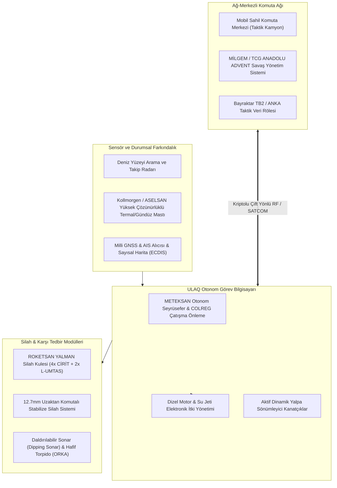

# 🚤 Proje: ULAQ (Silahlı İnsansız Deniz Aracı Ailesi)

  

---

## 🛡️ Stratejik Tanım & Doktriner Öncelik

**ULAQ**, ARES Tersanesi ve METEKSAN Savunma stratejik ortaklığıyla geliştirilen, **Türkiye'nin ilk, dünyanın ise muharebe testlerinden geçmiş en olgun Silahlı İnsansız Deniz Aracı (SİDA) ailesidir**. Mavi Vatan doktrini çerçevesinde Ege ve Doğu Akdeniz'deki adalar denizi ve açık deniz ortamlarında personeli tehlikeye atmaksızın 7/24 kesintisiz otonom devriye, istihbarat, su üstü harbi (SUH), denizaltı savunma harbi (DSH) ve kamikaze taarruz görevlerini icra eder.

Gelişmiş kompozit malzemeden üretilen gövdesi, düşük radar ve termal iz seviyesi (stealth) ve yapay zeka destekli otonom seyrüsefer algoritmaları ile donatılan ULAQ; karadaki Mobil Sahil Komuta Merkezi'nden (ÇAMK), sancak gemilerinden veya havadan İHA/SİHA'lar üzerinden güvenli kriptolu veri bağlarıyla yönetilir. Mavi Vatan tatbikatlarında canlı harp başlıklı CİRİT ve L-UMTAS füzeleriyle hedefleri tam isabetle vurarak harbe hazırlığını kanıtlamıştır.

---

## 📊 Kapsamlı Teknik Özellikler

| Parametre | Değer / Özellik | Açıklama |
| :--- | :--- | :--- |
| **Gövde Boyu** | 11.00 Metre (SİDA) / 12+ Metre (DSH) | İleri seviye vakum infüzyon kompozit gövde |
| **Azami Sürat** | 35+ Knot (65+ km/s) | Yüksek manevra kabiliyetine sahip su jeti/dizel itki |
| **Operasyonel Seyir Siası** | 400+ km (215+ Deniz Mili) | Korunaklı yakıt tankları ile uzun süreli devriye |
| **Faydalı Yük Kapasitesi** | 2.000 kg (Silah + Elektro-Optik + Sensörler) | Görev modülüne göre hızla değiştirilebilir yapı |
| **Haberleşme & Kontrol Menzili** | 200+ km (Görüş Hattı - LOS) / Uydu (SATCOM - BLOS) | Kesintisiz kriptolu milli veri bağı (METEKSAN KEMENT uyumlu) |
| **Otonomi Düzeyi** | Seviye 4 Otonom Seyrüsefer & Sürü Zekası | COLREG (Uluslararası Denizde Çatışmayı Önleme) kurallarına uyum |
| **Denizcilik Seviyesi** | Deniz Durumu 5 (Sea State 5) | Kaba dalgalı fırtınalı açık deniz dayanımı |
| **Silah Donanımı** | 4x CİRİT (Lazer Güdümlü) + 2x L-UMTAS / 12.7mm KORHAN UKSS | Milli ROKETSAN füze kuleleri ve hafif torpidolar |
| **Varyantlar** | SİDA (Su Üstü), DSH (Denizaltı Savunma), KAMA (Sarf Edilebilir İDA) | Çoklu görev aile mimarisi |

---

## 🧩 Alt Sistemler ve Aviyonik / Elektronik Entegrasyonu

- **COLREG Uyumlu Otonom Seyrüsefer:** ULAQ, radar ve elektro-optik kameralarla çevredeki sivil ve askeri gemileri algılayarak uluslararası deniz trafiği kurallarına göre yol verir, rotasını dinamik olarak yeniden çizer.
- **YALMAN Silah Kulesi:** ROKETSAN tarafından geliştirilen stabilize kule üzerinden lazer güdümlü CİRİT ile 8 km, L-UMTAS ile 8 km menzildeki hücumbot, fırkateyn veya kıyı hedeflerine cerrahi vuruş.
- **ADVENT Ağ Entegrasyonu:** TCG ANADOLU veya İ-Sınıfı fırkateynlerin ADVENT savaş yönetim sistemine doğrudan bir alt bileşen olarak bağlanıp ana geminin yüzlerce mil önünde ileri karakol görevi yapma.

---

## 🎯 Görev Profili, Muharebe Senaryoları & Mühimmat Yelpazesi

1. **Boğazlar ve Adalar Denizi Pusu Görevi:** Düşman gemilerinin geçiş koridorlarında sessiz modda bekleyerek kritik hedeflere ani güdümlü füze taarruzu.
2. **Denizaltı Savunma Harbi (DSH):** Daldırılabilir sonarını suya indirerek şüpheli denizaltıları tespit etme ve hafif torpido (ORKA) ile angajman.
3. **Sürü Halinde Asimetrik Taarruz:** Birden fazla ULAQ ve ULAQ KAMA'nın koordineli sürü zekasıyla düşman görev grubuna eşzamanlı çok yönlü saldırı düzenlemesi.
4. **Kıyı Tesisi ve Liman Savunması:** Deniz üslerinin ağzında 7/24 devriye atarak su altı sabotajcılarını ve şüpheli tekneleri engelleme.

---

## 🚀 TRL Seviyesi ve Gelişim Yol Haritası

- **Mevcut Durum:** `TRL 9` (Prototip, atış testleri, seri üretim tesisi yatırımı ve Deniz Kuvvetleri kabul süreçleri tamamlanmış, harbe hazır sistem).
- [x] Kompozit gövde üretimi ve deniz seyir kalifikasyonu
- [x] CİRİT füzesiyle deniz yüzeyindeki hedefi tam isabetle vurma testi
- [x] Denizaltı Savunma Harbi (DSH) varyantı tasarımı ve sonar entegrasyonu
- [x] 12.7mm UKSS entegre liman savunma botu atış testleri
- [x] Ankara ve Antalya'da seri üretim bantlarının devreye alınması ve ihracat görüşmeleri

---

## 🔗 İç Dizin Navigasyonu

[⬅️ Üst Dizine (ARES)](../README.md) | [🏛️ Dominion Hub (DOMINION_SEA)](../../README.md) | [🏠 Ana Sayfa](../../../README.md)
