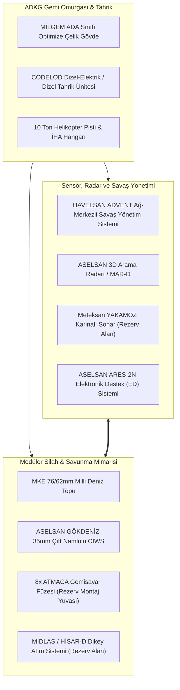

# ⚓ Proje: Açık Deniz Karakol Gemisi (ADKG)

[

  

](../../../docs/TRL_GUIDE.md)

---

## 🛡️ Stratejik Tanım & Doktriner Öncelik

**Açık Deniz Karakol Gemisi (ADKG)** projesi, Milli Savunma Bakanlığı ASFAT (Askeri Fabrika ve Tersane İşletme A.Ş.) ana yükleniciliğinde İstanbul Tersanesi Komutanlığı'nda Türk Deniz Kuvvetleri için inşa edilen stratejik deniz platformudur. Türkiye'nin MİLGEM ADA Sınıfı korvetlerden elde ettiği dünya çapındaki yerli tekne form ve gövde mühendisliği tecrübesi üzerine temellenmiştir.

ADKG projesinin temel doktrinel felsefesi **"Fitted For But Not With" (Gerektiğinde Donatılabilir)** konseptidir. Barış döneminde arama-kurtarma, deniz haydutluğuyla mücadele, terörizmle mücadele ve MEB karakol görevlerini düşük işletme maliyeti ve yüksek yakıt ekonomisi ile yürütürken; gerginlik ve savaş döneminde üzerine saatler/günler içinde milli gemisavar füzeleri (ATMACA), dikey atım hava savunma lançerleri (MİDLAS / HİSAR) ve modern sonar sistemleri takılarak tam donanımlı bir savaş fırkateynine/korvetine dönüştürülebilir.

---

## 📊 Kapsamlı Teknik Özellikler

| Parametre | Değer / Özellik | Açıklama |
| :--- | :--- | :--- |
| **Tam Boy (LOA)** | 99.56 Metre | Optimize edilmiş MİLGEM ADA sınıfı form |
| **Genişlik (Beam)** | 14.42 Metre | Geniş helikopter pisti ve operasyonel güverte |
| **Su Çekimi (Draft)** | 3.77 Metre | Açık deniz seyrüseferi için hidrodinamik tasarım |
| **Deplasman** | ~2.300 Ton | Yüksek mukavemetli gemi inşa çeliği gövde |
| **Azami Sürat** | 24+ Knot | İntikal ve önleme hızı |
| **Ekonomik Seyir Hızı** | 12 - 15 Knot | Uzun süreli okyanus ve açık deniz devriyesi |
| **Seyir Siası (Menzil)** | 4.500+ Deniz Mili (NM) | İkmal yapmaksızın 21 gün kesintisiz seyir |
| **Tahrik Mimarisi** | CODELOD (Kombine Dizel-Elektrik veya Dizel) | Yüksek yakıt verimliliği ve düşük işletme maliyeti |
| **Hava Araçları Kapasitesi** | 10 Tonluk Helikopter (Seahawk) & Döner/Sabit Kanat İHA | Tam donanımlı kapalı hangar ve uçuş güvertesi |
| **Mürettebat Kapasitesi** | 104 Kişi (+ Görev Kuvveti Konaklama) | Modern kamaralar ve uzun seyir lojistik desteği |

---

## 🧩 Alt Sistemler ve Aviyonik / Elektronik Entegrasyonu

- **ADVENT Savaş Yönetim Sistemi:** Dünyanın en modern ağ-merkezli savaş yönetim sistemlerinden biri olan HAVELSAN ADVENT ile diğer savaş gemileri, SİHA'lar ve denizaltılar ile ortak taktik veri paylaşımı.
- **Milli 76/62mm Deniz Topu:** MKE tarafından yerli imkanlarla üretilen dijital atış kontrollü baş topu ile su üstü ve hava hedeflerine dakikada 80+ atım.
- **Hava Savunma Kalkanı:** Yakın hava savunması için ASELSAN GÖKDENİZ 35mm parçacıklı mühimmat atan CIWS sistemi ve kızılötesi arama takip (IRST) entegrasyonu.

---

## 🎯 Görev Profili, Muharebe Senaryoları & Mühimmat Yelpazesi

1. **Açık Deniz ve MEB Karakolu:** Doğu Akdeniz ve Karadeniz hidrokarbon sahalarında sondaj gemilerimize kesintisiz eskort ve koruma.
2. **Deniz Haydutluğu ve Asimetrik Tehdit Önleme:** Aden Körfezi, Somali açıkları ve Kızıldeniz'de uluslararası görev kuvvetlerinde bayrak gösterme ve ticari gemileri koruma.
3. **MUM-T Deniz-Hava Entegrasyonu:** Gemiden kalkan insansız hava araçlarının (TB3, ANKA) sağladığı radar ve hedef verileriyle yüzlerce mil ötedeki hedefleri takip etme.
4. **Savaş Dönemi Korvet Rolü:** Kriz anında rezerv yuvalarına 8 adet ATMACA gemisavar füzesi ve MİDLAS hava savunma lançeri yüklenerek taarruz gemisine dönüşme.

---

## 🚀 TRL Seviyesi ve Gelişim Yol Haritası

- **Mevcut Durum:** `TRL 8` (Sınıfın ilk iki gemisi TCG AKHİSAR ve TCG KOÇHİSAR denize indirilmiş olup, deniz kabul testleri ve donatım faaliyetleri devam etmektedir).
- [x] Detay mühendislik tasarımı ve sözleşme fazı
- [x] Blok imalatı, kızaktan indirme ve tekne bütünlüğü doğrulaması
- [x] ADVENT, MAR-D ve milli 76mm deniz topu entegrasyonu
- [ ] Deniz kabul tecrübeleri (HAT & SAT) ve atışlı sistem kalifikasyonu
- [ ] Türk Deniz Kuvvetleri'ne bayrak çekme ve sancak teslim töreni

---

## 🔗 İç Dizin Navigasyonu

[⬅️ Üst Dizine (ASFAT)](../README.md) | [🏛️ Dominion Hub (DOMINION_SEA)](../../README.md) | [🏠 Ana Sayfa](../../../README.md)
