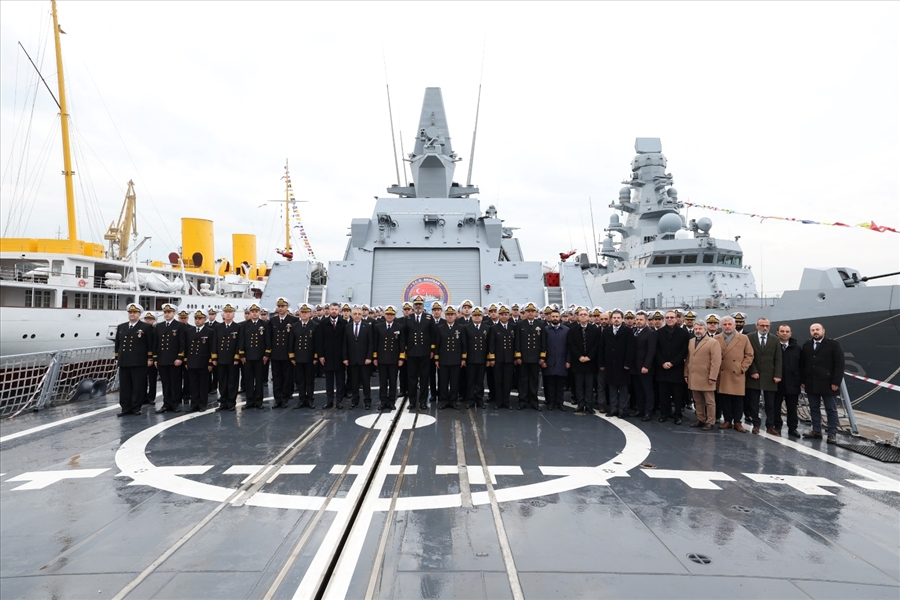
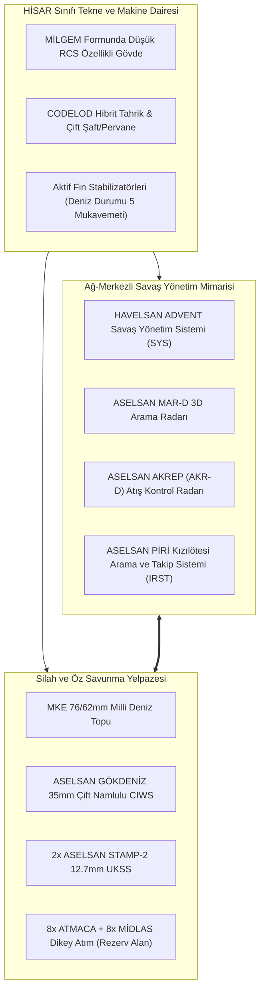

# 🛳️ Proje: HİSAR Sınıfı Açık Deniz Karakol Gemisi (OPV)

  

---

## 🛡️ Stratejik Tanım & Doktriner Öncelik

**HİSAR Sınıfı Açık Deniz Karakol Gemileri (TCG AKHİSAR - P-1220 ve TCG KOÇHİSAR - P-1221)**, ASFAT ana yükleniciliğinde Türk Deniz Kuvvetleri Komutanlığı'nın barışta karakol, gerginlik ve savaş hallerinde ise anında tam teşekküllü su üstü harbi (SUH) ve hava savunma harbi (HSH) korvetine dönüşebilen çok maksatlı platform ihtiyacı için inşa edilmektedir.

MİLGEM ADA Sınıfı korvet gövdesinin kanıtlanmış hidrodinamik başarısı korunarak tasarlanan HİSAR Sınıfı; **"Fitted For But Not With" (FFBNW)** doktrinine göre optimize edilmiştir. Geleneksel gaz türbini yerine CODELOD (Kombine Dizel-Elektrik veya Dizel) tahrik sistemi kullanılarak yakıt sarfiyatı ciddi oranda düşürülmüş, seyir menzili 4.500 deniz miline çıkarılmış ve bakım maliyetleri asgariye indirilmiştir.

---

## 📊 Kapsamlı Teknik Özellikler

| Parametre | Değer / Özellik | Açıklama |
| :--- | :--- | :--- |
| **Gemi Tam Boyu (LOA)** | 99.56 Metre | MİLGEM korvet formu optimizasyonu |
| **Genişlik (Beam)** | 14.42 Metre | Geniş uçuş güvertesi ve operasyon merkezi |
| **Su Çekimi (Draft)** | 3.77 Metre | Açık deniz seyrüseferi için hidrodinamik karina |
| **Deplasman** | ~2.300 Ton | Yüksek mukavemetli askeri çelik konstrüksiyon |
| **Azami Sürat** | 24+ Knot | Süratli intikal ve önleme hızı |
| **Operasyonel Seyir Siası** | 4.500 Deniz Mili (15 Knot Hızla) | Okyanus aşırı menzil ve 21 gün ikmalsiz görev |
| **Tahrik Sistemi** | CODELOD (2x Dizel Motor + 2x Elektrik Motoru) | Düşük akustik iz ve yüksek yakıt tasarrufu |
| **Helikopter & İHA Kapasitesi** | 10 Tonluk Helikopter Pisti ve Hangarı | S-70B Seahawk helikopteri ve SİHA operasyonları |
| **Bot Taşıma Kapasitesi** | 2x Hızlı Müdahale RHIB Botu | Kıç ve borda mataforaları üzerinden suya indirme |
| **Mürettebat Donanımı** | 104 Personel | Modern yaşam mahalli ve yüksek otomasyon |

---

## 🧩 Alt Sistemler ve Aviyonik / Elektronik Entegrasyonu

- **HAVELSAN ADVENT Savaş Yönetim Sistemi:** Türk Deniz Kuvvetleri'nin tüm gemi, denizaltı ve hava unsurlarını tek bir taktik resimde birleştiren dünyanın en gelişmiş C4ISR altyapısı.
- **MAR-D 3 Boyutlu Arama Radarı:** ASELSAN tarafından geliştirilen AESA teknolojili radar ile hava ve su üstü hedeflerinin 100+ km mesafeden eşzamanlı tespiti ve takibi.
- **Hızlı Dönüşüm Yeteneği (FFBNW):** Geminin gövdesinde ATMACA gemisavar füzeleri, MİDLAS dikey fırlatma sistemi ve YAKAMOZ karina sonarı için tüm kablo kanalları, güç bağlantıları ve yapısal takviyeler hazır tutulmaktadır.

---

## 🎯 Görev Profili, Muharebe Senaryoları & Mühimmat Yelpazesi

1. **Mavi Vatan ve MEB Güvenliği:** Ege, Doğu Akdeniz ve Karadeniz'deki enerji koridorlarında, kıta sahanlığımızda 7/24 kesintisiz bayrak dalgalandırma.
2. **Kriz Anında Korvete Dönüşüm:** Savaş tehlikesi belirdiğinde 8 adet ATMACA ve HİSAR-D hava savunma füzeleriyle donatılarak ön cephe taarruz korveti görevi icra etme.
3. **Deniz Haydutluğu ve Asimetrik Tehdit Önleme:** Somali ve Aden Körfezi gibi kritik geçiş noktalarında ticari konvoylara refakat etme.
4. **MUM-T İnsansız Sistemler Koordinatörlüğü:** ULAQ ve MARLİN gibi insansız deniz araçlarını (SİDA) uzaktan komuta ederek ileri karakol taraması yaptırma.

---

## 🚀 TRL Seviyesi ve Gelişim Yol Haritası

- **Mevcut Durum:** `TRL 8` (TCG AKHİSAR ve TCG KOÇHİSAR denize indirilmiş olup liman ve deniz kabul testleri devam etmektedir).
- [x] Detaylı gemi inşa mühendisliği ve saç kesimi
- [x] TCG AKHİSAR (P-1220) ve TCG KOÇHİSAR (P-1221) denize indirilmesi
- [x] MAR-D radarı ve MKE 76mm deniz topu entegrasyonu
- [ ] Liman ve Seyir Kabul Testlerinin (HAT & SAT) icrası
- [ ] Türk Deniz Kuvvetleri Komutanlığı'na resmi teslimat ve hizmete giriş

---

## 🔗 İç Dizin Navigasyonu

[⬅️ Üst Dizine (ASFAT)](../README.md) | [🏛️ Dominion Hub (DOMINION_SEA)](../../README.md) | [🏠 Ana Sayfa](../../../README.md)
