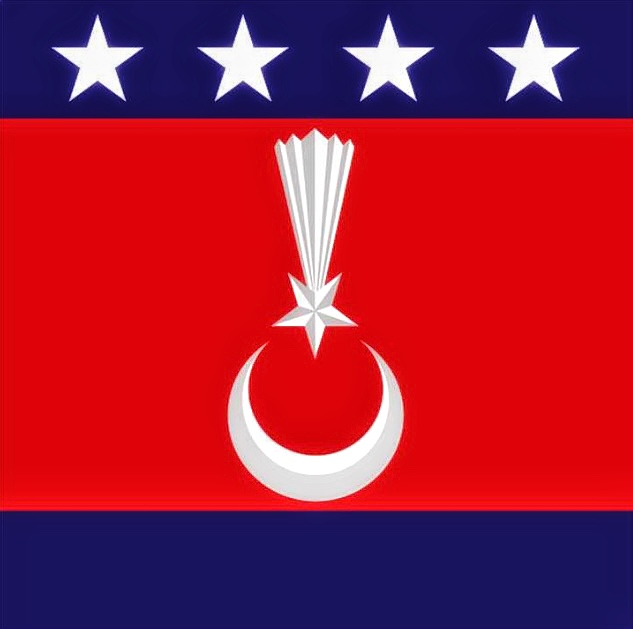

# 🚜 Proje: MEMATT (Mekanik Mayın Temizleme Teçhizatı)

[-00e676?style=for-the-badge&logo=shield)](../../../README.md)
[](../../README.md)
[](../README.md)
[]()

<p align="center">
  
</p>

---

### 🛡️ Stratejik Tanım & Doktriner Öncelik
MEMATT (Mekanik Mayın Temizleme Teçhizatı), ASFAT yürütücülüğünde yerli ve milli imkanlarla geliştirilmiş, uzaktan kumandalı, yüksek balistik korumalı ve modüler ataşmanlı bir insansız insani ve askeri mayın temizleme platformudur. Hem karasal harekât sahasında hem de amfibi hücum harekâtlarında kıyı başlarının (beachhead clearance) ve mayınlı hatların personel riski sıfıra indirilerek açılması doktrinine hizmet eder. 2. Karabağ Savaşı sonrasında işgalden kurtarılan Azerbaycan topraklarının anti-personel ve anti-tank mayınlarından arındırılmasında birincil operasyonel araç olarak muharebe sahasında kendini kanıtlamıştır. Uluslararası demining standartlarına (IMAS) tam uyumlu olan platform; patlama testlerinden başarıyla geçerek NATO ve Birleşmiş Milletler normlarında kalifiye edilmiş, Togo ve Burkina Faso dahil birçok dost ve müttefik ülkeye ihraç edilmiştir.

---

### 📊 Kapsamlı Teknik Özellikler Tablosu

| Parametre | Değer / Özellik | Açıklama |
| :--- | :--- | :--- |
| **Araç Tipi** | Uzaktan Kumandalı İnsansız Zırhlı Mayın Temizleme Aracı | Paletli yürüyüş sistemi |
| **Motor Gücü** | 300 HP (Beygir Gücü) Turbo Dizel | Ağır arazi ve yüksek tork kabiliyeti |
| **Gövde Zırhı** | Armox 500T Yüksek Mukavemetli Balistik Çelik | Anti-tank mayın infilaklarına mukavim |
| **Temizleme Genişliği** | 1.700 mm (1.7 Metre) | Flail (Zincirli) & Tiller (Keski/Kırıcı) ataşmanı |
| **Temizleme Derinliği** | 250 mm (25 cm) | Standart anti-personel derinliğinin üzerinde |
| **Operasyonel Hız** | 4 km/s (Temizleme modu) / 8 km/s (İntikal modu) | Değişken zemin koşullarına adaptif |
| **Komuta Kontrol Menzili**| 500 Metre (Güvenli RF Veri Bağı) | Operatör sahra kontrol konsolu üzerinden |
| **Kamera & Görüş Süiti**| 360° Durumsal Farkındalık + Termal Gece Görüş | Şok emici muhafazalı optikler |
| **Ağırlık** | ~12.500 kg (Ataşmanlı brüt ağırlık) | C-130 / A400M ile hava yoluyla nakledilebilir |

---

### 🧩 Alt Sistemler ve Aviyonik/Elektronik Entegrasyonu
- **Uzaktan Komuta Birimi:** Çift kanallı, frekans atlamalı ve elektronik karıştırmaya dirençli UHF/2.4 GHz RF telsiz linki ile 500 metreden gerçek zamanlı telemetri ve HD video aktarımı.
- **Güçlendirilmiş Palet & Süspansiyon:** Yüksek sertlikte kauçuk dolgulu çelik baklalı paletler; patlama anında palet kırılmalarını minimize eden elastik rulman yapısı.
- **Modüler Ataşman Arayüzü:** Sahada hızla değiştirilebilen "Zincirli Tokmak (Flail)" ve sert zemin taş kırıcı "Freze (Tiller)" mekanizmaları.
- **Görüntüleme & Algılama:** Darbe ve toz emici hava filtreli kamera kuleleri; gece şartlarında görüş sağlayan termal IR kızılötesi aydınlatma modülleri.

---

### 🎯 Görev Profili, Muharebe Senaryoları & Mühimmat Yelpazesi
- **Amfibi Kıyı Başı Açma:** Çıkarma gemilerinden (LST/LCM) karaya indirilerek amfibi deniz piyadesinin geçiş rotalarındaki sahil teli ve tuzaklı mayınları infilak ettirme.
- **Askeri İnsani Mayın Temizliği:** Mayınlı tarım arazilerinin, meskun mahal geçiş yollarının siviller ve askeri konvoylar için %100 emniyetle temizlenmesi.
- **Baskı Altında Patlatma:** Anti-personel (AP) mayınları zincir tokmak darbeleriyle fiziksel olarak parçalayarak veya basınçla patlatarak etkisizleştirme.

---

### 📐 Özel Sistem Mimarisi & Harekât Akışı

```mermaid
flowchart TD
    subgraph KONTROL["🎮 Operatör Sahra Kontrol Birimi (500m)"]
        OC["Taşınabilir Kontrol Konsolu"]
        RF_TX["Frekans Atlamalı RF Verici"]
        MON["Gerçek Zamanlı Telemetri & Video"]
        OC --> RF_TX
        MON <-- RF_TX
    end

    subgraph ARAC["🚜 MEMATT Platformu (Armox 500T)"]
        RF_RX["RF Alıcı & Anten Birimi"]
        ECU["Merkezi Sürüş & Görev Bilgisayarı"]
        ENG["300 BG Dizel Motor & Hidrolik Güç"]
        CAM["360° Durumsal Farkındalık Kameraları"]
        
        RF_RX --> ECU
        CAM --> RF_RX
        ECU --> ENG
    end

    subgraph IMHA["💥 Mayın İmha & Nüfuz Ataşmanları"]
        FLAIL["Dönen Zincirli Tokmak Sistemi (Flail)"]
        TILLER["Yüksek Hızlı Kesici Freze (Tiller)"]
        SOIL["Toprak İçi 25 cm Derinlik Temizliği"]
        
        ENG --> FLAIL
        ENG --> TILLER
        FLAIL --> SOIL
        TILLER --> SOIL
    end

    RF_TX <==>|"Kriptolu RF Veri Bağı (UHF/2.4 GHz)"| RF_RX
```

---

### 🚀 TRL Seviyesi ve Gelişim Yol Haritası
**Mevcut Olgunluk Seviyesi: TRL 9 (Muharebe Sahasında Kanıtlanmış Seri Üretim)**
- [x] Sistem Ar-Ge, patlama direnç testleri ve askeri kalifikasyon
- [x] TSK ve Azerbaycan Silahlı Kuvvetleri envanterine giriş
- [x] Karabağ mayın temizleme harekâtında fiili operasyonel başarı
- [x] Togo ve Burkina Faso'ya yurt dışı ihracat teslimatları
- [ ] Yeni nesil otonom rota çizme ve yapay zeka destekli mayın tespit sensörü entegrasyonu (Faz II)

---
[⬅️ Üst Dizine](../README.md) | [🏛️ Dominion Hub](../../README.md) | [🏠 Ana Sayfa](../../../README.md)\n