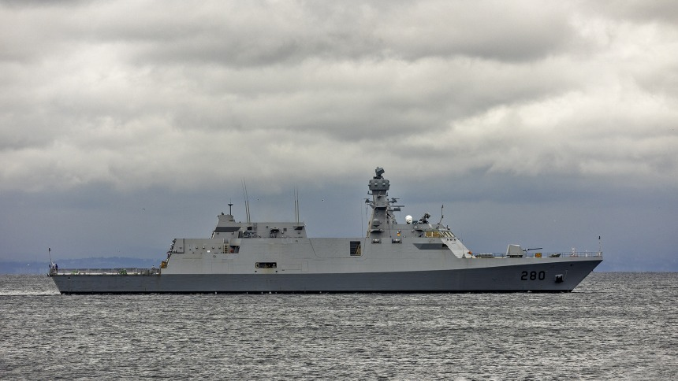
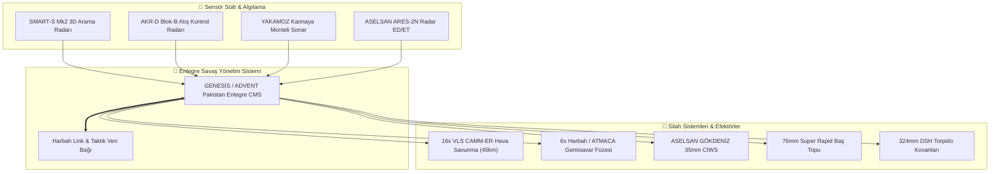

# 🚢 Proje: PN MİLGEM (Babur Sınıfı Fırkateyn / Ağır Korvet)

[-00e676?style=for-the-badge&logo=shield)](../../../README.md)
[-0077be?style=for-the-badge&logo=target)](../../README.md)

  

---

### 🛡️ Stratejik Tanım & Doktriner Öncelik
PN MİLGEM (Babur Sınıfı), Türkiye Cumhuriyeti tarihinin tek kalemde imzalanan en büyük savunma sanayii ihracat sözleşmesi kapsamında Pakistan Deniz Kuvvetleri için ASFAT ana yükleniciliğinde inşa edilen çok maksatlı ağır korvet / fırkateyn sınıfıdır. Türk Deniz Kuvvetleri'nin başarısını kanıtlamış ADA sınıfı korvet tasarımı temel alınarak; deplasmanı ~3.000 tona çıkarılmış, dikey atım hava savunma füze kabiliyeti (VLS), uzun menzilli seyir/gemisavar füzeleri ve gelişmiş 3B radar süiti eklenerek tam teşekküllü bir açık deniz muharip fırkateynine dönüştürülmüştür. Proje, 2 adedi İstanbul Tersanesi Komutanlığı'nda, 2 adedi ise teknoloji transferiyle Karaçi Tersanesi'nde inşa edilerek Türkiye'nin askeri gemi inşa alanındaki mühendislik ve teknoloji ihraç gücünü küresel ölçekte tescillemiştir.

---

### 📊 Kapsamlı Teknik Özellikler Tablosu

| Parametre | Değer / Özellik | Açıklama |
| :--- | :--- | :--- |
| **Gemi Sınıfı** | Babur Sınıfı Çok Maksatlı Fırkateyn (Ağır Korvet) | 4 Gemilik PN MİLGEM Filosu |
| **Tam Boy / Genişlik** | 108.8 Metre / 14.8 Metre | Genişletilmiş gövde ve helikopter hangarı |
| **Su Çekimi (Draft)** | 4.05 Metre | Yüksek denizcilik formu |
| **Deplasman** | ~2.988 - 3.000 Ton (Tam Yüklü) | Okyanus aşırı harekât icra kabiliyeti |
| **Azami Sürat / Ekonomik Hız** | 26+ Knot / 14.5 Knot | CODAD (Kombine Dizel ve Dizel) tahrik |
| **Seyir Siası (Menzil)** | 4.000 Deniz Mili (14 Knot ile) | 15 gün kesintisiz ikmalsiz kalabilme |
| **Mürettebat Kapasitesi** | 142 Personel (Gemi ve Hava unsurları) | Gelişmiş otomasyon seviyesi |
| **Ana Tahrik Sistemi** | 2 x Dizel Motor (veya CODAD dizilimi) + Çift Şaft/CPP | Yüksek manevra ve akustik izolasyon |
| **Hava Unsuru** | 1 adet 10 Tonluk Helikopter (Z-9EC / Sea King) | Tam donanımlı hangar ve uçuş pisti |

---

### 🧩 Alt Sistemler ve Aviyonik/Elektronik Entegrasyonu
- **Savaş Yönetim Sistemi (SYS):** HAVELSAN GENESİS/ADVENT tabanlı milli mimariyle entegre edilmiş yerli görev yönetim ağı.
- **Birincil Radar:** Thales SMART-S Mk2 3B Çok Hüzmeli Arama Radarı (250 km tespit menzili).
- **Atış Kontrol Radarı:** ASELSAN AKR-D Blok-B X/Ka-Bant çift frekanslı atış kontrol radarı.
- **Sonar Sistemi:** Meteksan Savunma YAKAMOZ Karinaya Monteli Aktif/Pasif Denizaltı Savunma Harbi Sonarı.
- **Elektronik Harp & Karşı Tedbirler:** ASELSAN ARES-2N Radar ED (Elektronik Destek) Sistemi, AREAS-2N Elektronik Taarruz Sistemi ve ASELSAN Chaff/Flare dekoy atıcılar.
- **Haberleşme & Taktik Ağ:** TAFICS, Link-11/Link-16 ve Pakistan milli veri bağı (Harbah Network) uyumlu KEMENT altyapısı.

---

### 🎯 Görev Profili, Muharebe Senaryoları & Mühimmat Yelpazesi
- **Su Üstü Harbi (SÜH):** 2 x 3 hücreli lançerden fırlatılan Pakistan üretimi uzun menzilli Harbah (veya ROKETSAN ATMACA muadili) gemisavar ve kara taarruz füzeleri.
- **Hava Savunma Harbi (HSH):** Baş üstünde konuşlu 16 hücreli dikey atım sisteminden (VLS) fırlatılan MBDA Albatros NG (CAMM-ER) füzeleri (45+ km menzil).
- **Yakın Hava Savunması (CIWS):** Kıç üstünde konuşlu 1 x 35 mm ASELSAN GÖKDENİZ çift namlulu parçacıklı mühimmatlı nokta hava savunma sistemi.
- **Denizaltı Savunma Harbi (DSH):** 2 x 324 mm ikiz torpido kovanı (Mk 46 / Mk 54 veya ORKA tipi hafif torpidolar) ile dikey atımlı denizaltısavar roketleri.
- **Baş Topu:** 1 x 76 mm Leonardo Super Rapid çok maksatlı deniz topu.

---

### 📐 Özel Sistem Mimarisi & Muharebe Ağı

---

### 🚀 TRL Seviyesi ve Gelişim Yol Haritası
**Mevcut Olgunluk Seviyesi: TRL 9 (Envanterde & Operasyonel Görevde)**
- [x] PNS BABUR (F-280) İstanbul Tersanesi'nde tamamlandı ve teslim edildi
- [x] PNS BADR (F-281) Karaçi Tersanesi'nde inşa edilip hizmete girdi
- [x] PNS KHAIBAR (F-282) İstanbul Tersanesi'nde denize indirildi ve testleri icra edildi
- [x] PNS TARIQ (F-283) Karaçi Tersanesi'nde inşa ve donatım safhasını tamamladı
- [ ] Müşterek tatbikatlar ve filo operasyonel idamesi

---
[⬅️ Üst Dizine](../README.md) | [🏛️ Dominion Hub](../../README.md) | [🏠 Ana Sayfa](../../../README.md)\n