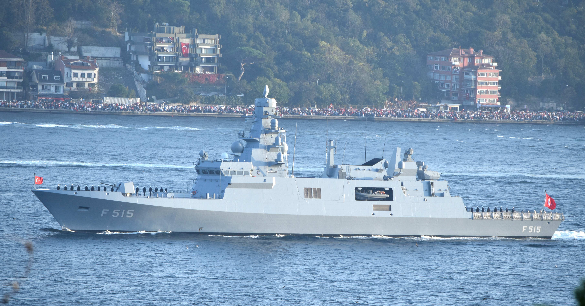
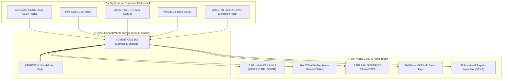

# 🚢 Proje: TCG İSTANBUL (F-515) - İ-Sınıfı Fırkateyn

[-00e676?style=for-the-badge&logo=shield)](../../../README.md)
[-0077be?style=for-the-badge&logo=target)](../../README.md)

  

---

### 🛡️ Stratejik Tanım & Doktriner Öncelik
TCG İSTANBUL (F-515), Türkiye'nin yerli mühendislik kabiliyetiyle tasarlayıp inşa ettiği ilk milli fırkateyni olup MİLGEM Projesi'nin 2. fazı olan İ-Sınıfı (İstif Sınıfı) fırkateyn ailesinin öncü gemisidir. %80'in üzerindeki yerlilik oranıyla inşa edilen platform; yabancı ambargoları kıran ROKETSAN MİDLAS dikey atım sistemi, ASELSAN CENK-350N 4 yüzlü AESA arama radarı, MKE 76 mm Milli Deniz Topu ve HAVELSAN ADVENT Savaş Yönetim Sistemi ile donatılmıştır. MİLGEM ADA sınıfı korvetlere kıyasla gövdesi 14 metre uzatılmış, yakıt ve mühimmat kapasitesi katlanarak açık denizlerde uzun menzilli hava savunma harbi (HSH), su üstü harbi (SÜH) ve denizaltı savunma harbi (DSH) icra yeteneği kazanmıştır. 19 Ocak 2024 tarihinde resmi olarak Deniz Kuvvetleri Komutanlığı envanterine katılmıştır.

---

### 📊 Kapsamlı Teknik Özellikler Tablosu

| Parametre | Değer / Özellik | Açıklama |
| :--- | :--- | :--- |
| **Gövde Tipi** | İstif (İ) Sınıfı Stealth Çok Maksatlı Fırkateyn | Düşük radar kesit alanı (RCS) |
| **Tam Boy / Genişlik** | 113.2 Metre / 14.4 Metre | Draft: 4.05 Metre |
| **Deplasman** | ~3.100 Ton (Tam Yüklü) | ADA sınıfından ~700 ton daha büyük |
| **Azami Sürat** | 29+ Knot | Yüksek operasyonel çeviklik |
| **Ekonomik Seyir Sürati** | 14 Knot (5.700 Deniz Mili Menzil) | Okyanus aşırı görev yarıçapı |
| **Tahrik Sistemi** | CODAG (1 x GE LM2500 Gaz Türbini + 2 x MTU Dizel) | Çift şaft ve değişken piçli pervane (CPP) |
| **Denizde Kalış Süresi** | 15 gün lojistik desteksiz | Yüksek otonomi ve yaşam konforu |
| **Mürettebat** | 123 Personel (Hava personeli dahil) | Yüksek otomasyonlu sistemler |
| **Hava Kapasitesi** | 10 Ton S-70B Seahawk Helikopteri + GÖKBEY + SİHA | Entegre hangar ve uçuş güvertesi |

---

### 🧩 Alt Sistemler ve Aviyonik/Elektronik Entegrasyonu
- **Savaş Yönetim Sistemi:** HAVELSAN ADVENT SYS (Dünyanın en gelişmiş ağ merkezli savaş yönetim sistemlerinden biri; filo seviyesinde hedef paylaşımı ve salvo planlama).
- **Birincil Radar:** ASELSAN CENK-350N (Dört yüzlü sabit antenli, 3B AESA çok fonksiyonlu hava/su üstü arama radarı).
- **Atış Kontrol Radarları:** 2 x ASELSAN AKREP (AKR-D) Blok-B radar & elektro-optik entegreli atış kontrol süiti.
- **Kızılötesi Arama & Takip (IRST):** ASELSAN PİRİ KATS (360° panoramik termal izleme ve pasif hedef tespiti).
- **Sonar:** Meteksan Savunma YAKAMOZ Karinalı DSH Sonarı.
- **Elektronik Harp:** ASELSAN ARES-2N Radar ED ve AREAS-2NC Elektronik Taarruz Süiti + Lazer İkaz Alıcı (LİAS) + Dekoy Atım Sistemi.
- **Taktik Veri Bağı:** Milli Taktik Veri Bağı KEMENT ve Link-16/Link-22 müşterek veri hatları.

---

### 🎯 Görev Profili, Muharebe Senaryoları & Mühimmat Yelpazesi
- **Milli Dikey Atım Gücü:** 16 Hücreli ROKETSAN MİDLAS VLS; HİSAR-D RF ve SİPER Blok 1-D füzeleriyle orta ve uzun menzilli hava soluyan hedeflere karşı mutlak şemsiye.
- **Çifte Vuruş Kapasiteli Gemisavar:** 16 x ROKETSAN ATMACA Güdümlü Mermisi (Geleneksel batı fırkateynlerinin 8 füzeli standardının 2 katı vuruş gücü).
- **Baş Topu:** 1 x 76/62 mm MKE Milli Deniz Topu (Su üstü, kara bombardımanı ve alçak hava hedefleri).
- **Son Hat Savunması (CIWS):** 1 x 35 mm ASELSAN GÖKDENİZ çift namlulu yakın hava savunma sistemi (ATOM akıllı parçacıklı mühimmatı ile süpersonik füzeleri önleme).
- **Asimetrik Savunma:** 2 x 25 mm ASELSAN STOP Uzaktan Komutalı Stabilize Top Sistemi.
- **Denizaltı Savunma:** 2 x 324 mm ikiz kovanlı hafif torpido lançeri (ORKA & Mk 46/54 torpidoları).

---

### 📐 Özel Sistem Mimarisi & Sensör-Silah Füzyonu

---

### 🚀 TRL Seviyesi ve Gelişim Yol Haritası
**Mevcut Olgunluk Seviyesi: TRL 9 (Donanma Hizmetinde & Muharebeye Hazır)**
- [x] İstanbul Tersanesi Komutanlığı'nda gövde inşası ve denize iniş
- [x] MİDLAS dikey atım sisteminin dünyada ilk kez deniz platformundan atış testi başarısı
- [x] MKE 76 mm Milli Deniz Topu ve CENK-350N AESA radarının milli entegrasyonu
- [x] 19 Ocak 2024 itibarıyla Dz.K.K. envanterine resmi kabul ve teslimat
- [ ] İstif Sınıfı Fırkateyn kardeş gemileri (F-516 İZMİR, F-517 İÇEL, F-518 İZMİT) inşa süreci

---
[⬅️ Üst Dizine](../README.md) | [🏛️ Dominion Hub](../../README.md) | [🏠 Ana Sayfa](../../../README.md)\n