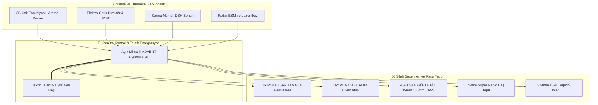

# 🚢 Proje: DEARSAN SALDIRGAN (C92 Korvet / Hafif Fırkateyn)

[

  

-00e676?style=for-the-badge&logo=shield)](../../../README.md)
[-0077be?style=for-the-badge&logo=target)](../../README.md)

  

---

### 🛡️ Stratejik Tanım & Doktriner Öncelik
DEARSAN SALDIRGAN (C92 Korvet), özel sektör Türk askeri gemi inşa sanayiinin yüksek teknoloji, modüler silah konfigürasyonu ve stealth geometriyle tasarladığı çok maksatlı bir deniz muharebe platformudur. 92 metre sınıfında fırkateyn ölçeğinde ateş gücü sunan C92; su üstü harbi (SÜH), denizaltı savunma harbi (DSH), hava savunma harbi (HSH) ve asimetrik kıyı güvenliği görevlerini aynı anda icra edebilir. Yüksek sürat yeteneği, düşük radar kesit alanı ve açık mimarili savaş yönetim sistemi entegrasyonu sayesinde Nijerya Deniz Kuvvetleri ve Hazar Denizi kıyıdaşı donanmalar dahil uluslararası müşterilere başarıyla ihraç edilmiş, Türkiye'nin askeri gemi ihracatındaki en dinamik platformlarından biri olmuştur.

---

### 📊 Kapsamlı Teknik Özellikler Tablosu

| Parametre | Değer / Özellik | Açıklama |
| :--- | :--- | :--- |
| **Gemi Tipi** | C92 Sınıfı Çok Maksatlı Hafif Fırkateyn / Korvet | Çelik gövde & Alüminyum üstyapı |
| **Tam Boy / Genişlik** | 91.4 Metre / 14.4 Metre | Draft: 3.85 Metre |
| **Deplasman** | ~1.600 - 1.700 Ton (Tam Yüklü) | Optimize hidrodinamik karina |
| **Azami Hız** | 26+ Knot | Yüksek operasyonel manevra yeteneği |
| **Seyir Siası (Menzil)** | 3.000 Deniz Mili (14 Knot ile) | Açık deniz devriye ve muharebe esnekliği |
| **Ana Tahrik Sistemi** | 2 x Marin Dizel Motor (veya CODAD opsiyonu) + CPP | Çift bağımsız sevk hattı |
| **Mürettebat Kapasitesi** | 100 Personel (Hava personeli dahil) | Ergonomik yaşam mahalli |
| **Hava Araçları** | 1 adet 10 Tonluk Helikopter + Taktik VTOL İHA | Helikopter pisti ve teleskopik hangar |
| **Deniz Vasıtaları** | 2 adet RHIB Hızlı Müdahale Botu | Vinçli borda mataforaları |

---

### 🧩 Alt Sistemler ve Aviyonik/Elektronik Entegrasyonu
- **Savaş Yönetim Sistemi:** Açık mimarili ADVENT / Havelsan GENESİS uyumlu C2 (Komuta Kontrol) sistemi.
- **Radar Donanımı:** 3B Çok Fonksiyonlu Hava ve Su Üstü Arama Radarı + X-Bant Seyir Radarı.
- **Atış Kontrol:** Elektro-optik direktör ve radar güdümlü bağımsız atış kontrol direktörü.
- **Sonar ve DSH:** Karinaya monteli yüksek frekanslı denizaltı tespit sonarı ve batimetrik ölçüm sensörleri.
- **Elektronik Harp & Savunma:** Elektronik Destek (ESM) süiti, Lazer İkaz Alıcı ve Chaff/Flare dekoy atıcı sistemleri.

---

### 🎯 Görev Profili, Muharebe Senaryoları & Mühimmat Yelpazesi
- **Uzun Menzilli Gemisavar:** 2 x 4 (8 adet) ROKETSAN ATMACA (veya müşteri isteğine göre Otomat / C-802) gemisavar füzesi.
- **Hava Savunma Füze Sistemi:** 2 x 8 (16 hücreli) Dikey Atım Sistemi (VLS) ile VL MICA veya CAMM füzeleri.
- **Baş Topu:** 1 x 76 mm Leonardo Super Rapid çok amaçlı deniz topu.
- **Nokta Savunma Sistemi (CIWS):** 1 x ASELSAN GÖKDENİZ 35 mm CIWS (veya 30 mm uzaktan komutalı ikiz top).
- **Asimetrik Yakın Savunma:** 2 x 12.7 mm veya 25 mm ASELSAN STOP/STAMP stabilize UKSS.
- **Denizaltısavar Torpidolar:** 2 x 324 mm üçüz torpido kovanı (Mk 46 / ORKA hafif torpidoları).

---

### 📐 Özel Sistem Mimarisi & Muharebe Ağı

---

### 🚀 TRL Seviyesi ve Gelişim Yol Haritası
**Mevcut Olgunluk Seviyesi: TRL 9 (Muharebede Kanıtlanmış & Uluslararası İhracat)**
- [x] C92 platformunun detay mühendisliği ve havuz kavitasyon testleri
- [x] Yurt dışı donanma ihalelerinin kazanılması ve sözleşmelerin imzalanması
- [x] Gemilerin kızakta inşası, denize indirilmesi ve silah entegrasyonu
- [x] Deniz kabul testleri ve teslimat safhasının tamamlanması
- [ ] Yeni nesil İHA konuşlu harekat ve milli MİDLAS entegrasyon konfigürasyonları

---
[⬅️ Üst Dizine](../README.md) | [🏛️ Dominion Hub](../../README.md) | [🏠 Ana Sayfa](../../../README.md)\n