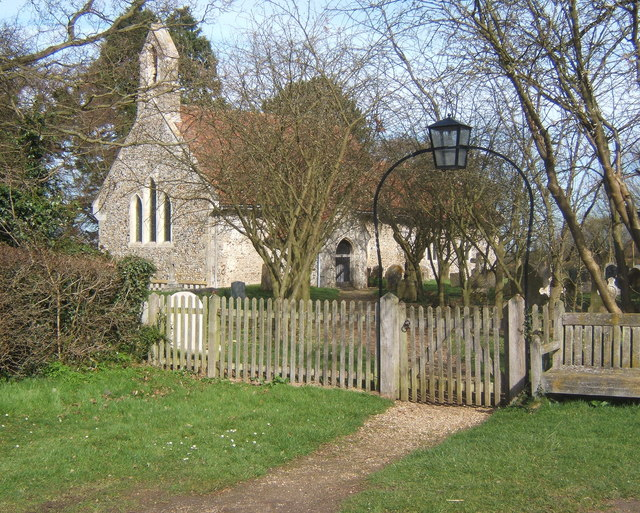
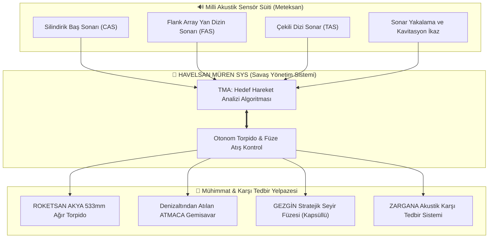

# 🦈 Proje: MİLDEN (Milli Denizaltı)

[-e85d04?style=for-the-badge&logo=shield)](../../../README.md)
[-0077be?style=for-the-badge&logo=target)](../../README.md)

  

---

### 🛡️ Stratejik Tanım & Doktriner Öncelik
MİLDEN (Milli Denizaltı), Türk Deniz Kuvvetleri Komutanlığı Dizayn Proje Ofisi liderliğinde, Gölcük Tersanesi Komutanlığı, ASFAT, STM, HAVELSAN, ASELSAN ve ROKETSAN ortaklığıyla yürütülen, Türk savunma sanayiinin en stratejik ve en yüksek mühendislik eşiğine sahip projesidir. Reis Sınıfı (Tip-214TN) denizaltıların inşasında kazanılan tecrübe üzerine bina edilen MİLDEN; tamamen yerli ve özgün bir formla sıfırdan tasarlanan Havadan Bağımsız Tahrik Sistemli (AIP) ağır taarruz denizaltısıdır. Türkiye'nin Mavi Vatan'da ve açık okyanuslarda mutlak sualtı caydırıcılığı kazanmasını hedefleyen proje; denizaltından atılan ATMACA gemisavar füzesi ve GEZGİN stratejik seyir füzesi atış yeteneğiyle Türkiye'yi küresel denizaltı liginde en üst seviyeye taşıyacaktır.

---

### 📊 Kapsamlı Teknik Özellikler Tablosu

| Parametre | Değer / Özellik | Açıklama |
| :--- | :--- | :--- |
| **Gemi Sınıfı** | AIP Ağır Taarruz Denizaltısı (SSK - AIP) | Çift cidarlı / hibrit mukavim tekne |
| **Boy / Genişlik** | ~80 Metre / ~8.5 Metre | Dalmış Deplasman: ~2.700 - 3.000 Ton |
| **Dalmış Sürat** | 20+ Knot | Şnorkelsiz kesintisiz sualtı intikali |
| **Seyir Siası & Otonomi**| 50+ Gün Sualtında Kesintisiz Görev | Havadan Bağımsız Tahrik (PEM Yakıt Pili) |
| **Maksimum Dalış Derinliği**| 350+ Metre | Yüksek mukavemetli yerli HY-100 çeliği |
| **Tahrik Sistemi** | Kalıcı Mıknatıslı Senkron Motor + Li-Ion / AIP | Fısıltı sessizliğinde akustik gizlilik |
| **Mürettebat** | ~35 - 40 Personel | Gelişmiş ergonomi ve yüksek otomasyon |
| **Silah Kovanları** | 8 x 533 mm Torpido Kovanı | Mühimmat kapasitesi: 20+ ağır silah |

---

### 🧩 Alt Sistemler ve Aviyonik/Elektronik Entegrasyonu
- **Savaş Yönetim Sistemi:** HAVELSAN MÜREN SYS (Tam milli algoritmalar, hedef hareket analizi TMA ve otonom angajman planlama).
- **Akustik Sensör Paketi (Milli Sonar Süiti):** Meteksan Savunma ve TÜBİTAK MAM iş birliğiyle geliştirilen Silindirik Sonar Dizini (CAS), Geniş Açılı Pasif Flank Array Sonar (FAS), Çekili Aktif/Pasif Sonar (TAS) ve Kavitasyon İkaz Sistemi.
- **Optronik & Periskop Süiti:** ASELSAN Denizaltı Optronik Direği (Penetrasyonsuz, termal, gündüz HD ve lazer mesafe ölçerli mast sistemi).
- **Elektronik Destek & Muhabere:** ASELSAN ARES-2NRES Denizaltı Radar ESM ve Uydu Muhabere (SATCOM) şnorkel direkleri.
- **Akustik Karşı Tedbir:** ROKETSAN ZARGANA Denizaltılar İçin Torpido Karşı Tedbir Sistemi (Dekoy ve Jammer atıcı lançerleri).

---

### 🎯 Görev Profili, Muharebe Senaryoları & Mühimmat Yelpazesi
- **Stratejik Derin Taarruz:** Torpido kovanlarından kapsül içinde fırlatılan ROKETSAN GEZGİN Seyir Füzesi ile karadaki stratejik hedeflere uzun menzilli baskın taarruzu.
- **Su Üstü Harbi (SÜH):** Denizaltından atılan ROKETSAN ATMACA Sub-Harpoon muadili füzeler ile yüzey filolarına taarruz.
- **Denizaltı Savunma Harbi (DSH):** ROKETSAN AKYA 533 mm Yeni Nesil Ağır Torpidoları ile düşman denizaltılarını aktif/pasif akustik arayıcı başlıkla avlama.
- **Özel Kuvvetler Harekâtı:** Gövde dışı entegre kızaklardan SAT komandoları ve insansız sualtı araçları (UUV/SDV) intikali.

---

### 📐 Özel Sistem Mimarisi & MÜREN CMS Entegrasyonu

---

### 🚀 TRL Seviyesi ve Gelişim Yol Haritası
**Mevcut Olgunluk Seviyesi: TRL 5 (Bileşen Doğrulama & Detay Tasarım / Blok Üretim Başlangıcı)**
- [x] Dz.K.K. Dizayn Proje Ofisi bünyesinde konsept ve kavramsal tasarım
- [x] Mukavim tekne hidrodinamik gövde form testleri ve kavitasyon analizleri
- [x] MÜREN Savaş Yönetim Sistemi'nin Ay ve Preveze sınıflarında doğrulanması
- [x] Gölcük Tersanesi'nde test bloğu sac kesimi ve kaynak kalifikasyonu
- [ ] İlk MİLDEN prototip denizaltısının kızakta tam montajı ve donatımı (2028-2030)
- [ ] Havadan Bağımsız Tahrik sistemi ve batarya deniz tecrübeleri

---
[⬅️ Üst Dizine](../README.md) | [🏛️ Dominion Hub](../../README.md) | [🏠 Ana Sayfa](../../../README.md)\n