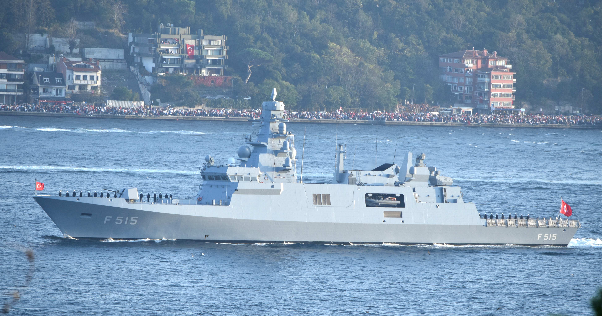
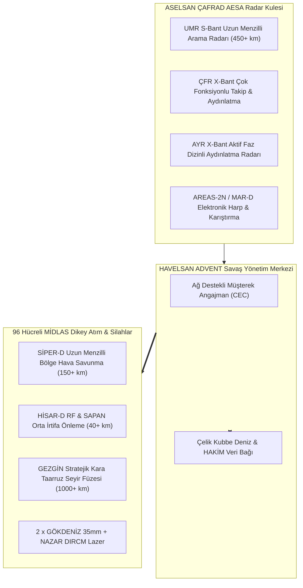

# 🛳️ Proje: TF-2000 Hava Savunma Harbi Muhribi (Air Defense Destroyer)

  

> **Geliştirici:** Dz.K.K. Dizayn Proje Ofisi (DPO) / İstanbul Tersanesi Komutanlığı / ASELSAN / ROKETSAN / HAVELSAN  
> **Sınıf:** Hava Savunma Harbi Muhribi (AAW Guided Missile Destroyer - DDG)  
> **Stratejik Önem:** Türkiye'nin "Çelik Kubbe" hava savunma mimarisinin açık denizlerdeki en üst katmanı; MİLGEM projesinin zirvesi olarak görev gruplarını (TCG ANADOLU ve Milli Uçak Gemisi) balistik füzelere, hipersonik tehditlere ve doygunluk saldırılarına karşı koruyan 8.300 tonluk stratejik muhrip.

---

## 🛡️ Stratejik Tanım & Doktriner Öncelik

**TF-2000 Hava Savunma Harbi Muhribi**, Türk Deniz Kuvvetleri Komutanlığı'nın Mavi Vatan ve açık okyanuslarda teşkil edeceği Amfibi/Uçak Gemisi Görev Gruplarını (Carrier Strike Group) her türlü hava, balistik füze, su üstü ve denizaltı tehdidine karşı korumak üzere geliştirilen Türkiye'nin ilk milli muhrip (Destroyer) projesidir. İstanbul Tersanesi Komutanlığı'nda ilk sac kesimi yapılarak inşa sürecine başlanan TF-2000; 8.300 ton deplasmanı, 149 metre boyu ve **96 hücreli Milli Dikey Atım Lançer Sistemi (MİDLAS)** ile dünya denizlerinin en ağır silahlı ve en gelişmiş hava savunma muhripleri arasında yer almaktadır.

Üzerinde taşıdığı **ASELSAN ÇAFRAD** (Çok Amaçlı Faz Dizili Radar) AESA radar süiti ve **HAVELSAN ADVENT** Ağ Destekli Savaş Yönetim Sistemi sayesinde 450+ kilometre yarıçaplı bir hava küresini anlık olarak tarar; yüzlerce hava hedefini aynı anda takip ederek **SİPER-D**, **HİSAR-D RF**, **GEZGİN** seyir füzesi ve **ATMACA** gemisavar füzeleriyle çok katmanlı angajman icra eder.

---

## 📊 Kapsamlı Teknik Özellikler

| Parametre | Değer / Özellik | Açıklama |
| :--- | :--- | :--- |
| **Gemi Sınıfı** | Hava Savunma Harbi Muhribi (AAW Destroyer - DDG) | MİLGEM Ailesinin En Üst Stratejik Halkası |
| **Tam Boy / Genişlik** | 149.0 Metre / 21.3 Metre | Draft: 5.75 Metre |
| **Deplasman** | ~8.300 Ton (Tam Yüklü) | Açık okyanus (Deniz Durumu 7+) harekat kabiliyeti |
| **Tahrik Sistemi** | CODOG (2 x Gaz Türbini + 2 x Dizel Motor) | Çift şaft, kontrol edilebilir 피çli pervane (CPP) |
| **Azami / Ekonomik Sürat** | 26+ Knot / 17 Knot | Görev grubu refakati için yüksek intikal hızı |
| **Dikey Atım Sistemi (VLS)** | 96 Hücreli ROKETSAN MİDLAS (32 Baş + 64 Orta) | SİPER-D, HİSAR-D, GEZGİN, ATMACA, SAPAN |
| **Gemisavar Füzeleri** | 16 x ATMACA / ÇAKIR Satıhtan Satıha Güdümlü Mermi | Harici eğik lançerler + VLS kapasitesi |
| **Ana Radar Süiti** | ASELSAN ÇAFRAD (UMR + ÇFR + AYR GaN AESA) | 450+ km menzilli çok fonksiyonlu faz dizinli radar |
| **Yakın Hava Savunma (CIWS)** | 2 x ASELSAN GÖKDENİZ (35mm ATOM) + NAZAR Lazer | Katmanlı nokta savunma ve elektro-optik körleme |
| **Baş Topu & UKSS** | 1 x 127 mm Ana Batarya Topu + 2 x 25 mm STOP | Su üstü ve kara bombardımanı desteği |
| **Denizaltı Savunma (DSH)** | DÜFAS Çekili Sonar + FERSAH Karinaya Monteli Sonar | 2 x Üçlü Torpido Kovanı (ORKA Hafif Torpido) |
| **Hava Aracı Kapasitesi** | 2 x 10 Ton Sınıfı DSH Helikopteri + SİHA Hangarı | Çift helikopter hangarı ve geniş uçuş güvertesi |

---

## 🧩 Alt Sistemler ve Aviyonik / Elektronik Entegrasyonu

- **ASELSAN ÇAFRAD Tümleşik Direk Mimarisi:** S-Bant Uzun Menzilli Radar (UMR) ile balistik füzeleri atmosfer dışında tespit ederken, X-Bant Çok Fonksiyonlu Radar (ÇFR) ile deniz yüzeyini yalayan (sea-skimming) süpersonik gemisavar füzelerini hassas takip eder.
- **96 Hücreli MİDLAS Esnekliği:** "Quad-Pack" (tek hücrede 4 füze) yeteneği sayesinde 96 hücreli MİDLAS içerisine yüzlerce hava savunma füzesi ve uzun menzilli GEZGİN seyir füzesi yerleştirilebilir.
- **ASELSAN DÜFAS & FERSAH Sonar Süiti:** Karinaya monteli aktif/pasif FERSAH sonarı ve gemi kıçından salınan DÜFAS Düşük Frekanslı Aktif Çekili Sonar ile denizaltıları birinci yakınsama kuşağının ötesinden tespit eder.

---

## 🎯 Görev Profili, Muharebe Senaryoları & Mühimmat Yelpazesi

1. **Görev Grubu Hava Savunma Şemsiyesi (A2/AD):** TCG ANADOLU LHD ve TCG TRAKYA Milli Uçak Gemisi görev gruplarının etrafında 150+ km yarıçaplı uçuşa yasak bölge ve hava savunma kubbesi oluşturma.
2. **Balistik Füze Savunması (BMD):** ÇAFRAD ve SİPER-D Blok-2/3 kombinasyonu ile taktik balistik füzelerin terminal ve orta safhada tespit ve önlenmesi.
3. **Derin Stratejik Kara Taarruzu:** MİDLAS hücrelerinden ateşlenen GEZGİN seyir füzeleri ile 1.000+ km derinlikteki düşman komuta merkezlerini denizden vurma.
4. **Ağ Merkezli Müşterek Angajman (CEC):** Kendi radarı kapalı olan dost fırkateynlere veya KAAN/KIZILELMA uçaklarına hedef verisi aktararak uzaktan füze güdümü sağlama.

---

## 🚀 TRL Seviyesi ve Gelişim Yol Haritası

- **Mevcut Durum:** `TRL 6` (Sözleşme, detay tasarım ve ÇAFRAD/MİDLAS alt sistem doğrulamaları tamamlanmış; İstanbul Tersanesi Komutanlığı'nda ilk blok sac kesimi gerçekleştirilmiştir).
- [x] Dz.K.K. Dizayn Proje Ofisi (DPO) kontrat ve detay tasarım fazının tamamlanması
- [x] ÇAFRAD AESA Radar prototipinin TCG GÖKSU üzerinde atışlı deniz kabul testleri
- [x] MİDLAS Dikey Atım Lançeri ve HİSAR-D RF deniz atış doğrulaması
- [x] İstanbul Tersanesi Komutanlığı'nda ilk sac kesimi ve blok inşasının başlaması (2025)
- [ ] İlk geminin denize indirilmesi, donatım ve liman/deniz kabul testleri

---

## 🔗 İç Dizin Navigasyonu

[⬅️ Üst Dizine (DzKK)](../README.md) | [🏛️ Dominion Hub (DOMINION_SEA)](../../README.md) | [🏠 Ana Sayfa](../../../README.md)
