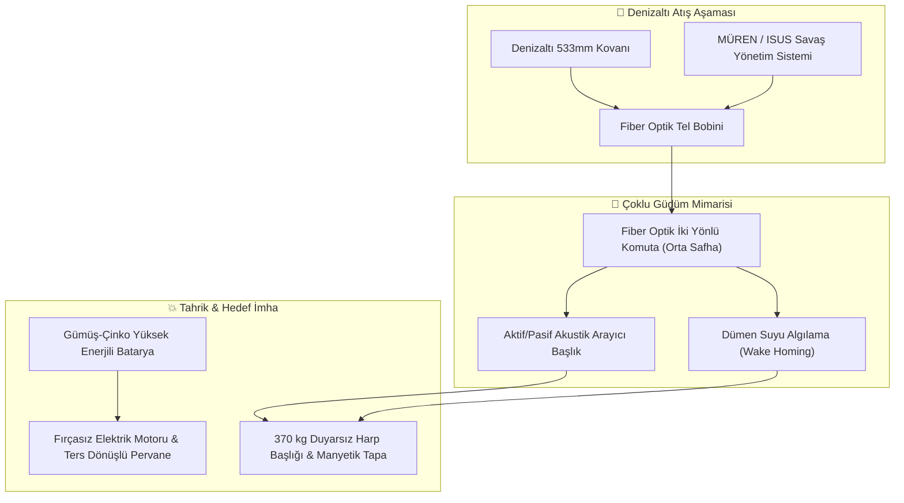

# 🦈 Proje: AKYA (Yeni Nesil Ağır Sınıf Akıllı Torpido)

[

  

-00e676?style=for-the-badge&logo=shield)](../../../README.md)
[-0077be?style=for-the-badge&logo=target)](../../README.md)

  

---

### 🛡️ Stratejik Tanım & Doktriner Öncelik
AKYA, ROKETSAN ana yükleniciliğinde, TÜBİTAK BİLGEM ve Deniz Kuvvetleri Komutanlığı Araştırma Merkezi Komutanlığı (ARMERKÖM) iş birliğiyle tamamen milli imkanlarla geliştirilmiş 533 mm çapında yeni nesil ağır sınıf akıllı torpidodur. Türk Deniz Kuvvetleri'nin yabancı kaynaklı MK-48 ve DM2A4 torpidolarına olan tam bağımlılığını sonlandıran stratejik bir caydırıcılık unsurudur. Preveze, Gür ve Reis sınıfı denizaltılarımızın birincil taarruz silahı haline gelen AKYA; denizaltılardan su üstü gemilerine ve rakip denizaltılara karşı fısıltı sessizliğinde yaklaşarak omurga kırıcı patlama gücü oluşturur. TCG PREVEZE denizaltısından yapılan harp başlıklı atış testinde hedef gemiyi ortadan ikiye bölerek batırmış ve TRL 9 muharebe kanıtlanmışlık seviyesine erişmiştir.

---

### 📊 Kapsamlı Teknik Özellikler Tablosu

| Parametre | Değer / Özellik | Açıklama |
| :--- | :--- | :--- |
| **Kalibre / Çap** | 533 mm (21 inç Standart Torpido Kovanı) | NATO standart kovanlarla tam uyumlu |
| **Boyut / Uzunluk** | ~6.5 - 7 Metre | Ağırlık: ~1.200 - 1.250 kg |
| **Operasyonel Menzil** | 50+ Kilometre (30+ Deniz Mili) | Yüksek menzil kapasitesi |
| **Azami Sürat** | 45+ Knot | Yüksek hızlı batarya-motor tahriki |
| **Tahrik Sistemi** | Fırçasız DC Elektrik Motoru + Çift Ters Dönüşlü Pervane | Akustik sessizlik sağlayan kontrarotatif pervane |
| **Enerji Kaynağı** | Yüksek Enerji Yoğunluklu Gümüş-Çinko / Li-Ion Batarya | Uzun süre yüksek güç çıkışı |
| **Harp Başlığı** | ~370 kg Yüksek Patlayıcılı Duyarsız Harp Başlığı | Manyetik yaklaşma ve çarpma tapası |
| **Güdüm Mimarisi** | Fiber Optik Kablo + Aktif/Pasif Akustik Sonar + Wake Homing | Dümen suyu takip yeteneği |

---

### 🧩 Alt Sistemler ve Aviyonik/Elektronik Entegrasyonu
- **Akustik Arayıcı Başlık:** TÜBİTAK BİLGEM tarafından geliştirilen çok huzmeli aktif/pasif sonar başlığı; hedef yansımalarını sahte hedeflerden ve akustik aldatıcılardan (chaff/jammer) ayırt edebilen gelişmiş dijital sinyal işleme (DSP).
- **Dümen Suyu Algılama (Wake Homing):** Hedef su üstü gemisinin pervanelerinin suda bıraktığı mikro hava kabarcığı yoğunluğunu optik ve akustik sensörlerle algılayarak rotayı doğrudan hedefin dümenine kilitleme.
- **Fiber Optik Veri Bağı:** Denizaltı ile torpido arasında çift yönlü yüksek hızlı veri akışı sağlayan mikron inceliğinde bobin kablo; operatörün anlık rota güncellemesi, hedef değiştirme veya iptal yapmasını sağlar.
- **MÜREN Entegrasyonu:** Denizaltı savaş yönetim sistemiyle tam dijital arayüz entegrasyonu.

---

### 🎯 Görev Profili, Muharebe Senaryoları & Mühimmat Yelpazesi
- **Omurga Kırma (Keel Breaking):** Su üstü muharip gemilerinin altına manyetik yaklaşımla dalarak infilak etme; oluşan gaz kabarcığı ve su basıncı dalgasıyla geminin omurgasını kırıp saniyeler içinde batırma.
- **Derin Su Denizaltı Avı:** Termoklin katmanlarını aşarak gizlenen düşman nükleer veya dizel-elektrik denizaltılarını pasif dinleme modunda saptayıp yüksek hızda imha etme.
- **Karşı Tedbirlere Direnç:** Düşmanın Zargana veya muadili dekoy sistemlerine aldanmadan gerçek hedefe kilitlenme.

---

### 📐 Özel Sistem Mimarisi & Güdüm Fazları

---

### 🚀 TRL Seviyesi ve Gelişim Yol Haritası
**Mevcut Olgunluk Seviyesi: TRL 9 (Muharebede Kanıtlanmış & Seri Üretim)**
- [x] Tasarım, laboratuvar ve donanım testlerinin tamamlanması
- [x] TCG GÜR ve TCG PREVEZE denizaltılarından yapılan telemetrik atışlar
- [x] Gerçek hedef gemiye karşı harp başlıklı batırma testi (Aralık 2023)
- [x] Dz.K.K. envanterine kabul ve seri üretim teslimatları
- [ ] Yeni nesil otonom sürü kabiliyeti ve MİLDEN denizaltılarına tam uyumluluk

---
[⬅️ Üst Dizine](../README.md) | [🏛️ Dominion Hub](../../README.md) | [🏠 Ana Sayfa](../../../README.md)\n