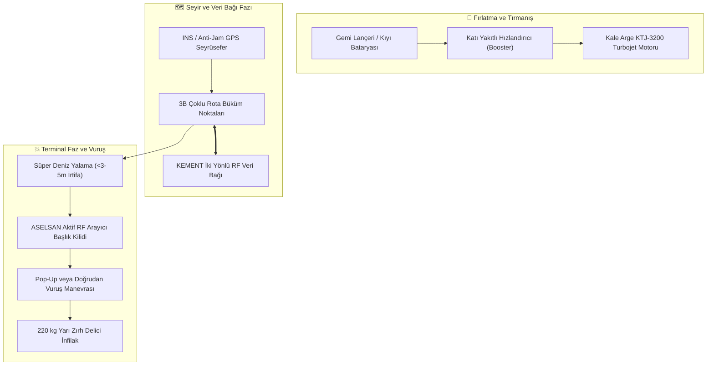

# 🦅 Proje: ATMACA (Satıhtan Satıha Hassas Gemisavar Füzesi)

[

  

-00e676?style=for-the-badge&logo=shield)](../../../README.md)
[-0077be?style=for-the-badge&logo=target)](../../README.md)

  

---

### 🛡️ Stratejik Tanım & Doktriner Öncelik
ATMACA, ROKETSAN tarafından her türlü hava şartında görev yapabilen, satıhtan satıha uzun menzilli, yüksek hassasiyetli bir gemisavar ve kıyı savunma seyir füzesi olarak geliştirilmiştir. "Mavi Vatan'ın Çelik Kılıcı" olarak adlandırılan ATMACA; Türk Deniz Kuvvetleri'nin Amerikan üretimi Harpoon (RGM-84) füzelerine bağımlılığını tamamen ortadan kaldırmıştır. Süper deniz yalama (sea-skimming: su yüzeyinden 3-5 metre irtifada seyir), gelişmiş 3B görev planlama, radar izini gizleyen kompozit gövde ve radar arayıcı başlık özellikleriyle donatılmıştır. Yerli Kale Arge KTJ-3200 turbojet motoruyla seri üretime geçen füze; MİLGEM korvetleri, İ-Sınıfı fırkateynler ve kıyı bataryalarında tam operasyonel statüde hizmet vermektedir.

---

### 📊 Kapsamlı Teknik Özellikler Tablosu

| Parametre | Değer / Özellik | Açıklama |
| :--- | :--- | :--- |
| **Füze Tipi** | Satıhtan Satıha / Kıyı Konuşlu Hassas Gemisavar Füzesi | Çok maksatlı gemi ve kıyı hedefleri |
| **Menzil** | 220+ Kilometre (120+ Deniz Mili) | Harpoon Blok II'nin ötesinde menzil |
| **Uçuş Hızı** | Mach 0.85 - 0.90 (Yüksek Subsonik) | Radara yakalanma süresini minimize eder |
| **Füze Ağırlığı** | ~750 kg (Katı yakıtlı fırlatma motoru dahil) | Çap: 350 mm / Kanat Açıklığı: 1.4 m |
| **Harp Başlığı** | 220 kg Yüksek Patlayıcılı / Yarı Zırh Delici | Penetrasyon ve gecikmeli patlama |
| **Motor Sistemi** | Katı Yakıtlı Booster + Kale Arge KTJ-3200 Turbojet | Yerli ve milli itki sistemi |
| **Güdüm Mimarisi** | INS + GPS + Barometrik/Radar Altimetre + Aktif RF | Karıştırmaya dayanıklı anti-jamming GPS |
| **Veri Bağı** | KEMENT İki Yönlü RF Taktik Veri Bağı | Uçuş sırasında hedef güncelleme & iptal |

---

### 🧩 Alt Sistemler ve Aviyonik/Elektronik Entegrasyonu
- **Aktif RF Radar Arayıcı Başlık:** ASELSAN tarafından geliştirilen yüksek çözünürlüklü X-Bant aktif radar; elektronik harp karıştırmalarına karşı frekans atlama ve sahte hedefleri filtreleme algoritmalarına sahiptir.
- **KEMENT Veri Bağı Entegrasyonu:** Meteksan Savunma KEMENT veri bağı sayesinde; fırlatıldıktan sonra dahi hedefin konum güncellemelerini alabilme, filo içindeki diğer platformlardan hedef koordinatı transfer etme ve yeniden angajman (re-attack) manevrası yapabilme.
- **3B Dinamik Görev Planlama:** Adalar Denizi gibi coğrafi engellerin arkasından dolaşabilen, belirlenen arazi noktalarından sakınarak rotayı büken çoklu büküm noktası (waypoint) programlama yeteneği.
- **Deniz Yalama (Sea-Skimming):** Son yaklaşma fazında dalga tepelerini yalayarak radar ufkunun altında tespit edilemez irtifada intikal.

---

### 🎯 Görev Profili, Muharebe Senaryoları & Mühimmat Yelpazesi
- **Su Üstü Görev Grubu İmhası:** Salvo atış modunda fırlatılan çoklu ATMACA füzelerinin farklı açılardan ve aynı anda hedefe varması (Time-on-Target) ile düşman hava savunma radarlarını doyuma uğratma.
- **Kıyı ve Liman Taarruzu:** Limanda demirli kritik lojistik gemileri veya kıyı radar üslerini hassas vuruşla tahrip etme.
- **Mobil Kıyı Savunma (BARBAROS):** 8x8 tekerlekli taktik araçlara monte edilen kıyı bataryalarıyla boğazları ve stratejik geçiş hatlarını kıyıdan kapatma.

---

### 📐 Özel Sistem Mimarisi & Görev Akışı

---

### 🚀 TRL Seviyesi ve Gelişim Yol Haritası
**Mevcut Olgunluk Seviyesi: TRL 9 (Muharebede Kanıtlanmış & Donanmada Aktif)**
- [x] TCG KINALIADA'dan telemetri ve harp başlıklı hedef batırma atışları
- [x] KTJ-3200 yerli turbojet motoru kalifikasyonu ve başarılı test uçuşu
- [x] Seri üretim hattının kurulması ve TCG İSTANBUL'a 16 adetlik tam konfigürasyon teslimi
- [x] BARBAROS Kıyı Savunma Sistemi kapsamında kara bataryasından atış başarısı
- [ ] Görüntüleyici Kızılötesi (IIR) arayıcı başlıklı ve denizaltı atımlı varyantlar

---
[⬅️ Üst Dizine](../README.md) | [🏛️ Dominion Hub](../../README.md) | [🏠 Ana Sayfa](../../../README.md)\n