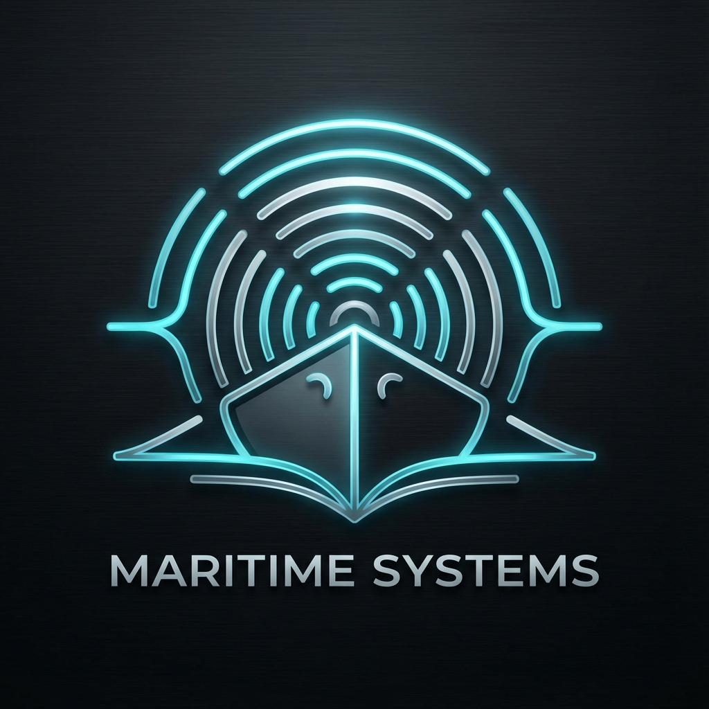
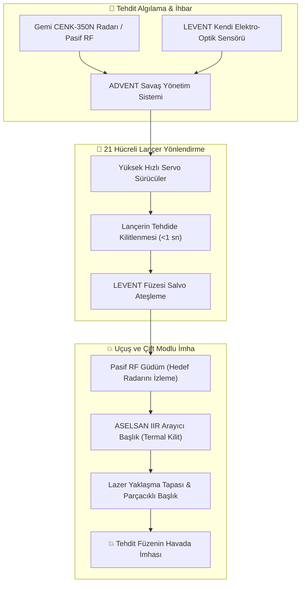

# 🛡️ Proje: ROKETSAN LEVENT (Yakın Hava Savunma Füze Sistemi)

[-7209b7?style=for-the-badge&logo=shield)](../../../README.md)
[-0077be?style=for-the-badge&logo=target)](../../README.md)

  

---

### 🛡️ Stratejik Tanım & Doktriner Öncelik
ROKETSAN LEVENT, Türk Deniz Kuvvetleri unsurlarını gemisavar füzelerine (AShM), seyir füzelerine, kamikaze insansız hava araçlarına, helikopterlere ve su üstü asimetrik tehditlerine karşı korumak üzere geliştirilen milli nokta hava savunma füze sistemidir (RAM - Rolling Airframe Missile muadili CIWS). Özellikle yabancı ülkelerin uyguladığı örtülü ve açık silah ambargoları nedeniyle temininde kısıtlamalar yaşanan RAM sisteminin yerine geçecek şekilde tasarlanmıştır. Bağımsız elektro-optik ve pasif RF sensörleri sayesinde hem geminin savaş yönetim sistemine (ADVENT) tam entegre çalışabilir hem de geminin tüm radar/elektronik sistemleri devre dışı kalsa bile otonom modda hedefi yakalayıp imha edebilir.

---

### 📊 Kapsamlı Teknik Özellikler Tablosu

| Parametre | Değer / Özellik | Açıklama |
| :--- | :--- | :--- |
| **Sistem Türü** | Gemi Konuşlu Nokta Yakın Hava Savunma Füze Sistemi (CIWS) | Lançer + Füze Mimari |
| **Lançer Kapasitesi** | 21 Hücreli / Modüler Lançer Tasarımı | 21 adet fırlatmaya hazır LEVENT füzesi |
| **Etkili Önleme Menzili**| 11+ Kilometre | Süpersonik ve subsonik füzelere karşı |
| **Füze Hızı** | Mach 2.0+ (Süpersonik) | Hızlı reaksiyon ve kinetik önleme |
| **Arayıcı Başlık** | Çift Modlu: Pasif RF + Görüntüleyici Kızılötesi (IIR) | Yüksek elektronik harbe dayanıklılık |
| **Hedef Seti** | Gemisavar Füzeleri, Seyir Füzeleri, İHA'lar, SİDA'lar | 360° kubbe koruması |
| **Çalışma Modları** | Entegre Mod (ADVENT SYS) & Bağımsız Otonom Mod | Sahip olduğu sensör kulesi ile bağımsız |
| **Tahrik** | Katı Yakıtlı Çift Kademeli Roket Motoru | Düşük dumanlı yüksek itkili kompozit yakıt |

---

### 🧩 Alt Sistemler ve Aviyonik/Elektronik Entegrasyonu
- **Çift Modlu Arayıcı Başlık (Dual-Mode Seeker):** Hedef füzenin yaydığı aktif radar arama sinyallerini algılayan Pasif RF antenleri ve hedefin termal görüntüsüne kilitlenen ASELSAN IIR optik başlık.
- **Bağımsız Elektro-Optik Direktör:** Lançer üzerine entegre edilmiş termal kamera, gündüz TV kamerası ve lazer mesafe ölçer süiti; gemi ana radarları suskunken dahi pasif hedef takibi sağlar.
- **Hızlı Yönlendirmeli Lançer:** Yüksek torklu servo motorlar sayesinde saliseler içerisinde tehdit eksenine dönerek peş peşe salvo füze fırlatma kabiliyeti.
- **ADVENT SYS Köprüsü:** Ağ merkezli harekat kapsamında gemi CENK-350N radarı veya filodaki diğer platformlardan gelen iz verileriyle hedefe kilitlenme.

---

### 🎯 Görev Profili, Muharebe Senaryoları & Mühimmat Yelpazesi
- **Son Savunma Hattı (Point Defense):** Gemiye deniz yalama irtifasında yaklaşan süpersonik veya subsonik bir gemisavar füzesini 10 km mesafeden karşılayarak doğrudan gövdeye vuruşla (hit-to-kill) imha etme.
- **Sürü İHA ve SİDA Engellemesi:** Eş zamanlı gelen çoklu kamikaze drone ve kamikaze insansız deniz botu saldırılarına karşı çoklu hedef angajmanı ile art arda atış yapabilme.
- **Asimetrik Kıyı Savunması:** Liman ve boğaz geçişlerinde alçaktan yaklaşan helikopter ve taktik uçaklara ani müdahale.

---

### 📐 Özel Sistem Mimarisi & Önleme Aşamaları

---

### 🚀 TRL Seviyesi ve Gelişim Yol Haritası
**Mevcut Olgunluk Seviyesi: TRL 7 (Sistem Prototip Doğrulama / Deniz Testleri Safhası)**
- [x] Konsept tasarım ve rüzgar tüneli aerodinamik testleri
- [x] Lançer mekanik ve servo kontrol sistemlerinin üretimi
- [x] Çift modlu arayıcı başlık laboratuvar ve kara atış testleri
- [x] Deniz platformu entegrasyon arayüzlerinin tamamlanması
- [ ] Denizde hedef füzeye karşı tam harp başlıklı canlı atış doğrulama testleri
- [ ] TCG İSTANBUL ve TF-2000 sınıfı gemilerde seri donatım

---
[⬅️ Üst Dizine](../README.md) | [🏛️ Dominion Hub](../../README.md) | [🏠 Ana Sayfa](../../../README.md)\n