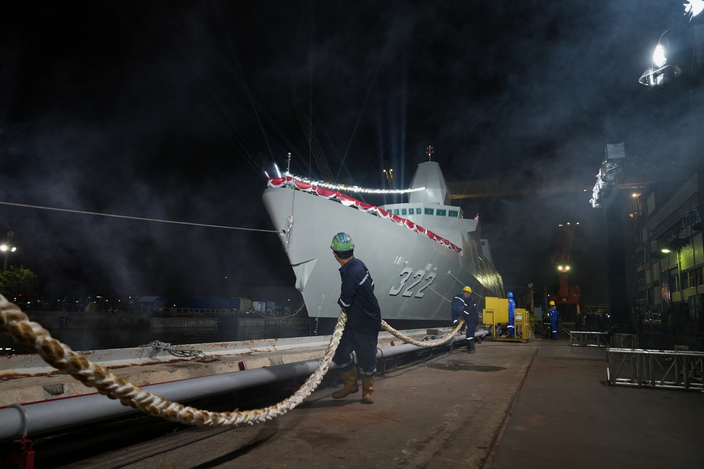
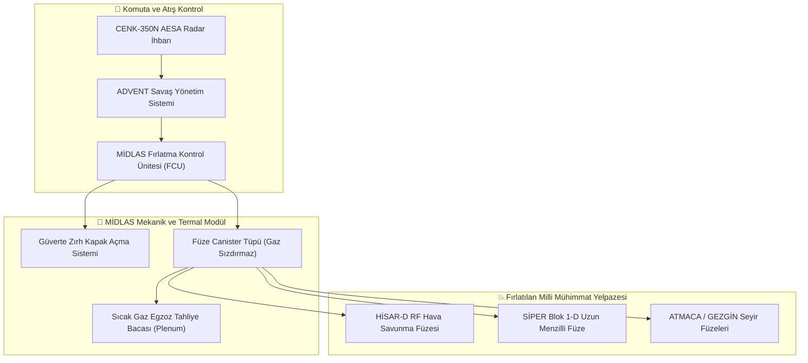

# 🚀 Proje: MİDLAS (Milli Dikey Atım Lançer Sistemi)

[-0077be?style=for-the-badge&logo=shield)](../../../README.md)
[-0077be?style=for-the-badge&logo=target)](../../README.md)

  

---

### 🛡️ Stratejik Tanım & Doktriner Öncelik
MİDLAS (Milli Dikey Atım Lançer Sistemi), ROKETSAN tarafından Türk Deniz Kuvvetleri muharip platformlarının dikey füze atım ihtiyacını karşılamak üzere geliştirilmiş, ABD menşeili Mk 41 VLS sisteminin yerini alan stratejik bir lançer altyapısıdır. Türkiye'ye yönelik uygulanan CAATSA ve örtülü ambargolar neticesinde TCG İSTANBUL fırkateynine Mk 41 satışının durdurulması üzerine başlatılan proje; rekor sürede tamamlanarak deniz kabul atışlarını başarıyla icra etmiştir. Gemi gövdesine dikey olarak gömülen modüler hücreler sayesinde füzeler 360 derece kapsama alanıyla herhangi bir yönlendirme mekanik gecikmesi olmaksızın anında ateşlenebilmekte, böylece donanmamız tam bağımsız hava savunma ve seyir füzesi atış kabiliyetine kavuşmaktadır.

---

### 📊 Kapsamlı Teknik Özellikler Tablosu

| Parametre | Değer / Özellik | Açıklama |
| :--- | :--- | :--- |
| **Sistem Tipi** | Gemi İçi Modüler Dikey Atım Lançer Sistemi (VLS) | Sıcak gaz tahliyeli (Plenum) mimari |
| **Modül Konfigürasyonu**| 8 Hücreli Standart Modüller (8'li / 16'lı / 32'li gruplar) | TCG İSTANBUL'da 16 Hücreli Entegrasyon |
| **Füze Uyumluluğu** | HİSAR-D RF, SİPER Blok 1-D, ATMACA, GEZGİN, ORKA | Geniş milli mühimmat yelpazesi |
| **Ateşleme Reaksiyonu** | Milisaniyeler seviyesinde sıralı / salvo atım | 360° anlık reaksiyon |
| **Gaz Tahliye Mimarisi**| Çift cidarlı su soğutmalı ve basınç sönümlemeli Plenum | Roket alevini güvenle güverte dışına atar |
| **Konteyner (Canister)**| Mühimmatın fabrika çıkışından atıma kadar korunduğu tüp| Gaz sızdırmaz, bakım gerektirmeyen ömür |
| **Ağırlık & Yapı** | Hafifletilmiş yüksek mukavemetli balistik çelik alaşım | Şok ve sualtı patlama testlerine dayanıklı |
| **Kontrol Arayüzü** | MIL-STD-1553B, Ethernet ve ADVENT SYS Tam Uyumu | Milli atış kontrol yazılımı |

---

### 🧩 Alt Sistemler ve Aviyonik/Elektronik Entegrasyonu
- **Sıcak Gaz Tahliye Sistemi (Plenum & Uptake):** Füzenin roket motoru fırlatma tüpü içerisinde ateşlendiğinde açığa çıkan binlerce derecelik sıcak gazı ve devasa basıncı gemi gövdesine zarar vermeden güverte üstüne tahliye eden hidrolik ve termal egzoz mimarisi.
- **Canister (Füze Koruma ve Fırlatma Tüpü):** Mühimmatın nem, tuzlu su ve vibrasyondan korunarak 10+ yıl bakım gerektirmeden hazır beklemesini sağlayan kompozit tüp.
- **Fırlatma Kontrol Ünitesi (FCU):** ADVENT savaş yönetim sisteminden gelen atış komutunu milisaniyeler içinde onaylayan, füze arayüzüne hedef verilerini yükleyen ve ateşleme zincirini yöneten emniyetli aviyonik bilgisayar.
- **Kapak Açma Mekanizması:** Patlama anında veya fırlatma öncesinde saliseler içinde açılan hidrolik/pnömatik güverte zırh kapakları.

---

### 🎯 Görev Profili, Muharebe Senaryoları & Mühimmat Yelpazesi
- **Katmanlı Hava Savunması:** 16 hücreli MİDLAS içerisinden ateşlenen HİSAR-D RF füzeleri ile orta irtifa hava soluyan hedefleri, SİPER Blok 1-D füzeleri ile 100+ km menzildeki yüksek irtifa balistik ve aero-balistik hedefleri karşılama.
- **Quad-Pack Yeteneği (Planlanan):** Tek bir MİDLAS hücresine 4 adet daha küçük hava savunma füzesi yerleştirerek fırkateynin hava savunma füze kapasitesini 16'dan 64'e çıkarma esnekliği.
- **Derin Darbe:** TF-2000 ve geleceğin muhriplerinde GEZGİN seyir füzelerini dikey ateşleyerek kıtalararası stratejik vuruş desteği sağlama.

---

### 📐 Özel Sistem Mimarisi & Dikey Fırlatma Dinamiği

---

### 🚀 TRL Seviyesi ve Gelişim Yol Haritası
**Mevcut Olgunluk Seviyesi: TRL 8 (Sistem Kalifikasyonu / Deniz Testleri Başarıyla Tamamlandı)**
- [x] Kara test standında sıcak ateşleme ve gaz tahliye testleri
- [x] Karadan HİSAR-D RF füzesiyle ilk dikey atış başarısı
- [x] TCG İSTANBUL fırkateynine 16 hücreli milli lançer montajı
- [x] Deniz kabul testleri kapsamında fırkateynden canlı füze atışı başarısı (Mart 2024)
- [ ] SİPER Blok 1-D ve GEZGİN füzeleri ile uzun menzilli dikey atım kalifikasyonu
- [ ] TF-2000 Hava Savunma Harbi Muhribi için 64/96 hücreli konfigürasyon üretimi

---
[⬅️ Üst Dizine](../README.md) | [🏛️ Dominion Hub](../../README.md) | [🏠 Ana Sayfa](../../../README.md)\n