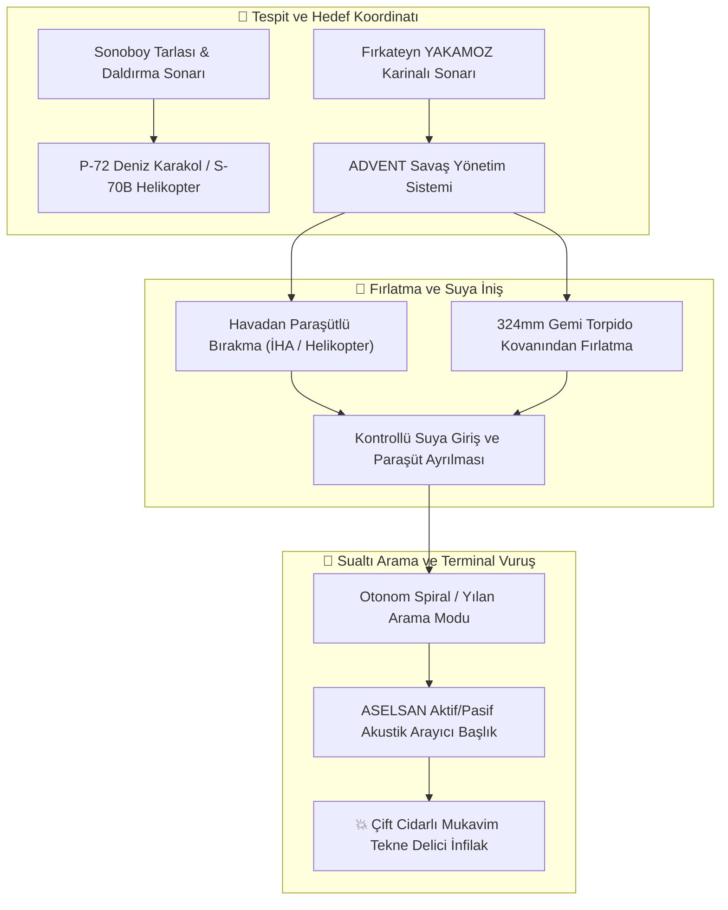

# ⚓ Proje: ORKA (Yeni Nesil Hafif Sınıf Akıllı Torpido)

[

  

-7209b7?style=for-the-badge&logo=shield)](../../../README.md)
[-0077be?style=for-the-badge&logo=target)](../../README.md)

  

---

### 🛡️ Stratejik Tanım & Doktriner Öncelik
ORKA, ROKETSAN ana yükleniciliğinde ve ASELSAN alt yükleniciliğinde, Türk Deniz Kuvvetleri'nin Denizaltı Savunma Harbi (DSH) kabiliyetini dışa bağımlılıktan kurtarmak için geliştirilen 324 mm çapında yeni nesil hafif sınıf akıllı torpidodur. Donanmamızın su üstü fırkateyn/korvetleri, S-70B Seahawk deniz helikopterleri, P-72 deniz karakol uçakları ve AKSUNGUR, ANKA, TB3 gibi insansız hava araçlarından atılabilen çok maksatlı bir sualtı avcısıdır. ABD yapımı MK-46 ve MK-54 torpidolarının yerini alacak olan ORKA; gelişmiş akustik sinyal işleme algoritmaları, derin deniz ve sığ sularda üstün manevra kabiliyeti ve yüksek patlayıcı tesirli başlığıyla Mavi Vatan'da düşman denizaltı tehdidini bertaraf etmek üzere tasarlanmıştır.

---

### 📊 Kapsamlı Teknik Özellikler Tablosu

| Parametre | Değer / Özellik | Açıklama |
| :--- | :--- | :--- |
| **Kalibre / Çap** | 324 mm (NATO Standart Hafif Torpido Tüpü) | Boyut: ~2.7 - 2.9 Metre |
| **Fırlatma Ağırlığı** | ~260 - 280 kg | Hava ve su üstü platformlarına tam uyum |
| **Operasyonel Menzil** | 25+ Kilometre (15+ Deniz Mili) | Yüksek menzil ve operasyonel derinlik |
| **Azami Hız** | 40+ Knot | Yüksek hızlı batarya ve motor |
| **Tahrik & Güç** | Fırçasız DC Elektrik Motoru + Lityum İyon Batarya | Akustik sessizlik sağlayan itki |
| **Maksimum Derinlik** | 400+ Metre | En derin denizaltı operasyon sahaları |
| **Harp Başlığı** | ~45 kg Yüksek Patlayıcılı Şekillendirilmiş Başlık | Çift cidarlı denizaltı gövdelerini delen yapı |
| **Arayıcı Başlık** | ASELSAN Aktif/Pasif Akustik Sonar Başlığı | Karşı tedbirlere dayanıklı sayısal hüzme |

---

### 🧩 Alt Sistemler ve Aviyonik/Elektronik Entegrasyonu
- **Akustik Arayıcı Başlık:** ASELSAN tarafından milli imkanlarla geliştirilen geniş bantlı aktif ve pasif sonar; denizaltıların akustik imzasını doğal arka plan gürültüsünden ve atılan aldatıcı dekoylardan ayırt edebilen yapay zeka destekli sınıflandırma mimarisi.
- **Hava Bırakma Paraşüt Sistemi:** S-70B helikopterleri, P-72 deniz karakol uçakları ve AKSUNGUR/ANKA İHA'larından bırakıldığında suya kontrollü ve hasarsız girişi sağlayan otomatik ayrılan paraşüt mekanizması.
- **Sualtı Seyrüsefer:** Entegre ataletsel navigasyon sistemi (INS) ve derinlik/basınç sensörleri ile hedef arama paternlerini (daire, zikzak vb.) otonom icra etme.

---

### 🎯 Görev Profili, Muharebe Senaryoları & Mühimmat Yelpazesi
- **Helikopterden / İHA'dan DSH Taarruzu:** Daldırılabilir sonar (dipping sonar) veya sonoboy tarlası ile yeri tespit edilen düşman denizaltısına havadan süratle intikal edip ORKA bırakarak kaçış manevrası fırsatı tanımama.
- **Su Üstü Gemi Öz Savunması:** Fırkateyn ve korvetlerin bordasında bulunan ikiz/üçüz 324 mm Mk 32 torpido kovanlarından fırlatılarak yaklaşan düşman denizaltısını püskürtme.
- **Sığ Su ve Kıyı Boğaz Harekâtı:** Termoklin tabakalarının karmaşık olduğu sığ sığ sularda akustik yansımaları filtreleyerek gizlenen denizaltıları etkisiz kılma.

---

### 📐 Özel Sistem Mimarisi & DSH Angajman Zinciri

---

### 🚀 TRL Seviyesi ve Gelişim Yol Haritası
**Mevcut Olgunluk Seviyesi: TRL 7 (Sistem Prototip Doğrulama / Deniz Testleri Safhası)**
- [x] Kavramsal tasarım ve sualtı dinamik simülasyonları
- [x] Aktif/Pasif akustik arayıcı başlık laboratuvar testleri
- [x] Platformlardan atış test standı doğrulamaları
- [x] Denizaltı hedef simülatörlerine karşı güdüm uçuşları
- [ ] Canlı denizaltı hedefine karşı güdümlü harp başlıklı kabul atışları
- [ ] Dz.K.K. envanterine seri üretim teslimatları

---
[⬅️ Üst Dizine](../README.md) | [🏛️ Dominion Hub](../../README.md) | [🏠 Ana Sayfa](../../../README.md)\n