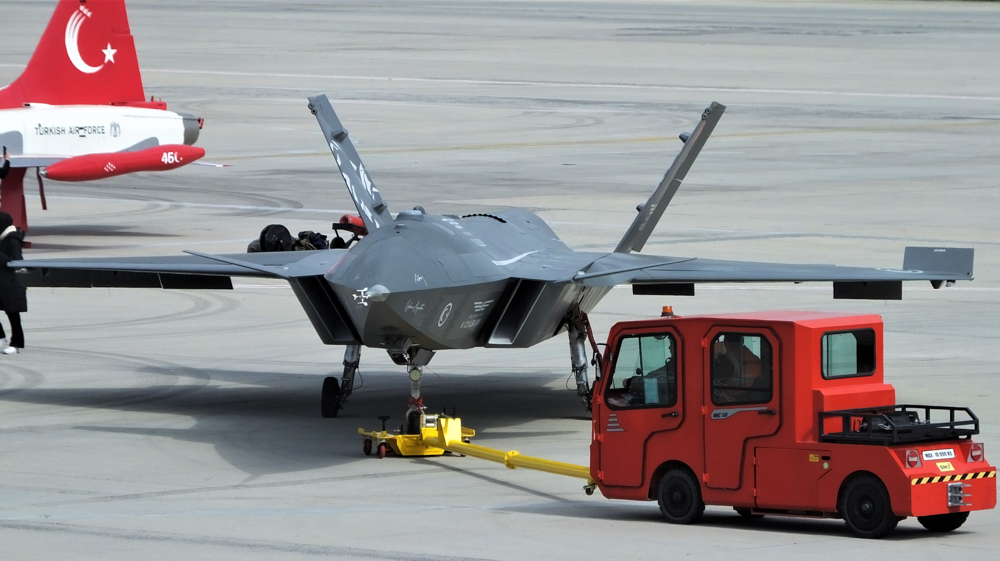
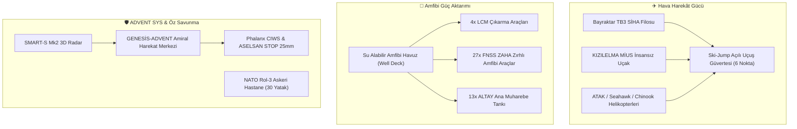

# 🚢 Proje: TCG ANADOLU (L-400) - Çok Maksatlı Amfibi Hücum Gemisi

[-00e676?style=for-the-badge&logo=shield)](../../../README.md)
[-0077be?style=for-the-badge&logo=target)](../../README.md)

  

---

### 🛡️ Stratejik Tanım & Doktriner Öncelik
TCG ANADOLU (L-400), Türk Deniz Kuvvetleri'nin amiral gemisi ve en büyük tonajlı muharip platformudur. SEDEF Tersanesi ana yükleniciliğinde, Navantia iş birliği ve ASELSAN-HAVELSAN milli sistem entegrasyonuyla Tuzla'da inşa edilmiştir. Çok Maksatlı Amfibi Hücum Gemisi (LHD) sınıfında yer alan gemi; Türkiye'nin F-35B ambargosu sonrası geliştirdiği çığır açıcı doktrinle **Dünyanın İlk SİHA Gemisi** unvanını kazanmıştır. Ege, Akdeniz ve Karadeniz'in ötesinde; Hint Okyanusu ve Atlantik'te tabur büyüklüğünde bir amfibi kuvveti hava, kara ve amfibi çıkarma unsurlarıyla birlikte kriz bölgelerine intikal ettirebilen, bünyesindeki 30 yataklı tam teşekküllü askerî hastanesiyle insani yardım ve tahliye harekâtı yönetebilen küresel güç aktarım platformudur.

---

### 📊 Kapsamlı Teknik Özellikler Tablosu

| Parametre | Değer / Özellik | Açıklama |
| :--- | :--- | :--- |
| **Gemi Sınıfı** | LHD / Çok Maksatlı Amfibi Hücum & SİHA Gemisi | Ski-Jump rampalı uçuş güvertesi |
| **Tam Boy / Genişlik** | 231 Metre / 32 Metre | Draft: 6.9 Metre |
| **Deplasman** | 27.436 Ton (Tam Yüklü) | Türk Donanmasının en büyük gemisi |
| **Azami Sürat** | 21+ Knot | Ekonomik Hız: 16 Knot |
| **Seyir Siası (Menzil)** | 9.000 Deniz Mili (16 Knot ile) | Yakıt ikmali yapmaksızın okyanus aşırı |
| **Tahrik Sistemi** | Dizel-Jeneratör + 2 x 11 MW Siemens e-Pod | 360° dönebilen azimut iticiler |
| **Hava Araçları Kapasitesi**| 30-50 Hava Aracı (TB3, KIZILELMA, Helikopterler)| Uçuş güvertesinde 6 iniş/kalkış noktası |
| **Amfibi Havuz Kapasitesi**| 4 x LCM (Mekanize Çıkarma Aracı) veya 2 x LCAC | Su alabilir amfibi havuz (Well Deck) |
| **Araç Güvertesi** | 94 Zırhlı Araç (13 Tank, 27 ZAHA, ZPT/ZMA vb.) | 1 Amfibi Deniz Piyade Taburu (1.200 asker)|
| **Tıbbi Kapasite** | 30 Yataklı Askerî Hastane (2 Ameliyathane + Yoğun Bakım)| NATO Rol-3 seviyesinde hastane |

---

### 🧩 Alt Sistemler ve Aviyonik/Elektronik Entegrasyonu
- **Savaş Yönetim Sistemi:** HAVELSAN GENESİS-ADVENT LHD Savaş Yönetim Sistemi (Amfibi harekat, hava trafiği kontrolü ve amiral komuta merkezi entegrasyonu).
- **Radar ve Durumsal Farkındalık:** Thales SMART-S Mk2 3B Hava ve Su Üstü Arama Radarı, SPN-720 Hassas Yaklaşma Radarı (PAR) ve ARPA Seyir Radarları.
- **Kızılötesi Arama & Takip:** ASELSAN PİRİ KATS 360° Kızılötesi Arama ve Takip Sistemi.
- **Elektronik Harp & Savunma:** ASELSAN ARES-2N Radar ED Sistemi, KORKUT-D / Chaff-Flare Dekoy Atıcılar ve Torpido Aldatma Sistemi.
- **Aviyonik & SİHA Kontrol:** Baykar TB3 ve KIZILELMA SİHA Komuta Kontrol İstasyonu; otomatik kalkış/iniş mandal ve telemetri veri bağı altyapısı.

---

### 🎯 Görev Profili, Muharebe Senaryoları & Mühimmat Yelpazesi
- **Dünyanın İlk SİHA/STOVL Hava Harekâtı:** Bayraktar TB3 katlanır kanatlı SİHA'lar ve KIZILELMA insansız savaş uçakları ile deniz aşırı hava taarruzu ve istihbarat.
- **Amfibi Hücum & Kıyı Çıkarma:** Bünyesindeki FNSS ZAHA (Zırhlı Amfibi Hücum Araçları) ve çıkarma botlarıyla amfibi piyade taburunu düşman kıyısına çıkarma.
- **Döner Kanat Hava Desteği:** T-129 ATAK, AH-1W Super Cobra taarruz helikopterleri, S-70B Seahawk DSH ve CH-47F Chinook ağır nakliye helikopteri operasyonları.
- **Nokta Savunma:** 2 x Phalanx Block 1B CIWS, 3 x 25 mm ASELSAN STOP stabilize top sistemi ve Aselsan uçaksavar kuleleri.

---

### 📐 Özel Sistem Mimarisi & Harekât Modülü

---

### 🚀 TRL Seviyesi ve Gelişim Yol Haritası
**Mevcut Olgunluk Seviyesi: TRL 9 (Donanma Hizmetinde & Muharebeye Hazır Amiral Gemisi)**
- [x] SEDEF Tersanesi'nde omurga kızağa konulması ve denize iniş
- [x] Deniz ve liman kabul tecrübelerinin tamamlanması
- [x] 10 Nisan 2023 itibarıyla Türk Deniz Kuvvetleri'ne resmi teslimat
- [x] Bayraktar TB3'ün TCG ANADOLU güvertesinden ilk otonom kalkış ve iniş başarısı (Kasım 2024)
- [ ] KIZILELMA SİHA gemi üzeri iniş-kalkış testleri ve tam filo konuşlanması

---
[⬅️ Üst Dizine](../README.md) | [🏛️ Dominion Hub](../../README.md) | [🏠 Ana Sayfa](../../../README.md)\n