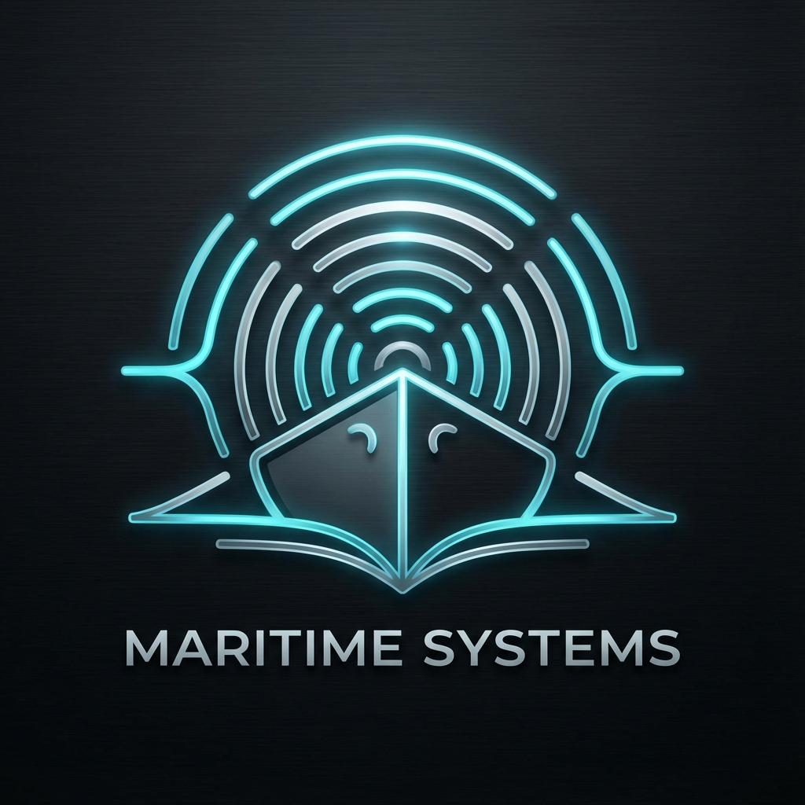
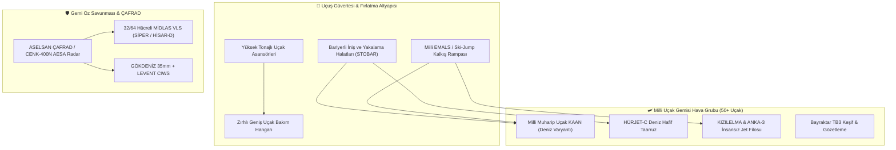

# 🚢 Proje: TCG TRAKYA (Milli Uçak Gemisi / Fleet Aircraft Carrier)

[-6c757d?style=for-the-badge&logo=shield)](../../../README.md)
[-0077be?style=for-the-badge&logo=target)](../../README.md)

  

---

### 🛡️ Stratejik Tanım & Doktriner Öncelik
TCG TRAKYA, Türk Deniz Kuvvetleri Komutanlığı Dizayn Proje Ofisi (DPO) tarafından konsept tasarımı yürütülen, Türkiye'nin ilk tam teşekküllü Milli Uçak Gemisi (Fleet Aircraft Carrier) projesidir. TCG ANADOLU amfibi gemisinden elde edilen tecrübeler ışığında; amfibi havuz taşımayan, saf hava üstünlüğü ve stratejik caydırıcılık odaklı, 60.000 ton sınıfında yüzen bir hava üssü olarak planlanmıştır. STOBAR (Kısa Kalkış / Bariyerli İniş) veya CATOBAR (Mancınıkla Kalkış / Bariyerli İniş) mimarisinde inşa edilecek olan gemi; KAAN Milli Muharip Uçak deniz varyantı, HÜRJET-C hafif taarruz uçağı, KIZILELMA ve ANKA-3 insansız savaş uçaklarını bünyesinde barındırarak Türkiye'yi dünya üzerinde okyanus aşırı hava filosu projeksiyonu yapabilen sayılı küresel süper güçler arasına yerleştirecektir.

---

### 📊 Kapsamlı Teknik Özellikler Tablosu

| Parametre | Değer / Özellik (Hedeflenen) | Açıklama |
| :--- | :--- | :--- |
| **Gemi Sınıfı** | Konvansiyonel / Hibrit Tahrikli Milli Uçak Gemisi (CV) | Açılı pist & Ski-Jump / EMALS rampası |
| **Tam Boy / Genişlik** | ~285 - 300 Metre / ~72 Metre | Draft: ~10 Metre |
| **Deplasman** | ~50.000 - 60.000 Ton (Tam Yüklü) | TCG Anadolu'nun 2 katından fazla |
| **Azami Sürat** | 25 - 28+ Knot | Hızlı intikal ve rüzgar hızı avantajı |
| **Seyir Siası (Menzil)** | 10.000+ Deniz Mili | Kesintisiz okyanus aşırı menzil |
| **Tahrik Mimarisi** | COGAG (4 x Gaz Türbini) veya Entegre Elektrik (IEP) | Yüksek megawatt elektrik üretimi |
| **Hava Aracı Kapasitesi**| 50+ Muharip Uçak, SİHA ve Helikopter | Geniş iç hangar ve iki katlı asansör |
| **Pist Mimarisi** | Açılı İniş Pisti + Yakalama Halatları (Arrester Wires)| Eş zamanlı kalkış ve iniş olanağı |
| **Mürettebat** | ~1.500 - 2.000 Personel (Gemi ve Hava Grubu) | Yüksek konfor ve otonom lojistik |

---

### 🧩 Alt Sistemler ve Aviyonik/Elektronik Entegrasyonu
- **Savaş Yönetim Sistemi:** ADVENT-CV Amiral Savaş Yönetim Sistemi (Çoklu görev grubu komuta ve müşterek hava harekat merkezi altyapısı).
- **Radar ve Sensör Süiti:** ASELSAN ÇAFRAD (Çok Amaçlı Faz Dizili Radar) veya CENK-400N AESA uzun menzilli hava gözetleme radarı; yüzlerce hava hedefini 450+ km mesafeden eşzamanlı takip.
- **İniş & Kalkış Destek Sistemleri:** Yerli ve milli elektromanyetik uçak fırlatma sistemi (EMALS) veya Ski-Jump rampası; optik iniş yönlendirme sistemi (FLOLS) ve gelişmiş bariyer/yakalama halatları.
- **Elektronik Harp & Savunma:** Entegre Çok Katmanlı Elektronik Harp Süiti, Lazer Silah Sistemleri ve Çelik Kubbe Deniz entegrasyonu.

---

### 🎯 Görev Profili, Muharebe Senaryoları & Mühimmat Yelpazesi
- **Milli Uçak Gemisi Hava Grubu:**
  - KAAN Deniz Varyantı (5. Nesil Hayalet Uçak)
  - HÜRJET-C (Hafif Taarruz ve Yakın Hava Desteği)
  - BAYKAR KIZILELMA (İnsansız Savaş Uçağı)
  - TUSAŞ ANKA-3 (Derin Taarruz Uçan Kanat SİHA)
  - BAYKAR TB3 (Keşif ve Lojistik SİHA)
  - TUSAŞ GÖKBEY ve ATAK-2 Denizaltı Savunma & Kurtarma Helikopterleri
- **Öz Savunma Sistemi:** MİDLAS 32/64 Hücreli VLS (HİSAR-D RF & SİPER Blok füzeleri), ASELSAN GÖKDENİZ CIWS ve ROKETSAN LEVENT yakın hava savunma füzeleri.

---

### 📐 Özel Sistem Mimarisi & Konsept Uçuş Güvertesi

---

### 🚀 TRL Seviyesi ve Gelişim Yol Haritası
**Mevcut Olgunluk Seviyesi: TRL 1 (Kavramsal Tasarım ve Fizibilite Fazı)**
- [x] Deniz Kuvvetleri Komutanlığı Dizayn Proje Ofisi (DPO) bünyesinde tasarım başlangıcı
- [x] Konsept boyut, tonaj ve hava grubu simülasyonlarının yapılması
- [ ] Ön tasarım ve havuz hidrodinamik gövde modelleme testleri
- [ ] EMALS mancınık ve arrestör teli mekanik Ar-Ge çalışmaları
- [ ] Tersane seçimi, sac kesimi ve kızakta inşa fazı

---
[⬅️ Üst Dizine](../README.md) | [🏛️ Dominion Hub](../../README.md) | [🏠 Ana Sayfa](../../../README.md)\n