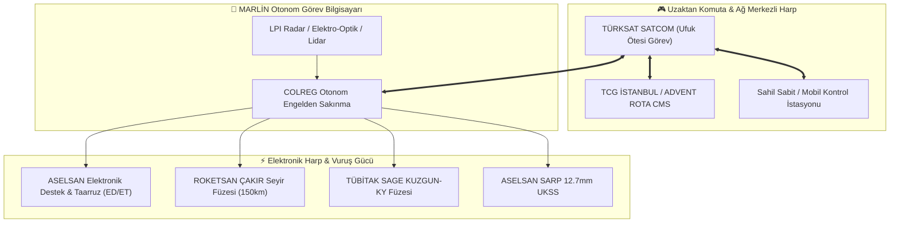

# 🐬 Proje: MARLİN SİDA (Elektronik Harp Destekli Silahlı İnsansız Deniz Aracı)

[

  

-00e676?style=for-the-badge&logo=shield)](../../../README.md)
[-0077be?style=for-the-badge&logo=target)](../../README.md)

  

---

### 🛡️ Stratejik Tanım & Doktriner Öncelik
MARLİN SİDA, Sefine Tersanesi ve ASELSAN iş birliğiyle Savunma Sanayii Başkanlığı koordinasyonunda geliştirilen, **dünyanın elektronik harp kabiliyetine sahip ilk insansız su üstü aracıdır**. Adını açık denizlerin en hızlı ve yırtıcı balıklarından biri olan Marlin'den alan platform; Portekiz'de düzenlenen NATO REPMUS ve Dynamic Messenger tatbikatlarında uluslararası deniz kuvvetlerinin radar ve telsiz muhaberelerini felç ederek küresel ölçekte takdir toplamıştır. Yüksek denizcilik kabiliyetine (Deniz Durumu 5'e kadar kesintisiz görev) sahip olan MARLİN; kıyı savunmasından açık deniz görev gruplarının korunmasına, asimetrik su üstü harbinden (SÜH) denizaltı savunma harbine (DSH) kadar geniş bir yelpazede sürü zekası ve tam otonomiyle görev icra eder.

---

### 📊 Kapsamlı Teknik Özellikler Tablosu

| Parametre | Değer / Özellik | Açıklama |
| :--- | :--- | :--- |
| **Araç Tipi** | Silahlı & Elektronik Harp İnsansız Deniz Aracı (SİDA) | Trimaran / Kompozit Gövde |
| **Tam Boy / Genişlik** | 15 Metre / 3.85 Metre | Yüksek stabilite ve alabora olmama |
| **Deplasman** | ~21 Ton | Modüler faydalı yük taşıma kapasitesi |
| **Azami Sürat** | 36 - 40+ Knot | Yüksek hızlı taarruz ve intikal |
| **Seyir Siası (Menzil)** | 400+ Deniz Mili | 72 Saate kadar kesintisiz denizde kalış |
| **Tahrik Sistemi** | 2 x Marin Dizel Motor + Su Jeti Sevk Sistemi | Yüksek manevra ve sığ sulara giriş |
| **Denizcilik Kabiliyeti**| Deniz Durumu 4-5 şartlarında operasyon | Ağır dalga koşullarında otonom stabilizasyon|
| **Faydalı Yük Kapasitesi**| ~4.000 kg (Silah, Sensör ve Elektronik Harp)| Modüler görev kuleleri |

---

### 🧩 Alt Sistemler ve Aviyonik/Elektronik Entegrasyonu
- **Dünyada İlk SİDA Elektronik Harp Süiti:** ASELSAN tarafından özel olarak minyatürize edilen Radar Elektronik Destek (ED/ESM) ve Elektronik Taarruz (ET/ECM) sistemi; düşman gemilerinin radarlarını kör etme ve haberleşmelerini karıştırma yeteneği.
- **Otonom Seyrüsefer & Algılama:** ASELSAN LPI Radar, Termal/Gündüz Elektro-Optik Kamera Süiti, Lidar ve AIS alıcıları; COLREG (Denizde Çatışmayı Önleme Tüzüğü) kurallarına tam uyumlu otonom engelden sakınma.
- **Haberleşme & Uydu Veri Bağı:** TÜRKSAT Uydu Muhabere (SATCOM) sistemi ile ufuk ötesi (BLOS) kesintisiz kontrol; geniş bantlı kriptolu RF LOS veri bağı.
- **Savaş Yönetim Sistemi Entegrasyonu:** HAVELSAN ADVENT ROTA SİDA Komuta Kontrol Yazılımı ile fırkateynlerden ve karadan filo eşgüdümlü sürü harekâtı.

---

### 🎯 Görev Profili, Muharebe Senaryoları & Mühimmat Yelpazesi
- **Elektronik Harp Perdesi Oluşturma:** Ana filonun önünde seyrederek düşman kıyı radarlarını ve gemi sensörlerini yanıltıcı elektronik taarruz uygulama, sahte hedefler üreterek düşman füzelerini üzerine çekme.
- **Hassas Güdümlü Taarruz:**
  - 4 x TÜBİTAK SAGE KUZGUN-KY (Katı Yakıtlı) Güdümlü Mermisi
  - ROKETSAN ÇAKIR Seyir Füzesi (150+ km menzil)
  - 1 x 12.7 mm ASELSAN SARP Stabilize Uzaktan Komutalı Silah Sistemi
- **Denizaltı Savunma Harbi (DSH):** Daldırılabilir hafif aktif sonar ve hafif torpido (ORKA) entegrasyonu ile liman ağızlarında denizaltı pususu kurma.

---

### 📐 Özel Sistem Mimarisi & Otonom Harekât

---

### 🚀 TRL Seviyesi ve Gelişim Yol Haritası
**Mevcut Olgunluk Seviyesi: TRL 9 (Muharebede Kanıtlanmış & Envanterde)**
- [x] Gövde inşası, denize iniş ve otonomi yazılımlarının kalifikasyonu
- [x] KUZGUN güdümlü mühimmatı ile denizden hedefe başarılı atış testi
- [x] NATO REPMUS ve Dynamic Messenger 2022 tatbikatlarında fiili başarı
- [x] Türk Deniz Kuvvetleri envanterine resmi kabul ve teslimat
- [ ] ÇAKIR seyir füzesi atış testleri ve çoklu SİDA sürü görevleri

---
[⬅️ Üst Dizine](../README.md) | [🏛️ Dominion Hub](../../README.md) | [🏠 Ana Sayfa](../../../README.md)\n