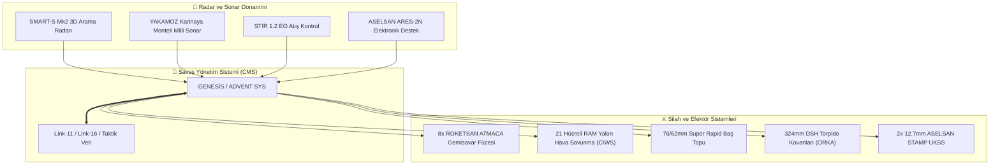

# 🚢 Proje: MİLGEM ADA Sınıfı Korvet (TCG Heybeliada / Büyükada / Burgazada / Kınalıada)

[

  

-00e676?style=for-the-badge&logo=shield)](../../../README.md)
[-0077be?style=for-the-badge&logo=target)](../../README.md)

  

---

### 🛡️ Stratejik Tanım & Doktriner Öncelik
MİLGEM ADA Sınıfı Korvet Projesi, modern Türkiye Cumhuriyeti savunma sanayiinin kırılma noktası ve donanma bağımsızlığımızın temel taşıdır. STM'nin ana yüklenici ve mühendislik koordinasyonunda, İstanbul Tersanesi Komutanlığı'nda inşa edilen 4 korvet (TCG HEYBELİADA F-511, TCG BÜYÜKADA F-512, TCG BURGAZADA F-513, TCG KINALIADA F-514); Türk mühendislerinin bir savaş gemisini baştan sona tasarlayıp inşa edebildiğini dünyaya kanıtlamıştır. Düşük radar izine (stealth form), üstün denizaltı savunma harbi (DSH) ve su üstü harbi (SÜH) yeteneklerine sahip olan gemiler; Mavi Vatan'ın Ege ve Doğu Akdeniz'deki hak ve menfaatlerinin korunmasında filomuzun omurgasını oluşturmaktadır. Seri aynı zamanda Ukrayna (Hetman Ivan Mazepa) ve Pakistan (Babur sınıfı) donanmalarına ihraç edilerek küresel bir marka haline gelmiştir.

---

### 📊 Kapsamlı Teknik Özellikler Tablosu

| Parametre | Değer / Özellik | Açıklama |
| :--- | :--- | :--- |
| **Gemi Sınıfı** | ADA Sınıfı Çok Maksatlı Stealth Korvet | Monohull stealth tasarım |
| **Tam Boy / Genişlik** | 99.5 Metre / 14.4 Metre | Draft: 3.9 Metre |
| **Deplasman** | ~2.400 Ton (Tam Yüklü) | Yüksek manevra kabiliyeti |
| **Azami Sürat** | 29+ Knot | Ekonomik Seyir Hızı: 15 Knot |
| **Seyir Siası (Menzil)** | 3.500 Deniz Mili (15 Knot ile) | 21 gün denizde lojistiksiz görev |
| **Tahrik Sistemi** | CODAG (1 x GE LM2500 Gaz Türbini + 2 x MTU Dizel) | Çift şaft / CPP pervaneler |
| **Mürettebat** | 93 Personel (Hava personeli dahil) | Yüksek yaşam standardı |
| **Hava Unsuru** | 1 x 10 Tonluk S-70B Seahawk Helikopteri + İHA | Tam teşekküllü hangar ve platform |

---

### 🧩 Alt Sistemler ve Aviyonik/Elektronik Entegrasyonu
- **Savaş Yönetim Sistemi:** HAVELSAN GENESİS (F-511, F-512, F-513) ve yeni nesil ADVENT SYS (TCG Kınalıada'da ilk kez entegre edildi).
- **Arama Radarı:** Thales SMART-S Mk2 3B E/F Bant Arama Radarı (250 km menzil).
- **Atış Kontrol:** ASELSAN/Thales STIR 1.2 EO Atış Kontrol Radarı.
- **Sonar:** Meteksan Savunma YAKAMOZ Karinalı Milli Sonar Süiti (Gelişmiş denizaltı tespit ve takip algoritmaları).
- **Elektronik Harp & Karşı Tedbirler:** ASELSAN ARES-2N Radar ED Süiti, Lazer İkaz Alıcı ve Mk 36 SRBOC Chaff/Flare atıcı lançerleri.
- **Torpido Savunması:** Aselsan HIZIR Torpido Karşı Tedbir ve Aldatma Sistemi.

---

### 🎯 Görev Profili, Muharebe Senaryoları & Mühimmat Yelpazesi
- **Vurucu Su Üstü Gücü:** 8 x ROKETSAN ATMACA Güdümlü Mermisi (TCG Kınalıada'da ilk kez Harpoon yerine milli ATMACA entegre edildi).
- **Baş Topu:** 1 x 76/62 mm Leonardo Super Rapid çok amaçlı top.
- **Nokta Hava Savunması:** 1 x 21 Hücreli RAM (Rolling Airframe Missile) PDMS füze lançeri.
- **Asimetrik Tehdit Önleme:** 2 x 12.7 mm ASELSAN STAMP Uzaktan Kumandalı Stabilize Makinalı Tüfek Sistemi.
- **Denizaltısavar Mühimmatı:** 2 x İkiz 324 mm Mk 32 torpido kovanı (Mk 46/54 ve ROKETSAN ORKA torpidoları).

---

### 📐 Özel Sistem Mimarisi & MİLGEM Muharebe Süiti

---

### 🚀 TRL Seviyesi ve Gelişim Yol Haritası
**Mevcut Olgunluk Seviyesi: TRL 9 (Donanmada Aktif & Küresel İhracat Başarısı)**
- [x] TCG HEYBELİADA (F-511) - 2011 Hizmete Giriş
- [x] TCG BÜYÜKADA (F-512) - 2013 Hizmete Giriş
- [x] TCG BURGAZADA (F-513) - 2018 Hizmete Giriş
- [x] TCG KINALIADA (F-514) - 2019 Hizmete Giriş (ADVENT & ATMACA ile donatıldı)
- [x] Pakistan ve Ukrayna donanmalarına ihracat gemilerinin inşası ve teslimatları

---
[⬅️ Üst Dizine](../README.md) | [🏛️ Dominion Hub](../../README.md) | [🏠 Ana Sayfa](../../../README.md)\n