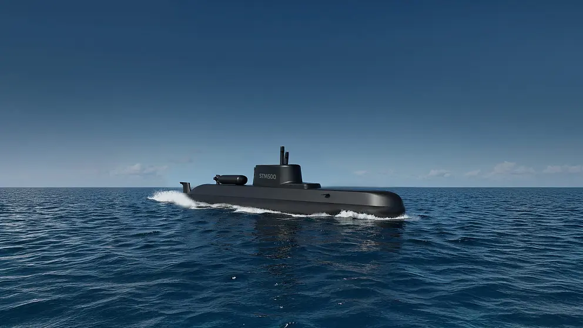
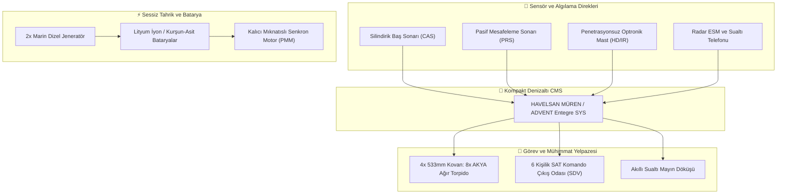

# 🦈 Proje: STM500 (Küçük Tonajlı Sığ Su Taarruz Denizaltısı)

[-f77f00?style=for-the-badge&logo=shield)](../../../README.md)
[-0077be?style=for-the-badge&logo=target)](../../README.md)

  

---

### 🛡️ Stratejik Tanım & Doktriner Öncelik
STM500, STM mühendisleri tarafından kavramsal ve detay tasarımı tamamen yerli kaynaklarla geliştirilen, sığ sularda ve adalar denizinde operasyon icra edebilmek üzere optimize edilmiş 500 ton sınıfı kompakt bir dizel-elektrik taarruz denizaltısıdır. Geleneksel 2.000-3.000 tonluk ağır denizaltıların draft ve akustik yankılanma nedeniyle intikal edemediği kıyı sularında, boğazlarda ve dar kanal hatlarında fısıltı sessizliğinde görev yapabilir. Özel Kuvvetler (SAT/SAS) timlerinin düşman kıyılarına sızdırılması, mayın döküşü, istihbarat toplama ve ağır torpidolarla su üstü/denizaltı hedeflerini imha etme yeteneğine sahiptir. Mukavim tekne test bloğu başarıyla üretilen proje; Türkiye'nin küçük tonajlı denizaltı pazarında küresel bir ihracat aktörü olmasını sağlayacaktır.

---

### 📊 Kapsamlı Teknik Özellikler Tablosu

| Parametre | Değer / Özellik | Açıklama |
| :--- | :--- | :--- |
| **Gemi Sınıfı** | Küçük Tonajlı Dizel-Elektrik Sığ Su Denizaltısı (SSK) | Kompakt mukavim gövde |
| **Boy / Genişlik** | 42 Metre / 4.2 Metre | Yükseklik: 8.5 Metre |
| **Deplasman** | 485 Ton (Su Üstü) / ~540 Ton (Dalmış) | Sığ sularda yüksek manevra kabiliyeti |
| **Azami Dalmış Sürat** | 18+ Knot | Ekonomik Seyir Hızı: 5 Knot |
| **Seyir Siası (Menzil)** | 3.500 - 4.000 Deniz Mili (Dizel ile) | Dalmışken: 75 NM (Batarya ile) |
| **Dalış Derinliği** | 200+ Metre (Operasyonel) | Test derinliği: 250+ Metre |
| **Denizde Kalış Süresi** | 30 Gün | Lojistik ikmalsiz görev süresi |
| **Mürettebat Kapasitesi** | 18 Personel + 6 Özel Kuvvet (SAT Timi) | 24 Yatak kapasitesi |
| **Tahrik Sistemi** | Kalıcı Mıknatıslı Elektrik Motoru (~1.5 MW) | 2 x Dizel Jeneratör + Li-Ion / Kurşun-Asit |

---

### 🧩 Alt Sistemler ve Aviyonik/Elektronik Entegrasyonu
- **Savaş Yönetim Sistemi:** HAVELSAN kompakt MÜREN / ADVENT türevi entegre denizaltı komuta kontrol sistemi.
- **Akustik Sensörler (Sonar Süiti):** Silindirik Sonar Dizini (CAS), Pasif Mesafeleme Sonarı (PRS), Kavitasyon İzleme ve Kesme Sonarı.
- **Optronik & Periskop Direkleri:** Penetrasyonsuz elektro-optik keşif ve gözetleme mastı (Termal/HD) ile radar/telsiz ESM direği.
- **Muhabere Altyapısı:** Sualtı telefon sistemleri, VLF/HF alıcıları ve şnorkel derinliğinde uydu bağlantısı (SATCOM).
- **Akustik İzolasyon:** Şok emici takozlar üzerine monte edilmiş elastik jeneratör ve makine temelleri ile son derece düşük akustik iz.

---

### 🎯 Görev Profili, Muharebe Senaryoları & Mühimmat Yelpazesi
- **Özel Harekât Sızması:** Gövdeye entegre hava kilitli çıkış kompartımanından 6 kişilik tam teçhizatlı SAT komando timini ve sualtı intikal araçlarını (SDV) gizlice düşman kıyısına ulaştırma.
- **Torpidolu Taarruz:** 4 adet 533 mm torpido kovanı; 4 adedi kovanda, 4 adedi cephanelikte olmak üzere toplam 8 adet ROKETSAN AKYA ağır torpidosu veya güdümlü füze atma kabiliyeti.
- **Gizli Mayın Döküşü:** Kovanlardan atılan dip mayınlarıyla kritik boğaz hatlarını ve liman çıkışlarını habersizce abluka altına alma.
- **Kıyı Karakol & Dinleme:** Kendi motorlarını kapatıp batarya modunda deniz tabanına oturarak düşman su üstü konvoylarını pasif sonar tarlasıyla gözetleme.

---

### 📐 Özel Sistem Mimarisi & Sığ Su Görev Modülü

---

### 🚀 TRL Seviyesi ve Gelişim Yol Haritası
**Mevcut Olgunluk Seviyesi: TRL 6 (Sistem / Prototip Model Doğrulama)**
- [x] Kavramsal tasarım ve boyutlandırma çalışmalarının tamamlanması
- [x] Hidrodinamik gövde simülasyonları ve mukavim tekne hesaplamaları
- [x] Mukavim tekne test bloğu üretimi ve kaynak testlerinin icrası (2022)
- [ ] İlk prototipin kızağa konulması ve sistem donatımı
- [ ] Deniz tecrübeleri, dalış testleri ve torpido kabul atışları

---
[⬅️ Üst Dizine](../README.md) | [🏛️ Dominion Hub](../../README.md) | [🏠 Ana Sayfa](../../../README.md)\n