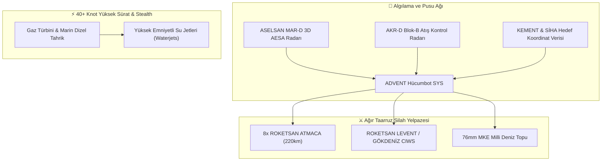

# ⚡ Proje: STM-MPAC (Milli Hücumbot / Multi-Purpose Attack Craft)

[

  

-7209b7?style=for-the-badge&logo=shield)](../../../README.md)
[-0077be?style=for-the-badge&logo=target)](../../README.md)

  

---

### 🛡️ Stratejik Tanım & Doktriner Öncelik
STM-MPAC (Multi-Purpose Attack Craft), Türk Deniz Kuvvetleri'nin Türk Tipi Hücumbot Projesi ihtiyacını karşılamak üzere STM tarafından özgün olarak tasarlanan yeni nesil ağır silahlı yüksek hızlı hücumbottur. Özellikle Ege Adalar Denizi'nin coğrafi yapısına, dar boğazlara ve kıyı şeritlerine uygun olarak geliştirilmiştir. 40+ knot'ı aşan yüksek sürati, son derece düşük radar kesit alanı (stealth geometri) ve fırkateyn seviyesindeki ağır taarruz silahları sayesinde; "Vur-Kaç (Hit-and-Run)" doktrini çerçevesinde düşman unsurlarını yıldırım hızıyla imha edip güvenli kıyı hatlarına çekilme kabiliyetine sahiptir. Eski nesil Kılıç ve Doğan sınıfı hücumbotların yerini alacak olan MPAC; modern hava savunma füzeleri ve ATMACA mühimmatı ile donatılmıştır.

---

### 📊 Kapsamlı Teknik Özellikler Tablosu

| Parametre | Değer / Özellik | Açıklama |
| :--- | :--- | :--- |
| **Gemi Sınıfı** | Yeni Nesil Çok Maksatlı Hücumbot (FAC / MPAC) | Monohull stealth gövde formu |
| **Tam Boy / Genişlik** | 60 - 66 Metre / 9.2 Metre | Draft: 2.2 Metre (Sığ sulara giriş) |
| **Deplasman** | ~600 - 700 Ton (Tam Yüklü) | Hafif ve yüksek mukavemetli çelik/alaşım |
| **Azami Sürat** | 40 - 45+ Knot | Çok yüksek reaksiyon ve intikal sürati |
| **Seyir Siası (Menzil)** | 1.000+ Deniz Mili (20 Knot ile) | Adalar Denizi ve Karadeniz operasyon çapı |
| **Tahrik Sistemi** | CODAG (Gaz Türbini + Dizel Motorlar) + Su Jetleri | Şaft-pervane yerine yüksek verimli su jeti |
| **Mürettebat** | ~35 - 40 Personel | Yüksek otomasyonlu kontrol |
| **Denizcilik Kabiliyeti**| Deniz Durumu 5'te görev icra edebilme | Ağır deniz koşullarında stabil seyir |

---

### 🧩 Alt Sistemler ve Aviyonik/Elektronik Entegrasyonu
- **Savaş Yönetim Sistemi:** HAVELSAN ADVENT SYS (Hücumbot varyantı; fırkateynler ve SİHA'larla müşterek hedef tespiti ve koordineli salvo atış).
- **Radar Donanımı:** ASELSAN MAR-D 3B AESA Arama Radarı (Düşük radar kesit alanına sahip küçük hedefleri dahi 100+ km'den tespit).
- **Atış Kontrol:** ASELSAN AKR-D Blok-B radar ve entegre elektro-optik atış kontrol direktörü.
- **Elektronik Harp & Savunma:** ASELSAN Radar ED/ET süiti ve Lazer İkaz Alıcılar + Şok emici Chaff/Flare dekoy atıcılar.
- **Taktik Haberleşme:** KEMENT veri bağı, Link-16 ve uydu muhabere (SATCOM) terminalleri.

---

### 🎯 Görev Profili, Muharebe Senaryoları & Mühimmat Yelpazesi
- **Yıldırım Su Üstü Taarruzu:** 8 x ROKETSAN ATMACA Gemisavar Füzesi ile adaların arkasına gizlenerek radar pusu kurma ve 220 km ötedeki hedef filoyu salvo atışla vurma.
- **Baş Topu Bombardımanı:** 1 x 76 mm MKE Milli Deniz Topu ile su üstü hedefleri ve sahil bataryalarını yüksek atım hızıyla ateş altına alma.
- **Öz Hava Savunması:** 1 x ROKETSAN LEVENT Yakın Hava Savunma Füze Sistemi (veya ASELSAN GÖKDENİZ 35 mm CIWS) ile yaklaşan füzeleri karşılama.
- **Asimetrik Savunma:** 2 x 12.7 mm ASELSAN STAMP / SANCAK stabilize uzaktan komutalı silah kuleleri.

---

### 📐 Özel Sistem Mimarisi & Vur-Kaç Doktrini

---

### 🚀 TRL Seviyesi ve Gelişim Yol Haritası
**Mevcut Olgunluk Seviyesi: TRL 7 (Sistem Prototip Doğrulama / Detay Tasarım)**
- [x] STM bünyesinde hidrodinamik tasarım ve kavitasyon havuz testleri
- [x] Savunma Sanayii Başkanlığı ve Dz.K.K. ile tasarım onay süreçleri
- [x] MAR-D AESA radarı ve ADVENT SYS arayüz kalifikasyonu
- [ ] Prototip gemi inşa sözleşmesi ve kızakta sac kesimi
- [ ] Deniz kabul testleri ve seri donatım safhası

---
[⬅️ Üst Dizine](../README.md) | [🏛️ Dominion Hub](../../README.md) | [🏠 Ana Sayfa](../../../README.md)\n