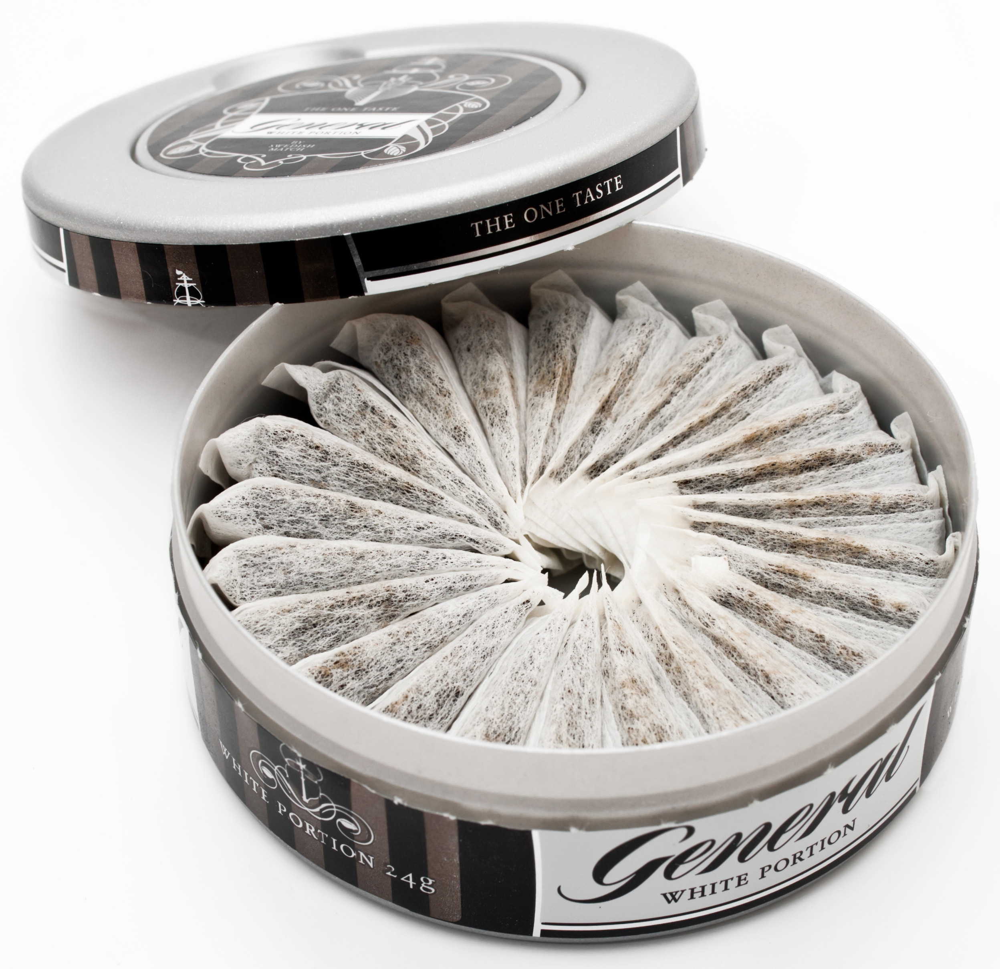
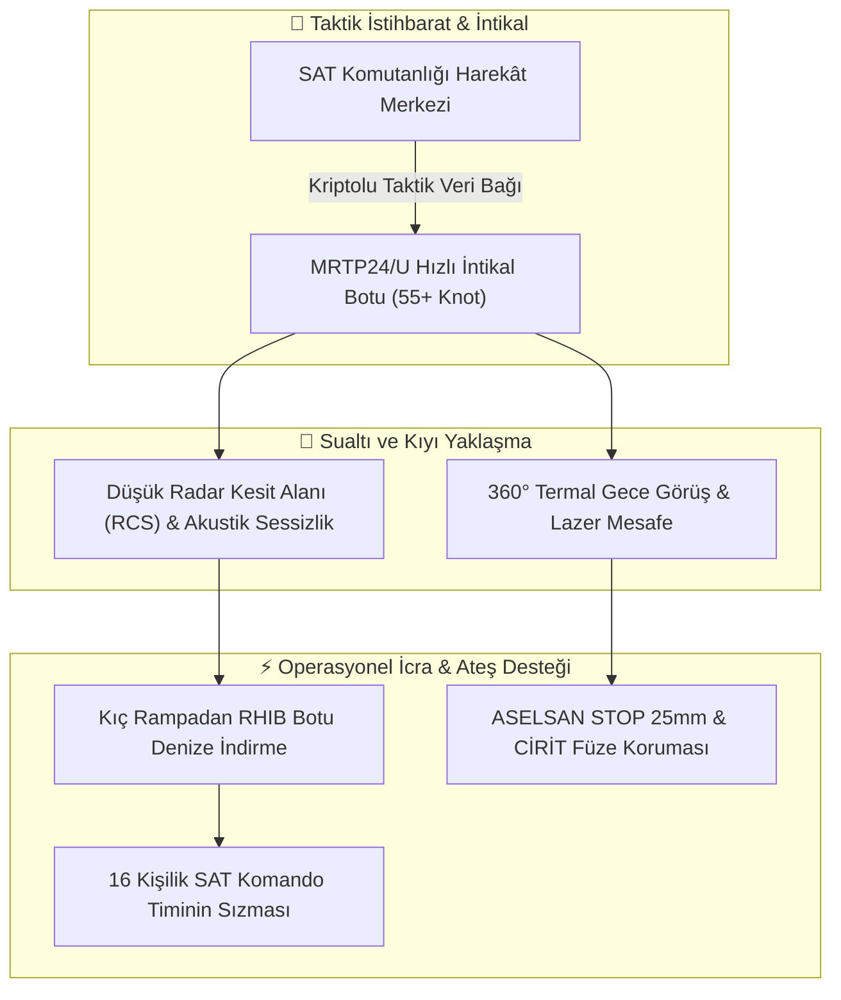

# ⚓ Proje: MRTP24/U (Yeni SAT Harekât ve Ani Müdahale Botu)

[-00e676?style=for-the-badge&logo=shield)](../../../README.md)
[-0077be?style=for-the-badge&logo=target)](../../README.md)

  

---

### 🛡️ Stratejik Tanım & Doktriner Öncelik
MRTP24/U, Yonca-Onuk Tersanesi tarafından Türk Deniz Kuvvetleri Su Altı Taarruz (SAT) Komutanlığı'nın kritik operasyonel gereksinimleri doğrultusunda özel olarak tasarlanıp inşa edilmiş ileri kompozit hızlı müdahale ve özel harekât intikal botudur. En zorlu deniz koşullarında 50-55+ knot üzeri süratle seyir yaparken dahi bünyesinde taşıdığı komando timinin fiziksel kondisyonunu koruyan özel şok sönümleyici koltuk sistemleriyle donatılmıştır. Düşük radar izi (RCS), düşük akustik ve termal imzası ile düşman kıyılarına fark edilmeden yaklaşabilen MRTP24/U; kıç tarafında bulunan hızlı bot indirme-kaldırma rampası, stabilize uzaktan komutalı silah kuleleri ve güdümlü mühimmatlarıyla özel harekât doktrinimizin en stratejik deniz vasıtasıdır.

---

### 📊 Kapsamlı Teknik Özellikler Tablosu

| Parametre | Değer / Özellik | Açıklama |
| :--- | :--- | :--- |
| **Gemi Tipi** | Hızlı Müdahale ve Özel Harekât Botu (SOC / Fast Intervention)| Derin V gövde geometrisi |
| **Tam Boy / Genişlik** | 24.5 Metre / 5.4 Metre | Draft: 1.1 Metre (Sığ sulara tam erişim) |
| **Deplasman** | ~55 Ton (Tam Yüklü) | Hafif ve dayanıklı kompozit yapı |
| **Azami Sürat** | 54 - 58+ Knot | Seyir Sürati: 35+ Knot |
| **Seyir Siası (Menzil)** | 500+ Deniz Mili | Operasyon bölgesinde uzun süre görev |
| **Gövde Malzemesi** | Gelişmiş Karbon/Aramid/Vinilester Kompozit | Balistik korumalı kokpit ve kabin |
| **Ana Tahrik Sistemi** | 2 x MTU 16V 2000 M94 Dizel Motor | Toplam ~5.200 HP güç |
| **Sevk Sistemi** | 2 x Arneson ASD15 Yüzey Delici Pervane (Surface Drive)| Azami itme verimi ve manevra |
| **Kapasite** | 5 Mürettebat + 16 Tam Teçhizatlı SAT Komandosu | Şok sönümlemeli Ullman koltuklar |
| **Taktik Bot Rampası** | Kıç güvertede 1 x Hızlı Şişme Bot (RHIB / Zodiac) | Harekât esnasında anında denize indirme|

---

### 🧩 Alt Sistemler ve Aviyonik/Elektronik Entegrasyonu
- **Balistik Zırh Koruması:** Kokpit ve komando kabini STANAG Seviye 1/2 standartlarında hafif kompozit panellerle zırhlandırılmıştır.
- **Şok Sönümleme Mimarisi:** Dalgaların oluşturduğu 6G'ye varan dikey ivmelenmeleri sönümleyen askeri standartta özel süspansiyonlu koltuk donanımı.
- **FLIR & Seyrüsefer:** Gyro-stabilize termal kamera (FLIR), gece görüş kameraları, yüksek çözünürlüklü arama radarı ve elektronik harita sistemi (ECDIS).
- **Haberleşme & Taktik Ağ:** Kriptolu VHF/UHF telsizler, uydu telefonu ve SAT harekât merkezine anlık görüntü aktaran veri bağı.

---

### 🎯 Görev Profili, Muharebe Senaryoları & Mühimmat Yelpazesi
- **Özel Kuvvet Baskın & Sızma:** Düşman kontrolündeki adalara, petrol platformlarına veya kıyı hedeflerine gece şartlarında radar izi vermeden saniyeler içinde yanaşarak SAT timini tahliye etme.
- **Ateş Destek Gücü:**
  - Başta: 1 x 25 mm ASELSAN STOP Uzaktan Kumandalı Stabilize Top
  - Kıç ve Borda: 2 x 12.7 mm ASELSAN STAMP veya el kumandalı makineli tüfekler
  - Füze Entegrasyonu: ROKETSAN CİRİT veya L-UMTAS lazer güdümlü hassas füzeler
- **Açık Deniz Rehin Kurtarma & VBSS:** Ticari gemilere deniz haydutları veya terör unsurları tarafından yapılan el koyma durumlarında gemiye bordalama (Visit, Board, Search, and Seizure - VBSS) harekâtı.

---

### 📐 Özel Sistem Mimarisi & SAT Harekât Akışı

---

### 🚀 TRL Seviyesi ve Gelişim Yol Haritası
**Mevcut Olgunluk Seviyesi: TRL 9 (Muharebede Kanıtlanmış & SAT Envanterinde Aktif)**
- [x] Türk Deniz Kuvvetleri SAT Komutanlığı gereksinimlerine göre tasarım
- [x] Kompozit gövde üretimi ve Arneson yüzey delici pervane entegrasyonu
- [x] Deniz kabul testleri ve tam hızda dalga stabilite doğrulamaları
- [x] Dz.K.K. envanterine teslimat ve aktif operasyonel görevler
- [ ] Yeni nesil otonom seyir ve insansız operasyon modülü entegrasyon çalışmaları

---
[⬅️ Üst Dizine](../README.md) | [🏛️ Dominion Hub](../../README.md) | [🏠 Ana Sayfa](../../../README.md)\n