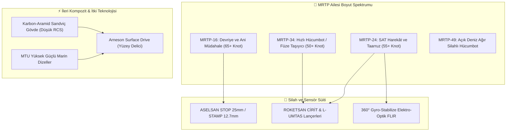

# 🚤 Proje: MRTP KAAN Sınıfı Hızlı Müdahale ve Hücumbot Ailesi

[

  

-00e676?style=for-the-badge&logo=shield)](../../../README.md)
[-0077be?style=for-the-badge&logo=target)](../../README.md)

  

---

### 🛡️ Stratejik Tanım & Doktriner Öncelik
MRTP (Multi Role Tactical Platform) KAAN Sınıfı Hızlı Müdahale ve Hücumbot Ailesi, Yonca-Onuk Tersanesi tarafından ileri teknoloji kompozit malzemeler (karbon-elyaf, vinilester, kevlar matriks) kullanılarak üretilen, "Denizlerin Ferrarisi" olarak tanınan efsanevi askeri bot serisidir. MRTP-16, MRTP-20, MRTP-24, MRTP-34 ve MRTP-45 gibi farklı tonaj ve boyuttaki platformlardan oluşan aile; 60 ila 70+ knot'ı aşan olağanüstü süratleri, patentli ONUK derin V karina formları ve dalga sönümleme yetenekleriyle dünya standartlarını belirlemiştir. Türk Sahil Güvenlik Komutanlığı ve Deniz Kuvvetleri'nin ana vurucu gücü olmanın yanı sıra; Katar, Birleşik Arap Emirlikleri, Gürcistan, Umman, Kuveyt ve Pakistan donanmalarına ihraç edilerek Türkiye'nin kompozit askeri gemi inşasında dünya lideri olmasını sağlamıştır.

---

### 📊 Kapsamlı Teknik Özellikler Tablosu (Genel Seri Spektrumu)

| Parametre | Değer / Özellik | Açıklama |
| :--- | :--- | :--- |
| **Platform Sınıfı** | Çok Maksatlı Taktik Kompozit Bot / Hücumbot (MRTP) | ONUK-KO Derin V tasarımı |
| **Boy Yelpazesi** | 16.5 Metre (MRTP-16) ila 47 Metre (MRTP-49) | Farklı taktik görev sınıfları |
| **Gövde Malzemesi** | İleri Kompozit (Karbon/Aramid/Epoksi Matriks) | Korozyonsuz, radar izi düşük, hafif |
| **Azami Sürat** | 55 - 70+ Knot (Modele göre 120+ km/s) | Torpido ve gemilerin çoğundan hızlı |
| **Seyir Siası (Menzil)** | 400 - 1.000 Deniz Mili | Yüksek hızda uzun intikal yarıçapı |
| **Tahrik Grubu** | 2 veya 3 x MTU Dizel Motor + Arneson Yüzey Delici / Su Jeti| Arneson Surface Drive teknolojisi |
| **Manevra Kabiliyeti** | Tam süratte 360° ani dönüş ve ani frenleme | Üstün hidrodinamik stabilite |
| **Silah Entegrasyonu** | 12.7 mm / 25 mm UKSS, CİRİT, L-UMTAS, ÇAKIR Füzeleri| Ağır vuruş gücüne sahip botlar |

---

### 🧩 Alt Sistemler ve Aviyonik/Elektronik Entegrasyonu
- **Gövde & Malzeme Mimarisi:** Yonca-Onuk tarafından geliştirilen ve patentlenen gelişmiş kompozit sandviç yapı; kurşun geçirmez balistik kabin zırhı ve düşük akustik/termal imza.
- **Arneson Surface Drive (Yüzey Delici Pervane):** Pervanelerin yarı batmış olarak çalıştığı yüksek verimli tahrik sistemi; kavitasyonu önleyerek sığ sularda dahi 60+ knot hızlara ivmelenme sağlar.
- **Sensör ve Radar Entegrasyonu:** Askeri X-Bant arama radarları, 360° FLIR elektro-optik gece/gündüz görüş kuleleri ve lazer mesafe ölçerler.
- **Taktik Komuta ve Muhabere:** Aselsan telsiz süitleri, Link veri hatları ve şok sönümleyici ergonomik pilot konsolları.

---

### 🎯 Görev Profili, Muharebe Senaryoları & Mühimmat Yelpazesi
- **Asimetrik Tehdit Önleme & Kıyı Baskını:** Düşman hücumbotlarına veya intihar teknelerine karşı yüksek süratle manevra yaparak ASELSAN STOP 25 mm veya STAMP 12.7 mm ile müdahale.
- **Lazer Güdümlü Füze Taarruzu:** ROKETSAN CİRİT (8 km) ve L-UMTAS (8 km) füzeleriyle zırhlı veya yumuşak kıyı ve su üstü hedeflerine cerrahi vuruş.
- **Özel Kuvvet Hızlı İntikali:** SAT komandolarını yüksek deniz durumunda dahi sarsıntısız ve fiziksel yorgunluk yaratmadan operasyon bölgesine sızdırma.
- **Düzensiz Göç ve Kaçakçılıkla Mücadele:** Açık denizde kaçan şüpheli yüksek hızlı sürat motorlarını rahatlıkla yakalama ve bordalama.

---

### 📐 Özel Sistem Mimarisi & Seri Yelpazesi

---

### 🚀 TRL Seviyesi ve Gelişim Yol Haritası
**Mevcut Olgunluk Seviyesi: TRL 9 (Muharebede Kanıtlanmış Seri Üretim & Küresel İhracat)**
- [x] Kompozit gövde prototip kalifikasyonu ve sürat rekorları
- [x] Türk Sahil Güvenlik Komutanlığı'na onlarca botluk teslimat
- [x] Türk Deniz Kuvvetleri SAT botu konfigürasyonlarının envantere girişi
- [x] Körfez ülkelerine (Katar, BAE vb.) yüz milyonlarca dolarlık ihracat
- [ ] Otonom ve insansız çalışabilen hibrit MRTP platformlarının geliştirilmesi

---
[⬅️ Üst Dizine](../README.md) | [🏛️ Dominion Hub](../../README.md) | [🏠 Ana Sayfa](../../../README.md)\n