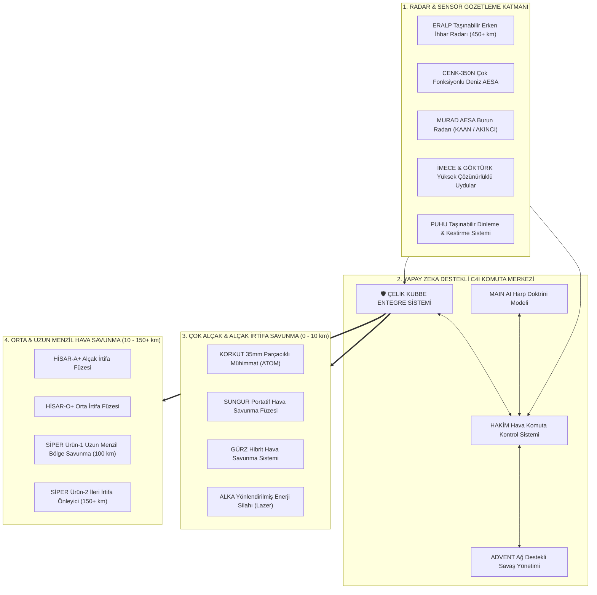
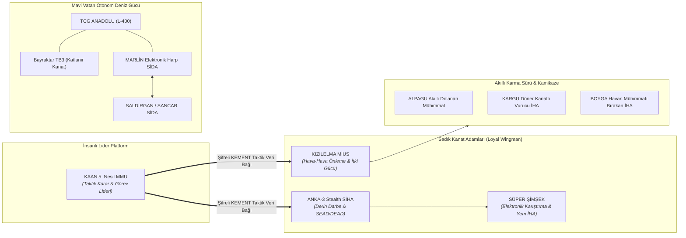

# 🇹🇷 Milli Teknoloji Envanteri (National Defense & Tech Portal)

<p align="center">
  
</p>

<p align="center">
  <b>"Köklerden Göklere, Mavi Vatan'dan Uzaya: Tam Bağımsız Türk Savunma Sanayii"</b>
</p>

<p align="center">
  <a href="https://github.com/bahattinyunus/Milli-Teknoloji-Envanteri"></a>
  <a href="docs/TRL_GUIDE.md"></a>
  <a href="DASHBOARD.html"></a>
  <a href="docs/ARCHITECTURE.md"></a>
  <a href="docs/API_CLI.md"></a>
</p>

<p align="center">
  <a href="#-dominion-aerospace-hava--uzay">🌌 Hava & Uzay</a> •
  <a href="#-dominion-electronics--ai-dijital-egemenlik">📡 Elektronik & YZ</a> •
  <a href="#-dominion-land-kara--zırh">🚜 Kara & Zırh</a> •
  <a href="#-dominion-sea-mavi-vatan">⚓ Mavi Vatan</a> •
  <a href="#-çelik-kubbe--ağ-merkezli-hava-savunma-doktrini">🛡️ Çelik Kubbe</a> •
  <a href="#-mum-t-ve-karma-sürü-muharebe-doktrini">🤖 MUM-T Doktrini</a> •
  <a href="DASHBOARD.html">🖥️ Canlı Dashboard</a> •
  <a href="#-stratejik-dokümantasyon-ve-standartlar">📚 Dokümantasyon</a>
</p>

---

## 🏛️ Stratejik Egemenlik ve Vizyon Manifestosu

Milli Teknoloji Envanteri, Türkiye'nin **2053 ve 2071 stratejik vizyonlarına** giden yolda geliştirilen yerli ve milli savunma sanayii varlıklarının yüksek çözünürlüklü dijital kütüphanesidir. İthal ikameci anlayıştan küresel oyun kurucu doktrin seviyesine yükselen Türk savunma ekosisteminin tüm operasyonel bileşenlerini ve TRL olgunluk seviyelerini belgeler.

### 🌟 Dört Boyutlu Muharebe Hakimiyeti:
1. **🌌 Hava ve Uzay:** 5. Nesil Hayalet Uçak (KAAN), İnsansız Muharip Uçaklar (KIZILELMA, ANKA-3), Yüksek İrtifa TİHA'lar ve Alçak Yörünge Uydu Takımları.
2. **📡 Siber ve Elektronik Harp:** AESA Radarları (ERALP, CENK, MURAD), Çelik Kubbe Yapay Zeka Karar Ağı, ADVENT Savaş Yönetimi ve KORAL/REDET EH Sistemleri.
3. **🚜 Kara ve Zırhlı Muharebe:** ALTAY Yeni Nesil Ana Muharebe Tankı, FIRTINA II Obüsleri, İleri Zırhlı Taktik Araçlar ve Balistik Derin Darbe Füzeleri (BORA, TAYFUN).
4. **⚓ Mavi Vatan:** TCG ANADOLU Çok Maksatlı Amfibi Hücum Gemisi, MİLGEM İ-Sınıfı Fırkateynler, MİLDEN Havadan Bağımsız Tahrikli Denizaltılar ve Otonom SİDA Sürüleri.

---

## 💎 Amiral Gemisi Platformlar (Flagship Highlights)

| Platform | Üretici | Dominion | Rol & Stratejik Nitelik | TRL |
| :--- | :--- | :--- | :--- | :---: |
| **[KAAN](./DOMINION_AEROSPACE/TUSAŞ/KAAN/README.md)** | TUSAŞ | AEROSPACE | 5. Nesil Milli Muharip Uçak, Süperseyir, Dahili Silah Yuvası, AESA | `TRL 7` |
| **[KIZILELMA](./DOMINION_AEROSPACE/BAYKAR/KIZILELMA/README.md)** | BAYKAR | AEROSPACE | İnsansız Savaş Uçağı (MİUS), Düşük RCS, Süpersonik İtki, MUM-T | `TRL 8` |
| **[ANKA-3](./DOMINION_AEROSPACE/TUSAŞ/ANKA-3/README.md)** | TUSAŞ | AEROSPACE | Uçan Kanat (Flying Wing) Derin Darbe Hayalet SİHA | `TRL 7` |
| **[ÇELİK KUBBE](./DOMINION_ELECTRONICS/ASELSAN/ÇELİK_KUBBE/README.md)** | SSB / ASELSAN | ELECTRONICS | Çok Katmanlı Yapay Zeka Destekli Entegre Hava Savunma Sistemi | `TRL 8` |
| **[TCG ANADOLU](./DOMINION_SEA/DzKK/TCG_ANADOLU/README.md)** | DzKK / SEDEF | SEA | Dünyanın İlk SİHA/LHD Amfibi Görev Gemisi | `TRL 9` |
| **[TCG İSTANBUL (F-515)](./DOMINION_SEA/STM/TCG_İSTANBUL/README.md)** | STM / DzKK | SEA | Milli MİLGEM İ-Sınıfı Fırkateyn, MİDLAS Dikey Atım & ADVENT SYS | `TRL 9` |
| **[ALTAY](./DOMINION_LAND/BMC/ALTAY/README.md)** | BMC | LAND | Yeni Nesil Ana Muharebe Tankı, AKKOR Aktif Koruma, 1500 BG BATU | `TRL 8` |
| **[TAYFUN](./DOMINION_LAND/ROKETSAN/TAYFUN/README.md)** | ROKETSAN | LAND | Kısa/Orta Menzilli Stratejik Hipersonik/Balistik Füze Sistemi | `TRL 8` |

---

## 🏛️ Kurumsal Dominion Envanteri

> [!NOTE]
> Aşağıdaki tablolar `inventory_manager.py` analiz motoru tarafından otomatik olarak taranıp doğrulanmıştır. Her platformun detaylı teknik özelliklerine, silah konfigürasyonlarına ve motor tiplerine ilgili bağlantıdan ulaşabilirsiniz.

### [🌌 DOMINION AEROSPACE (Hava & Uzay)](./DOMINION_AEROSPACE/README.md)

> *Hava Hakimiyeti, İnsansız Hava Araçları, Helikopterler, İtki Motorları ve Uydu Sistemleri* — **Toplam 58 Kayıtlı Platform**

<details open>
<summary><b>📋 AEROSPACE Platform Kataloğunu Görüntüleyin / Daraltın (58 Sistem)</b></summary>

| Proje / Platform | Üretici / Kurum | Sınıf & Stratejik Görev | Olgunluk (TRL) |
| :--- | :--- | :--- | :---: |
| **[TOLUN](./DOMINION_AEROSPACE/ASELSAN/TOLUN/README.md)** | ASELSAN | Kritik Savunma Teknolojisi | `TRL 9` |
| **[AKINCI](./DOMINION_AEROSPACE/BAYKAR/AKINCI/README.md)** | BAYKAR | Kritik Savunma Teknolojisi | `TRL 9` |
| **[FERGANİ](./DOMINION_AEROSPACE/BAYKAR/FERGANİ/README.md)** | BAYKAR | Kritik Savunma Teknolojisi | `TRL 8` |
| **[KALKAN](./DOMINION_AEROSPACE/BAYKAR/KALKAN/README.md)** | BAYKAR | Kritik Savunma Teknolojisi | `TRL 8` |
| **[KEMANKEŞ](./DOMINION_AEROSPACE/BAYKAR/KEMANKEŞ/README.md)** | BAYKAR | Kritik Savunma Teknolojisi | `TRL 7` |
| **[KEMANKEŞ 2](./DOMINION_AEROSPACE/BAYKAR/KEMANKEŞ_2/README.md)** | BAYKAR | Kritik Savunma Teknolojisi | `TRL 7` |
| **[KIZILELMA](./DOMINION_AEROSPACE/BAYKAR/KIZILELMA/README.md)** | BAYKAR | Kritik Savunma Teknolojisi | `TRL 8` |
| **[TB2](./DOMINION_AEROSPACE/BAYKAR/TB2/README.md)** | BAYKAR | Kritik Savunma Teknolojisi | `TRL 9` |
| **[TB3](./DOMINION_AEROSPACE/BAYKAR/TB3/README.md)** | BAYKAR | Kritik Savunma Teknolojisi | `TRL 7` |
| **[TOMRİS](./DOMINION_AEROSPACE/BAYKAR/TOMRİS/README.md)** | BAYKAR | Kritik Savunma Teknolojisi | `TRL 3` |
| **[KARAYEL](./DOMINION_AEROSPACE/Lentatek/KARAYEL/README.md)** | Lentatek | Kritik Savunma Teknolojisi | `TRL 9` |
| **[AKATA](./DOMINION_AEROSPACE/ROKETSAN/AKATA/README.md)** | ROKETSAN | Kritik Savunma Teknolojisi | `TRL 7` |
| **[ALKA](./DOMINION_AEROSPACE/ROKETSAN/ALKA/README.md)** | ROKETSAN | Kritik Savunma Teknolojisi | `TRL 8` |
| **[BARBAROS](./DOMINION_AEROSPACE/ROKETSAN/BARBAROS/README.md)** | ROKETSAN | Kritik Savunma Teknolojisi | `TRL 8` |
| **[BORA](./DOMINION_AEROSPACE/ROKETSAN/BORA/README.md)** | ROKETSAN | Kritik Savunma Teknolojisi | `TRL 9` |
| **[CENK](./DOMINION_AEROSPACE/ROKETSAN/CENK/README.md)** | ROKETSAN | Kritik Savunma Teknolojisi | `TRL 6` |
| **[CİRİT](./DOMINION_AEROSPACE/ROKETSAN/CİRİT/README.md)** | ROKETSAN | Kritik Savunma Teknolojisi | `TRL 9` |
| **[HİSAR](./DOMINION_AEROSPACE/ROKETSAN/HİSAR/README.md)** | ROKETSAN | Kritik Savunma Teknolojisi | `TRL 9` |
| **[MAM AILESI](./DOMINION_AEROSPACE/ROKETSAN/MAM_AILESI/README.md)** | ROKETSAN | Kritik Savunma Teknolojisi | `TRL 9` |
| **[TAYFUN](./DOMINION_AEROSPACE/ROKETSAN/TAYFUN/README.md)** | ROKETSAN | Kritik Savunma Teknolojisi | `TRL 9` |
| **[TAYFUN BLOK4](./DOMINION_AEROSPACE/ROKETSAN/TAYFUN_BLOK4/README.md)** | ROKETSAN | Kritik Savunma Teknolojisi | `TRL 5` |
| **[UMTAS](./DOMINION_AEROSPACE/ROKETSAN/UMTAS/README.md)** | ROKETSAN | Kritik Savunma Teknolojisi | `TRL 9` |
| **[ÇAKIR](./DOMINION_AEROSPACE/ROKETSAN/ÇAKIR/README.md)** | ROKETSAN | Kritik Savunma Teknolojisi | `TRL 9` |
| **[İHA-300](./DOMINION_AEROSPACE/ROKETSAN/İHA-300/README.md)** | ROKETSAN | Kritik Savunma Teknolojisi | `TRL 8` |
| **[BOYGA](./DOMINION_AEROSPACE/STM/BOYGA/README.md)** | STM | Kritik Savunma Teknolojisi | `TRL 9` |
| **[KARGU](./DOMINION_AEROSPACE/STM/KARGU/README.md)** | STM | Kritik Savunma Teknolojisi | `TRL 9` |
| **[TOGAN](./DOMINION_AEROSPACE/STM/TOGAN/README.md)** | STM | Kritik Savunma Teknolojisi | `TRL 9` |
| **[PD170](./DOMINION_AEROSPACE/TEI/PD170/README.md)** | TEI | Kritik Savunma Teknolojisi | `TRL 9` |
| **[PD222](./DOMINION_AEROSPACE/TEI/PD222/README.md)** | TEI | Kritik Savunma Teknolojisi | `TRL 8` |
| **[TF10000](./DOMINION_AEROSPACE/TEI/TF10000/README.md)** | TEI | Kritik Savunma Teknolojisi | `TRL 6` |
| **[TF6000](./DOMINION_AEROSPACE/TEI/TF6000/README.md)** | TEI | Kritik Savunma Teknolojisi | `TRL 7` |
| **[TJ300](./DOMINION_AEROSPACE/TEI/TJ300/README.md)** | TEI | Kritik Savunma Teknolojisi | `TRL 9` |
| **[TJ90](./DOMINION_AEROSPACE/TEI/TJ90/README.md)** | TEI | Kritik Savunma Teknolojisi | `TRL 9` |
| **[TS1400](./DOMINION_AEROSPACE/TEI/TS1400/README.md)** | TEI | Kritik Savunma Teknolojisi | `TRL 8` |
| **[AY GÖREVİ](./DOMINION_AEROSPACE/TUA/AY_GÖREVİ/README.md)** | TUA | Kritik Savunma Teknolojisi | `TRL 6` |
| **[AKSUNGUR](./DOMINION_AEROSPACE/TUSAŞ/AKSUNGUR/README.md)** | TUSAŞ | Kritik Savunma Teknolojisi | `TRL 9` |
| **[ANKA](./DOMINION_AEROSPACE/TUSAŞ/ANKA/README.md)** | TUSAŞ | Kritik Savunma Teknolojisi | `TRL 9` |
| **[ANKA-3](./DOMINION_AEROSPACE/TUSAŞ/ANKA-3/README.md)** | TUSAŞ | Kritik Savunma Teknolojisi | `TRL 7` |
| **[ATAK-2](./DOMINION_AEROSPACE/TUSAŞ/ATAK-2/README.md)** | TUSAŞ | Kritik Savunma Teknolojisi | `TRL 7` |
| **[GÖKBEY](./DOMINION_AEROSPACE/TUSAŞ/GÖKBEY/README.md)** | TUSAŞ | Kritik Savunma Teknolojisi | `TRL 8` |
| **[GÖKTÜRK](./DOMINION_AEROSPACE/TUSAŞ/GÖKTÜRK/README.md)** | TUSAŞ | Kritik Savunma Teknolojisi | `TRL 9` |
| **[GÖKTÜRK-3](./DOMINION_AEROSPACE/TUSAŞ/GÖKTÜRK-3/README.md)** | TUSAŞ | Kritik Savunma Teknolojisi | `TRL 6` |
| **[HÜRJET](./DOMINION_AEROSPACE/TUSAŞ/HÜRJET/README.md)** | TUSAŞ | Kritik Savunma Teknolojisi | `TRL 8` |
| **[HÜRKUŞ](./DOMINION_AEROSPACE/TUSAŞ/HÜRKUŞ/README.md)** | TUSAŞ | Kritik Savunma Teknolojisi | `TRL 9` |
| **[KAAN](./DOMINION_AEROSPACE/TUSAŞ/KAAN/README.md)** | TUSAŞ | Kritik Savunma Teknolojisi | `TRL 7` |
| **[SÜPER ŞİMŞEK](./DOMINION_AEROSPACE/TUSAŞ/SÜPER_ŞİMŞEK/README.md)** | TUSAŞ | Kritik Savunma Teknolojisi | `TRL 7` |
| **[T129 ATAK](./DOMINION_AEROSPACE/TUSAŞ/T129_ATAK/README.md)** | TUSAŞ | Kritik Savunma Teknolojisi | `TRL 9` |
| **[TÜRKSAT 6A](./DOMINION_AEROSPACE/TUSAŞ/TÜRKSAT_6A/README.md)** | TUSAŞ | Kritik Savunma Teknolojisi | `TRL 8` |
| **[ŞİMŞEK](./DOMINION_AEROSPACE/TUSAŞ/ŞİMŞEK/README.md)** | TUSAŞ | Kritik Savunma Teknolojisi | `TRL 9` |
| **[ALPİN](./DOMINION_AEROSPACE/Titra/ALPİN/README.md)** | Titra | Kritik Savunma Teknolojisi | `TRL 7` |
| **[DELİ](./DOMINION_AEROSPACE/Titra/DELİ/README.md)** | Titra | Kritik Savunma Teknolojisi | `TRL 9` |
| **[BOZDOĞAN](./DOMINION_AEROSPACE/TÜBİTAK_SAGE/BOZDOĞAN/README.md)** | TÜBİTAK SAGE | Kritik Savunma Teknolojisi | `TRL 9` |
| **[GOKDOGAN](./DOMINION_AEROSPACE/TÜBİTAK_SAGE/GOKDOGAN/README.md)** | TÜBİTAK SAGE | Kritik Savunma Teknolojisi | `TRL 9` |
| **[GÜNEŞ](./DOMINION_AEROSPACE/TÜBİTAK_SAGE/GÜNEŞ/README.md)** | TÜBİTAK SAGE | Kritik Savunma Teknolojisi | `TRL 9` |
| **[KUZGUN](./DOMINION_AEROSPACE/TÜBİTAK_SAGE/KUZGUN/README.md)** | TÜBİTAK SAGE | Kritik Savunma Teknolojisi | `TRL 7` |
| **[MORS](./DOMINION_AEROSPACE/TÜBİTAK_SAGE/MORS/README.md)** | TÜBİTAK SAGE | Kritik Savunma Teknolojisi | `TRL 9` |
| **[SOM](./DOMINION_AEROSPACE/TÜBİTAK_SAGE/SOM/README.md)** | TÜBİTAK SAGE | Kritik Savunma Teknolojisi | `TRL 9` |
| **[İMECE](./DOMINION_AEROSPACE/TÜBİTAK_SAGE/İMECE/README.md)** | TÜBİTAK SAGE | Kritik Savunma Teknolojisi | `TRL 9` |

</details>

### [📡 DOMINION ELECTRONICS & AI (Dijital Egemenlik)](./DOMINION_ELECTRONICS/README.md)

> *AESA Radarları, Elektronik Harp, Komuta Kontrol (C4I), Askeri Yapay Zeka ve Elektro-Optik Sistemler* — **Toplam 44 Kayıtlı Platform**

<details open>
<summary><b>📋 ELECTRONICS Platform Kataloğunu Görüntüleyin / Daraltın (44 Sistem)</b></summary>

| Proje / Platform | Üretici / Kurum | Sınıf & Stratejik Görev | Olgunluk (TRL) |
| :--- | :--- | :--- | :---: |
| **[ALBATROS-S](./DOMINION_ELECTRONICS/ASELSAN/ALBATROS-S/README.md)** | ASELSAN | Kritik Savunma Teknolojisi | `TRL 9` |
| **[ASELFLIR-500](./DOMINION_ELECTRONICS/ASELSAN/ASELFLIR-500/README.md)** | ASELSAN | Kritik Savunma Teknolojisi | `TRL 9` |
| **[CENK 350N](./DOMINION_ELECTRONICS/ASELSAN/CENK_350N/README.md)** | ASELSAN | Kritik Savunma Teknolojisi | `TRL 7` |
| **[EJDERHA](./DOMINION_ELECTRONICS/ASELSAN/EJDERHA/README.md)** | ASELSAN | Kritik Savunma Teknolojisi | `TRL 7` |
| **[ERALP](./DOMINION_ELECTRONICS/ASELSAN/ERALP/README.md)** | ASELSAN | Kritik Savunma Teknolojisi | `TRL 9` |
| **[GÖKDENİZ](./DOMINION_ELECTRONICS/ASELSAN/GÖKDENİZ/README.md)** | ASELSAN | Kritik Savunma Teknolojisi | `TRL 9` |
| **[GÖKSUR](./DOMINION_ELECTRONICS/ASELSAN/GÖKSUR/README.md)** | ASELSAN | Kritik Savunma Teknolojisi | `TRL 7` |
| **[GÖKTAN](./DOMINION_ELECTRONICS/ASELSAN/GÖKTAN/README.md)** | ASELSAN | Kritik Savunma Teknolojisi | `TRL 7` |
| **[GÜRZ](./DOMINION_ELECTRONICS/ASELSAN/GÜRZ/README.md)** | ASELSAN | Kritik Savunma Teknolojisi | `TRL 8` |
| **[HAKİM](./DOMINION_ELECTRONICS/ASELSAN/HAKİM/README.md)** | ASELSAN | Kritik Savunma Teknolojisi | `TRL 9` |
| **[HAVA SOJ](./DOMINION_ELECTRONICS/ASELSAN/HAVA_SOJ/README.md)** | ASELSAN | Kritik Savunma Teknolojisi | `TRL 7` |
| **[IHTAR](./DOMINION_ELECTRONICS/ASELSAN/IHTAR/README.md)** | ASELSAN | Kritik Savunma Teknolojisi | `TRL 9` |
| **[KARAT](./DOMINION_ELECTRONICS/ASELSAN/KARAT/README.md)** | ASELSAN | Kritik Savunma Teknolojisi | `TRL 8` |
| **[KORAL](./DOMINION_ELECTRONICS/ASELSAN/KORAL/README.md)** | ASELSAN | Kritik Savunma Teknolojisi | `TRL 9` |
| **[KORKUT](./DOMINION_ELECTRONICS/ASELSAN/KORKUT/README.md)** | ASELSAN | Kritik Savunma Teknolojisi | `TRL 9` |
| **[MURAD](./DOMINION_ELECTRONICS/ASELSAN/MURAD/README.md)** | ASELSAN | Kritik Savunma Teknolojisi | `TRL 7` |
| **[MİLKAR](./DOMINION_ELECTRONICS/ASELSAN/MİLKAR/README.md)** | ASELSAN | Kritik Savunma Teknolojisi | `TRL 9` |
| **[PUHU](./DOMINION_ELECTRONICS/ASELSAN/PUHU/README.md)** | ASELSAN | Kritik Savunma Teknolojisi | `TRL 9` |
| **[SANCAK](./DOMINION_ELECTRONICS/ASELSAN/SANCAK/README.md)** | ASELSAN | Yeni Nesil V/UHF Taktik Muhabere Elektronik Taarruz ... | `TRL 9` |
| **[SİPER](./DOMINION_ELECTRONICS/ASELSAN/SİPER/README.md)** | ASELSAN | Uzun Menzilli Bölge Hava ve Füze Savunma Sistemi (Hİ... | `TRL 8` |
| **[TOYGUN](./DOMINION_ELECTRONICS/ASELSAN/TOYGUN/README.md)** | ASELSAN | 5. Nesil Düşük Görünürlüklü Entegre Elektro-Optik He... | `TRL 7` |
| **[TULGAR](./DOMINION_ELECTRONICS/ASELSAN/TULGAR/README.md)** | ASELSAN | 5. Nesil Kaska Monteli Entegre Gösterge ve Nişangah ... | `TRL 8` |
| **[TURAN](./DOMINION_ELECTRONICS/ASELSAN/TURAN/README.md)** | ASELSAN | Zırhlı Konvoy ve Taktik Birlik Koruma / Reaktif Elek... | `TRL 9` |
| **[ULAQ](./DOMINION_ELECTRONICS/ASELSAN/ULAQ/README.md)** | ASELSAN | İnsansız Deniz Aracı (İDA/SİDA) Sensör, Aviyonik ve ... | `TRL 9` |
| **[YILDIRIM-100](./DOMINION_ELECTRONICS/ASELSAN/YILDIRIM-100/README.md)** | ASELSAN | Havadan Yönlendirilmiş Kızılötesi Karşı Tedbir Siste... | `TRL 8` |
| **[ÇELİK KUBBE](./DOMINION_ELECTRONICS/ASELSAN/ÇELİK_KUBBE/README.md)** | ASELSAN | Çok Katmanlı Ağ Merkezli Entegre Hava ve Füze Savunm... | `TRL 8` |
| **[ÖZGÜR](./DOMINION_ELECTRONICS/ASELSAN/ÖZGÜR/README.md)** | ASELSAN | 4.5 Nesil Çok Rollü Muharip Uçak Milli Aviyonik ve G... | `TRL 9` |
| **[GIMBAL SISTEMLERI](./DOMINION_ELECTRONICS/Altınay_Savunma/GIMBAL_SISTEMLERI/README.md)** | Altınay Savunma | Çok Eksenli Jiroskopik Stabilize Elektro-Optik Gimba... | `TRL 9` |
| **[KOBOT](./DOMINION_ELECTRONICS/Altınay_Savunma/KOBOT/README.md)** | Altınay Savunma | Hafif Sınıf Taktik İnsansız Kara Aracı (İKA) & Bomba... | `TRL 9` |
| **[PEREGRINE](./DOMINION_ELECTRONICS/Altınay_Savunma/PEREGRINE/README.md)** | Altınay Savunma | Döner Kanatlı Kamikaze İHA / Taktik Dolanan Mühimmat... | `TRL 7` |
| **[ADVENT](./DOMINION_ELECTRONICS/HAVELSAN/ADVENT/README.md)** | HAVELSAN | Yeni Nesil Ağ Destekli Veri Entegre Savaş Yönetim Si... | `TRL 9` |
| **[BAHA](./DOMINION_ELECTRONICS/HAVELSAN/BAHA/README.md)** | HAVELSAN | Bulut Altı Taktik İnsansız Hava Aracı (B-İHA) / Dike... | `TRL 9` |
| **[BARKAN](./DOMINION_ELECTRONICS/HAVELSAN/BARKAN/README.md)** | HAVELSAN | Orta Sınıf Paletli Çok Maksatlı İnsansız Kara Aracı ... | `TRL 9` |
| **[CYBER SECURITY](./DOMINION_ELECTRONICS/HAVELSAN/CYBER_SECURITY/README.md)** | HAVELSAN | Askeri Düzey Kurumsal ve Kritik Altyapı Siber Güvenl... | `TRL 9` |
| **[KAPGAN](./DOMINION_ELECTRONICS/HAVELSAN/KAPGAN/README.md)** | HAVELSAN | Ağır Sınıf Çok Maksatlı İnsansız Kara Aracı (A-İKA) | `TRL 7` |
| **[MAIN AI](./DOMINION_ELECTRONICS/HAVELSAN/MAIN_AI/README.md)** | HAVELSAN | Güvenli ve Kapalı Devre Kurumsal Büyük Dil Modeli (L... | `TRL 7` |
| **[SANCAR](./DOMINION_ELECTRONICS/HAVELSAN/SANCAR/README.md)** | HAVELSAN | Taktik Sınıf Silahlı İnsansız Deniz Aracı (SİDA) | `TRL 8` |
| **[SIMULATORS](./DOMINION_ELECTRONICS/HAVELSAN/SIMULATORS/README.md)** | HAVELSAN | Kritik Savunma Teknolojisi | `TRL 9` |
| **[MİLDAR](./DOMINION_ELECTRONICS/METEKSAN/MİLDAR/README.md)** | METEKSAN | Kritik Savunma Teknolojisi | `TRL 8` |
| **[NAZAR](./DOMINION_ELECTRONICS/METEKSAN/NAZAR/README.md)** | METEKSAN | Kritik Savunma Teknolojisi | `TRL 9` |
| **[RETINAR](./DOMINION_ELECTRONICS/METEKSAN/RETINAR/README.md)** | METEKSAN | Kritik Savunma Teknolojisi | `TRL 9` |
| **[YAKAMOZ](./DOMINION_ELECTRONICS/METEKSAN/YAKAMOZ/README.md)** | METEKSAN | Kritik Savunma Teknolojisi | `TRL 9` |
| **[DATA LINKS](./DOMINION_ELECTRONICS/MilSOFT/DATA_LINKS/README.md)** | MilSOFT | Kritik Savunma Teknolojisi | `TRL 9` |
| **[ACMI POD](./DOMINION_ELECTRONICS/SDT/ACMI_POD/README.md)** | SDT | Kritik Savunma Teknolojisi | `TRL 9` |

</details>

### [🚜 DOMINION LAND (Kara & Zırh)](./DOMINION_LAND/README.md)

> *Ana Muharebe Tankları, Zırhlı Taktik Araçlar, Ağır Topçu, Balistik Füzeler ve Güç Grupları* — **Toplam 43 Kayıtlı Platform**

<details open>
<summary><b>📋 LAND Platform Kataloğunu Görüntüleyin / Daraltın (43 Sistem)</b></summary>

| Proje / Platform | Üretici / Kurum | Sınıf & Stratejik Görev | Olgunluk (TRL) |
| :--- | :--- | :--- | :---: |
| **[ALTAY](./DOMINION_LAND/BMC/ALTAY/README.md)** | BMC | Kritik Savunma Teknolojisi | `TRL 9` |
| **[KIRPI](./DOMINION_LAND/BMC/KIRPI/README.md)** | BMC | Kritik Savunma Teknolojisi | `TRL 9` |
| **[KİRPİ II](./DOMINION_LAND/BMC/KİRPİ_II/README.md)** | BMC | Kritik Savunma Teknolojisi | `TRL 9` |
| **[VURAN](./DOMINION_LAND/BMC/VURAN/README.md)** | BMC | Kritik Savunma Teknolojisi | `TRL 9` |
| **[AZRA](./DOMINION_LAND/BMC_POWER/AZRA/README.md)** | BMC POWER | Kritik Savunma Teknolojisi | `TRL 8` |
| **[BATU](./DOMINION_LAND/BMC_POWER/BATU/README.md)** | BMC POWER | Kritik Savunma Teknolojisi | `TRL 8` |
| **[TUNA](./DOMINION_LAND/BMC_POWER/TUNA/README.md)** | BMC POWER | Kritik Savunma Teknolojisi | `TRL 9` |
| **[UTKU](./DOMINION_LAND/BMC_POWER/UTKU/README.md)** | BMC POWER | Kritik Savunma Teknolojisi | `TRL 8` |
| **[M2 QCB](./DOMINION_LAND/CANİK/M2_QCB/README.md)** | CANİK | Kritik Savunma Teknolojisi | `TRL 9` |
| **[METE MC9](./DOMINION_LAND/CANİK/METE_MC9/README.md)** | CANİK | Kritik Savunma Teknolojisi | `TRL 9` |
| **[VENOM LR](./DOMINION_LAND/CANİK/VENOM_LR/README.md)** | CANİK | Kritik Savunma Teknolojisi | `TRL 9` |
| **[KAPLAN](./DOMINION_LAND/FNSS/KAPLAN/README.md)** | FNSS | Kritik Savunma Teknolojisi | `TRL 9` |
| **[PARS](./DOMINION_LAND/FNSS/PARS/README.md)** | FNSS | Kritik Savunma Teknolojisi | `TRL 9` |
| **[PARS 4x4](./DOMINION_LAND/FNSS/PARS_4x4/README.md)** | FNSS | Kritik Savunma Teknolojisi | `TRL 9` |
| **[SAMUR](./DOMINION_LAND/FNSS/SAMUR/README.md)** | FNSS | Kritik Savunma Teknolojisi | `TRL 9` |
| **[ZAHA](./DOMINION_LAND/FNSS/ZAHA/README.md)** | FNSS | Kritik Savunma Teknolojisi | `TRL 9` |
| **[HIZIR](./DOMINION_LAND/Katmerciler/HIZIR/README.md)** | Katmerciler | Kritik Savunma Teknolojisi | `TRL 9` |
| **[KIRAÇ](./DOMINION_LAND/Katmerciler/KIRAÇ/README.md)** | Katmerciler | Kritik Savunma Teknolojisi | `TRL 9` |
| **[76MM DENİZ TOPU](./DOMINION_LAND/MKE/76MM_DENİZ_TOPU/README.md)** | MKE | Kritik Savunma Teknolojisi | `TRL 9` |
| **[BORAN](./DOMINION_LAND/MKE/BORAN/README.md)** | MKE | Kritik Savunma Teknolojisi | `TRL 9` |
| **[FIRTINA II](./DOMINION_LAND/MKE/FIRTINA_II/README.md)** | MKE | Kritik Savunma Teknolojisi | `TRL 9` |
| **[MPT-76](./DOMINION_LAND/MKE/MPT-76/README.md)** | MKE | Kritik Savunma Teknolojisi | `TRL 9` |
| **[PIRANA](./DOMINION_LAND/MKE/PIRANA/README.md)** | MKE | Kritik Savunma Teknolojisi | `TRL 8` |
| **[TOLGA](./DOMINION_LAND/MKE/TOLGA/README.md)** | MKE | Kritik Savunma Teknolojisi | `TRL 8` |
| **[YAVUZ](./DOMINION_LAND/MKE/YAVUZ/README.md)** | MKE | Kritik Savunma Teknolojisi | `TRL 9` |
| **[EJDER YALÇIN](./DOMINION_LAND/Nurol_Makina/EJDER_YALÇIN/README.md)** | Nurol Makina | Kritik Savunma Teknolojisi | `TRL 9` |
| **[ILGAZ](./DOMINION_LAND/Nurol_Makina/ILGAZ/README.md)** | Nurol Makina | Kritik Savunma Teknolojisi | `TRL 9` |
| **[YÖRÜK](./DOMINION_LAND/Nurol_Makina/YÖRÜK/README.md)** | Nurol Makina | Kritik Savunma Teknolojisi | `TRL 9` |
| **[AKREP II](./DOMINION_LAND/OTOKAR/AKREP_II/README.md)** | OTOKAR | Kritik Savunma Teknolojisi | `TRL 8` |
| **[ALPAR](./DOMINION_LAND/OTOKAR/ALPAR/README.md)** | OTOKAR | Kritik Savunma Teknolojisi | `TRL 4` |
| **[ARMA](./DOMINION_LAND/OTOKAR/ARMA/README.md)** | OTOKAR | Kritik Savunma Teknolojisi | `TRL 4.5` |
| **[ARMA 8x8](./DOMINION_LAND/OTOKAR/ARMA_8x8/README.md)** | OTOKAR | Kritik Savunma Teknolojisi | `TRL 4.5` |
| **[COBRA II](./DOMINION_LAND/OTOKAR/COBRA_II/README.md)** | OTOKAR | Kritik Savunma Teknolojisi | `TRL 4.5` |
| **[TULPAR](./DOMINION_LAND/OTOKAR/TULPAR/README.md)** | OTOKAR | Kritik Savunma Teknolojisi | `TRL 5` |
| **[GÖKBORA](./DOMINION_LAND/ROKETSAN/GÖKBORA/README.md)** | ROKETSAN | Kritik Savunma Teknolojisi | `TRL 4` |
| **[KARAOK](./DOMINION_LAND/ROKETSAN/KARAOK/README.md)** | ROKETSAN | Kritik Savunma Teknolojisi | `TRL 4.5` |
| **[OMTAS](./DOMINION_LAND/ROKETSAN/OMTAS/README.md)** | ROKETSAN | Kritik Savunma Teknolojisi | `TRL 4.5` |
| **[SUNGUR](./DOMINION_LAND/ROKETSAN/SUNGUR/README.md)** | ROKETSAN | Kritik Savunma Teknolojisi | `TRL 4.5` |
| **[TRG-230](./DOMINION_LAND/ROKETSAN/TRG-230/README.md)** | ROKETSAN | Kritik Savunma Teknolojisi | `TRL 4.5` |
| **[SAR127](./DOMINION_LAND/Sarsılmaz/SAR127/README.md)** | Sarsılmaz | Kritik Savunma Teknolojisi | `TRL 4.5` |
| **[SAR56](./DOMINION_LAND/Sarsılmaz/SAR56/README.md)** | Sarsılmaz | Kritik Savunma Teknolojisi | `TRL 4.5` |
| **[SAR9](./DOMINION_LAND/Sarsılmaz/SAR9/README.md)** | Sarsılmaz | Kritik Savunma Teknolojisi | `TRL 4.5` |
| **[SARBOT](./DOMINION_LAND/Sarsılmaz/SARBOT/README.md)** | Sarsılmaz | Kritik Savunma Teknolojisi | `TRL 5` |

</details>

### [⚓ DOMINION SEA (Mavi Vatan)](./DOMINION_SEA/README.md)

> *Fırkateynler, Amfibi Hücum Gemileri, Havadan Bağımsız Denizaltılar ve Otonom SİDA Sürüleri* — **Toplam 22 Kayıtlı Platform**

<details open>
<summary><b>📋 SEA Platform Kataloğunu Görüntüleyin / Daraltın (22 Sistem)</b></summary>

| Proje / Platform | Üretici / Kurum | Sınıf & Stratejik Görev | Olgunluk (TRL) |
| :--- | :--- | :--- | :---: |
| **[ARES 150](./DOMINION_SEA/ARES/ARES_150/README.md)** | ARES | Kritik Savunma Teknolojisi | `TRL 4.5` |
| **[ULAQ DERE](./DOMINION_SEA/ARES/ULAQ_DERE/README.md)** | ARES | Kritik Savunma Teknolojisi | `TRL 4.5` |
| **[ADKG](./DOMINION_SEA/ASFAT/ADKG/README.md)** | ASFAT | Kritik Savunma Teknolojisi | `TRL 4` |
| **[HİSAR SINIFI OPV](./DOMINION_SEA/ASFAT/HİSAR_SINIFI_OPV/README.md)** | ASFAT | Kritik Savunma Teknolojisi | `TRL 4` |
| **[MEMATT](./DOMINION_SEA/ASFAT/MEMATT/README.md)** | ASFAT | Kritik Savunma Teknolojisi | `TRL 9` |
| **[PN MILGEM](./DOMINION_SEA/ASFAT/PN_MILGEM/README.md)** | ASFAT | Kritik Savunma Teknolojisi | `TRL 9` |
| **[TCG İSTANBUL](./DOMINION_SEA/ASFAT/TCG_İSTANBUL/README.md)** | ASFAT | Kritik Savunma Teknolojisi | `TRL 9` |
| **[SALDIRGAN](./DOMINION_SEA/DEARSAN/SALDIRGAN/README.md)** | DEARSAN | Kritik Savunma Teknolojisi | `TRL 9` |
| **[MİLDEN](./DOMINION_SEA/DzKK/MİLDEN/README.md)** | DzKK | Kritik Savunma Teknolojisi | `TRL 5` |
| **[AKYA](./DOMINION_SEA/ROKETSAN/AKYA/README.md)** | ROKETSAN | Kritik Savunma Teknolojisi | `TRL 9` |
| **[ATMACA](./DOMINION_SEA/ROKETSAN/ATMACA/README.md)** | ROKETSAN | Kritik Savunma Teknolojisi | `TRL 9` |
| **[LEVENT](./DOMINION_SEA/ROKETSAN/LEVENT/README.md)** | ROKETSAN | Kritik Savunma Teknolojisi | `TRL 7` |
| **[MİDLAS](./DOMINION_SEA/ROKETSAN/MİDLAS/README.md)** | ROKETSAN | Kritik Savunma Teknolojisi | `TRL 8` |
| **[ORKA](./DOMINION_SEA/ROKETSAN/ORKA/README.md)** | ROKETSAN | Kritik Savunma Teknolojisi | `TRL 7` |
| **[TCG ANADOLU](./DOMINION_SEA/SEDEF/TCG_ANADOLU/README.md)** | SEDEF | Kritik Savunma Teknolojisi | `TRL 9` |
| **[TCG TRAKYA](./DOMINION_SEA/SEDEF/TCG_TRAKYA/README.md)** | SEDEF | Kritik Savunma Teknolojisi | `TRL 1` |
| **[MARLİN](./DOMINION_SEA/SEFİNE/MARLİN/README.md)** | SEFİNE | Kritik Savunma Teknolojisi | `TRL 9` |
| **[MİLGEM](./DOMINION_SEA/STM/MİLGEM/README.md)** | STM | Kritik Savunma Teknolojisi | `TRL 9` |
| **[STM MPAC](./DOMINION_SEA/STM/STM_MPAC/README.md)** | STM | Kritik Savunma Teknolojisi | `TRL 7` |
| **[STM500](./DOMINION_SEA/STM/STM500/README.md)** | STM | Kritik Savunma Teknolojisi | `TRL 6` |
| **[MRTP SERISI](./DOMINION_SEA/Yonca-Onuk/MRTP_SERISI/README.md)** | Yonca-Onuk | Kritik Savunma Teknolojisi | `TRL 9` |
| **[MRTP24](./DOMINION_SEA/Yonca-Onuk/MRTP24/README.md)** | Yonca-Onuk | Kritik Savunma Teknolojisi | `TRL 9` |

</details>

---

## 🛡️ Çelik Kubbe & Ağ Merkezli Hava Savunma Doktrini

Milli Çelik Kubbe mimarisi; en alt irtifadan uzay sınırına kadar tüm radar, elektro-optik, komuta kontrol ve füze/namlulu önleme katmanlarını yapay zeka ile senkronize eder:



---

## 🤖 MUM-T ve Karma Sürü Muharebe Doktrini

İnsanlı ve insansız platformların müşterek harekat icra ettiği Manned-Unmanned Teaming (MUM-T) mimarisi:



---

## 📚 Stratejik Dokümantasyon ve Standartlar

Envanterin metodolojisi, savunma mimarisi ve API kullanımı hakkında hazırlanan detaylı teknik kılavuzlar:

| Doküman | Açıklama | Bağlantı |
| :--- | :--- | :--- |
| **Sistem Mimarisi** | Ağ merkezli harp, Çelik Kubbe ve Mavi Vatan entegrasyon doktrini | [docs/ARCHITECTURE.md](docs/ARCHITECTURE.md) |
| **TRL Değerlendirme Kılavuzu** | NASA/DoD ve SSB TRL 1-9 savunma sanayii hazırlık standartları | [docs/TRL_GUIDE.md](docs/TRL_GUIDE.md) |
| **CLI & Veri Tabanı API** | `inventory_manager.py` komut satırı araçları ve veri formatları | [docs/API_CLI.md](docs/API_CLI.md) |
| **İnteraktif Komuta Ekranı** | Fütüristik ses efektli, radarlı ve filtreli canlı gösterge paneli | [DASHBOARD.html](DASHBOARD.html) |
| **Stratejik Rapor** | Genel ekosistem olgunluk analizi ve şirket bazlı dağılım raporu | [INVENTORY_REPORT.md](INVENTORY_REPORT.md) |
| **JSON Veri Tabanı** | Makine tarafından işlenebilir güncel envanter veri tabanı | [inventory_data.json](inventory_data.json) |
| **CSV Tablo Verisi** | Elektronik tablo ve veri analizi için düzleştirilmiş veri | [inventory_data.csv](inventory_data.csv) |

---

## 🛠️ Envanter Yönetim Aracı (`inventory_manager.py`)

Gelişmiş otomasyon ve veri doğrulama motoru ile envanteri yönetmek için kullanılan temel komutlar:

```bash
# Sistem sağlık denetimi (Tüm spec-sheet ve bağlantıları doğrular)
python inventory_manager.py --health

# Stratejik istatistikleri ve TRL metriklerini terminalde göster
python inventory_manager.py --stats

# Şirketler ve dominionlar arası yetenek matrisini incele
python inventory_manager.py --matrix

# Akıllı çok terimli arama motorunu çalıştır
python inventory_manager.py --search "AESA"

# Tüm sistemleri (README, Dashboard, Rapor, JSON, CSV) tek seferde senkronize et
python inventory_manager.py --sync-all
```

---

## 🤝 Katkıda Bulunma ve Ekosistem Standartları

Milli Teknoloji Envanteri açık kaynaklı, şeffaf ve kurumsal bir bilgi bankasıdır. Yeni bir platform eklemek veya mevcut spec-sheet dokümanlarını güncellemek için:
- Lütfen [CONTRIBUTING.md](CONTRIBUTING.md) belgesini inceleyin.
- GitHub Issue şablonlarını kullanarak doğrudan platform bildiriminde bulunun:
  - [Yeni Platform Ekleme Formu](.github/ISSUE_TEMPLATE/01_yeni_platform.yml)
  - [Teknik Veri Güncelleme](.github/ISSUE_TEMPLATE/02_veri_guncelleme.yml)
  - [Hata / Uyuşmazlık Bildirimi](.github/ISSUE_TEMPLATE/03_hata_bildirimi.yml)

---

<p align="center">
  <b>"Yarın Değil, Şimdi! Gelecek Burada."</b> 🇹🇷<br/>
  <i>Milli Savunma Sanayii & Türk Mühendisliğinin Hizmetindedir.</i>
</p>
