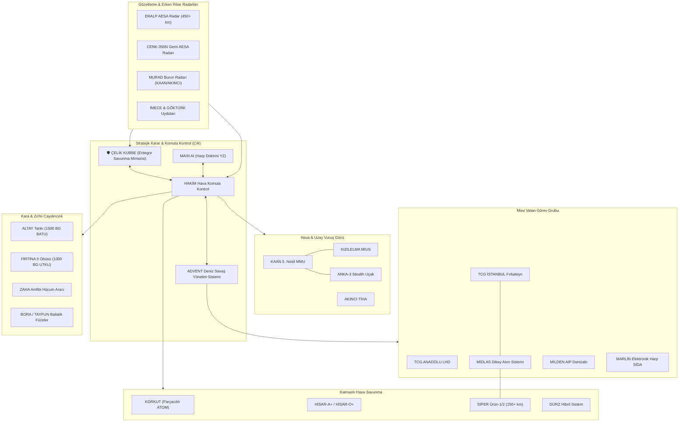

# 🇹🇷 Milli Teknoloji Envanteri (National Tech Inventory)


> **"Köklerden Göklere, Mavi Vatan'dan Uzaya: Tam Bağımsız Türkiye!"**
>
> 
> 
> 
> 

## 🛡️ Stratejik Egemenlik Manifestosu (Strategic Sovereignty)
Bu envanter, sadece bir savunma sanayii proje dökümü değil; Türkiye'nin **2053 ve 2071 stratejik vizyonlarına** giden yolda döşenen teknolojik bağımsızlık taşlarının dökümüdür. "Tam Bağımsızlık" ilkesiyle, ithal ikameci anlayıştan teknoloji ihraç eden ve küresel doktrin belirleyen bir güç haline gelen Türk mühendisliğinin kolektif hafızasıdır.

### 🎯 Temel Doktriner Hedefler:
1. **Dışa Bağımlılığın Sıfırlanması:** Kritik alt sistemlerin (Motor, Transmisyon, AESA Radar, Sensör, Mikroişlemci ve Gerçek Zamanlı İşletim Sistemleri) %100 yerlileştirilmesi.
2. **Çok Katmanlı Ağ Merkezli Savunma (Çelik Kubbe):** Çok alçak irtifadan uzay sınırına kadar tüm hava ve füze savunma unsurlarını yapay zeka ile koordine eden entegre kalkan.
3. **Karma Sürü ve İnsansız Muharebe Üstünlüğü:** SİHA, İDA, İKA ve insanlı platformların (Manned-Unmanned Teaming / MUM-T) müşterek görev icrası.
4. **Stratejik Caydırıcılık:** Derin darbe balistik ve seyir füzeleri, havadan bağımsız tahrikli denizaltılar ve 5. nesil stealth platformlar ile sınır ötesi caydırıcılık.

---

## 🏗️ Teknolojik Katmanlar ve Derinlik (Technological Layers)

### 💎 Katman 0: Donanım ve Malzeme (The Foundation)
- **Galyum Nitrat (GaN) Yarı İletkenler:** ASELSAN ve NANOTAM bünyesinde üretilen, MURAD, ERALP, CENK AESA radarlarının çekirdeğini oluşturan güç transistörleri.
- **İleri Kompozit ve Radar Soğurucu Malzemeler:** KAAN, ANKA-3 ve KIZILELMA için geliştirilen düşük radar kesit alanı (RCS) sağlayan gövde kaplamaları.
- **Milli Zırh Çelikleri & Balistik Seramikler:** ALTAY, ZAHA ve PARS için geliştirilen yüksek mukavemetli milli zırh alaşımları.

### 🧠 Katman 1: Yazılım, Yapay Zeka ve C4I (The Intelligence)
- **ÇELİK KUBBE & HAKİM C4I:** Bütün hava savunma bataryalarını, radarları ve erken ihbar sistemlerini milisaniyeler seviyesinde eşleştiren yapay zeka karar destek ağı.
- **ADVENT SYS:** Dünyanın en gelişmiş ağ destekli savaş yönetim yazılımlarından biri; Türk Donanması ve ihraç gemilerinde ana operasyonel beyin.
- **MAIN AI:** HAVELSAN tarafından askeri ve kurumsal doktrin için geliştirilen milli üretken yapay zeka modeli.

### ⚙️ Katman 2: Enerji ve Tahrik (The Power)
- **Havacılık Motorları (TEI):** TF6000 ve art yakıcılı TF10000 turbofan motorları, TS1400 helikopter turboşaftı ve PD170/PD222 İHA motorları.
- **Zırhlı Araç Güç Grupları (BMC POWER):** ALTAY için 1500 BG BATU, hafif zırhlılar ve Fırtına için 1000 BG UTKU güç grupları.
- **Katı & Sıvı Yakıtlı İtki (ROKETSAN):** BORA, TAYFUN ve CENK balistik füzeleri ile milli uzay fırlatma roket motorları.

---

## 🏛️ Kurumsal Dominion Yapısı ve Stratejik Derinlik

> [!NOTE]
> Bu bölümdeki tüm veriler, `inventory_manager.py` analiz motoru tarafından alt dizinlerdeki teknik spec-sheet dokümanlarından taranarak otomatik olarak doğrulanmıştır.

### 🌌 [DOMINION AEROSPACE (Hava & Uzay)](./DOMINION_AEROSPACE/README.md)

*52 Platform / Sistem - Hava ve Uzay Egemenliği*

| Proje / Platform | Üretici | Sınıf / Stratejik Rol | TRL |
| :--- | :--- | :--- | :--- |
| **[TOLUN](./DOMINION_AEROSPACE/ASELSAN/TOLUN/README.md)** | ASELSAN | Kritik Savunma Teknolojisi | TRL 9 |
| **[AKINCI](./DOMINION_AEROSPACE/BAYKAR/AKINCI/README.md)** | BAYKAR | Yüksek İrtifa Uzun Dayanım (HALE) Taarruzi İHA | TRL 9 |
| **[FERGANİ](./DOMINION_AEROSPACE/BAYKAR/FERGANİ/README.md)** | BAYKAR | Kritik Savunma Teknolojisi | TRL 8 |
| **[KALKAN](./DOMINION_AEROSPACE/BAYKAR/KALKAN/README.md)** | BAYKAR | Taktik Dikey İniş Kalkışlı İnsansız Hava Aracı (VTOL... | TRL 8 |
| **[KEMANKEŞ](./DOMINION_AEROSPACE/BAYKAR/KEMANKEŞ/README.md)** | BAYKAR | Mini Akıllı Seyir Füzesi (Loitering Munition) | TRL 7 |
| **[KEMANKEŞ 2](./DOMINION_AEROSPACE/BAYKAR/KEMANKEŞ_2/README.md)** | BAYKAR | Yapay Zeka Destekli Yeni Nesil Mini Akıllı Seyir Füz... | TRL 7 |
| **[KIZILELMA](./DOMINION_AEROSPACE/BAYKAR/KIZILELMA/README.md)** | BAYKAR | Kritik Savunma Teknolojisi | TRL 8 |
| **[TB2](./DOMINION_AEROSPACE/BAYKAR/TB2/README.md)** | BAYKAR | Taktik Silahlı İnsansız Hava Aracı | TRL 9 |
| **[TB3](./DOMINION_AEROSPACE/BAYKAR/TB3/README.md)** | BAYKAR | Gemi Konuşlu / Katlanır Kanatlı Taktik SİHA | TRL 7 |
| **[TOMRİS](./DOMINION_AEROSPACE/BAYKAR/TOMRİS/README.md)** | BAYKAR | Yeni Nesil Küçük Modüler Nükleer Reaktör (Small Modu... | TRL 3 |
| **[KARAYEL](./DOMINION_AEROSPACE/Lentatek/KARAYEL/README.md)** | Lentatek | NATO STANAG-4671 Uyumlu Taktik Silahlı İnsansız Hava... | TRL 9 |
| **[AKATA](./DOMINION_AEROSPACE/ROKETSAN/AKATA/README.md)** | ROKETSAN | Denizaltı Torpido Kovanından Atılan Kapsüllü Gemisav... | TRL 7 |
| **[ALKA](./DOMINION_AEROSPACE/ROKETSAN/ALKA/README.md)** | ROKETSAN | Kritik Savunma Teknolojisi | TRL 8 |
| **[BARBAROS](./DOMINION_AEROSPACE/ROKETSAN/BARBAROS/README.md)** | ROKETSAN | Kritik Savunma Teknolojisi | TRL 8 |
| **[BORA](./DOMINION_AEROSPACE/ROKETSAN/BORA/README.md)** | ROKETSAN | Kısa Menzilli Taktik Balistik Füze (SRBM - Short-Ran... | TRL 9 |
| **[CENK](./DOMINION_AEROSPACE/ROKETSAN/CENK/README.md)** | ROKETSAN | Orta Menzilli Balistik Füze (MRBM - Medium-Range Bal... | TRL 6 |
| **[CİRİT](./DOMINION_AEROSPACE/ROKETSAN/CİRİT/README.md)** | ROKETSAN | 2.75" Lazer Güdümlü Füze | TRL 9 |
| **[HİSAR](./DOMINION_AEROSPACE/ROKETSAN/HİSAR/README.md)** | ROKETSAN | Alçak ve Orta İrtifa Hava Savunma Füze Sistemi | TRL 9 |
| **[MAM AILESI](./DOMINION_AEROSPACE/ROKETSAN/MAM_AILESI/README.md)** | ROKETSAN | Lazer Güdümlü Mini Mühimmat | TRL 9 |
| **[TAYFUN](./DOMINION_AEROSPACE/ROKETSAN/TAYFUN/README.md)** | ROKETSAN | Kısa Menzilli Balistik Füze (SRBM) | TRL 9 |
| **[TAYFUN BLOK4](./DOMINION_AEROSPACE/ROKETSAN/TAYFUN_BLOK4/README.md)** | ROKETSAN | Kritik Savunma Teknolojisi | TRL 5 |
| **[ÇAKIR](./DOMINION_AEROSPACE/ROKETSAN/ÇAKIR/README.md)** | ROKETSAN | Yeni Nesil Seyir Füzesi | TRL 9 |
| **[İHA-300](./DOMINION_AEROSPACE/ROKETSAN/İHA-300/README.md)** | ROKETSAN | Havadan Atılan Taktik Balistik / Süpersonik Füze (Ai... | TRL 8 |
| **[PD170](./DOMINION_AEROSPACE/TEI/PD170/README.md)** | TEI | Havacılık Turbodizel Motoru | TRL 9 |
| **[PD222](./DOMINION_AEROSPACE/TEI/PD222/README.md)** | TEI | Kritik Savunma Teknolojisi | TRL 8 |
| **[TF10000](./DOMINION_AEROSPACE/TEI/TF10000/README.md)** | TEI | Askeri Turbofan Motor (Afterburning Turbofan) | TRL 6 |
| **[TF6000](./DOMINION_AEROSPACE/TEI/TF6000/README.md)** | TEI | Askeri Turbofan Motor | TRL 7 |
| **[TJ300](./DOMINION_AEROSPACE/TEI/TJ300/README.md)** | TEI | Orta Menzilli Gemi Savar Füze Motoru (Turbojet) | TRL 9 |
| **[TJ90](./DOMINION_AEROSPACE/TEI/TJ90/README.md)** | TEI | Kritik Savunma Teknolojisi | TRL 9 |
| **[TS1400](./DOMINION_AEROSPACE/TEI/TS1400/README.md)** | TEI | Turboşaft Motor (Helikopter Motoru) | TRL 8 |
| **[AY GÖREVİ](./DOMINION_AEROSPACE/TUA/AY_GÖREVİ/README.md)** | TUA | Türkiye'nin "Derin Uzay" ligine girişi. Hibrit roket... | TRL 5.5 |
| **[ANKA](./DOMINION_AEROSPACE/TUSAŞ/ANKA/README.md)** | TUSAŞ | Kritik Savunma Teknolojisi | TRL 9 |
| **[ANKA-3](./DOMINION_AEROSPACE/TUSAŞ/ANKA-3/README.md)** | TUSAŞ | Derin Darbe (Deep Strike) / Hayalet İnsansız Savaş U... | TRL 7 |
| **[ATAK-2](./DOMINION_AEROSPACE/TUSAŞ/ATAK-2/README.md)** | TUSAŞ | Ağır Sınıf Taarruz Helikopteri | TRL 7 |
| **[GÖKBEY](./DOMINION_AEROSPACE/TUSAŞ/GÖKBEY/README.md)** | TUSAŞ | Genel Maksat Helikopteri (6 Ton Sınıfı) | TRL 8 |
| **[GÖKTÜRK](./DOMINION_AEROSPACE/TUSAŞ/GÖKTÜRK/README.md)** | TUSAŞ | Keşif Gözetleme Uydusu (EO) | TRL 9 |
| **[GÖKTÜRK-3](./DOMINION_AEROSPACE/TUSAŞ/GÖKTÜRK-3/README.md)** | TUSAŞ | Sentetik Açıklıklı Radar (SAR) Keşif-Gözetleme Uydusu | TRL 6 |
| **[HÜRJET](./DOMINION_AEROSPACE/TUSAŞ/HÜRJET/README.md)** | TUSAŞ | Kritik Savunma Teknolojisi | TRL 8 |
| **[HÜRKUŞ](./DOMINION_AEROSPACE/TUSAŞ/HÜRKUŞ/README.md)** | TUSAŞ | Yeni Nesil Temel Eğitim, İleri Eğitim ve Hafif Taarr... | TRL 9 |
| **[KAAN](./DOMINION_AEROSPACE/TUSAŞ/KAAN/README.md)** | TUSAŞ | 5. Nesil Çok Rollü Savaş Uçağı | TRL 7 |
| **[SÜPER ŞİMŞEK](./DOMINION_AEROSPACE/TUSAŞ/SÜPER_ŞİMŞEK/README.md)** | TUSAŞ | Yüksek Hızlı Hedef Uçak / Dolanan Mühimmat / Elektro... | TRL 7 |
| **[TÜRKSAT 6A](./DOMINION_AEROSPACE/TUSAŞ/TÜRKSAT_6A/README.md)** | TUSAŞ | Yerli Haberleşme Uydusu (GEO) | TRL 8 |
| **[ŞİMŞEK](./DOMINION_AEROSPACE/TUSAŞ/ŞİMŞEK/README.md)** | TUSAŞ | Yüksek Hızlı Hedef Uçak / Sahte Hedef | TRL 9 |
| **[ALPİN](./DOMINION_AEROSPACE/Titra/ALPİN/README.md)** | Titra | İnsansız Helikopter (Rotary Wing UAV) | TRL 7 |
| **[DELİ](./DOMINION_AEROSPACE/Titra/DELİ/README.md)** | Titra | Taktik Kamikaze İHA (Loitering Munition) | TRL 9 |
| **[BOZDOĞAN](./DOMINION_AEROSPACE/TÜBİTAK_SAGE/BOZDOĞAN/README.md)** | TÜBİTAK SAGE | Görüş İçi Hava-Hava Füzesi (Within Visual Range Air-... | TRL 9 |
| **[GOKDOGAN](./DOMINION_AEROSPACE/TÜBİTAK_SAGE/GOKDOGAN/README.md)** | TÜBİTAK SAGE | Görüş Ötesi Hava-Hava Füzesi (BVRAAM) | TRL 9 |
| **[GÜNEŞ](./DOMINION_AEROSPACE/TÜBİTAK_SAGE/GÜNEŞ/README.md)** | TÜBİTAK SAGE | Yeni Nesil Lazer ve Kızılötesi Görüntüleyici Arayıcı... | TRL 9 |
| **[KUZGUN](./DOMINION_AEROSPACE/TÜBİTAK_SAGE/KUZGUN/README.md)** | TÜBİTAK SAGE | Modüler Müşterek Mühimmat Ailesi | TRL 7 |
| **[MORS](./DOMINION_AEROSPACE/TÜBİTAK_SAGE/MORS/README.md)** | TÜBİTAK SAGE | Hassas Güdümlü Akıllı Havan ve Mini Roket Mühimmatı ... | TRL 9 |
| **[SOM](./DOMINION_AEROSPACE/TÜBİTAK_SAGE/SOM/README.md)** | TÜBİTAK SAGE | Hava-Yer Seyir Füzesi (Cruise Missile) | TRL 9 |
| **[İMECE](./DOMINION_AEROSPACE/TÜBİTAK_SAGE/İMECE/README.md)** | TÜBİTAK SAGE | Yüksek Çözünürlüklü Yer Gözlem Uydusu | TRL 9 |

### 📡 [DOMINION ELECTRONICS & AI (Dijital Egemenlik)](./DOMINION_ELECTRONICS/README.md)

*41 Platform / Sistem - Elektronik Harp, Radar, Siber Güvenlik ve Yapay Zeka*

| Proje / Platform | Üretici | Sınıf / Stratejik Rol | TRL |
| :--- | :--- | :--- | :--- |
| **[ALBATROS-S](./DOMINION_ELECTRONICS/ASELSAN/ALBATROS-S/README.md)** | ASELSAN | Sürü İnsansız Deniz Aracı (Sürü İDA / K-İDA) | TRL 9 |
| **[ASELFLIR-500](./DOMINION_ELECTRONICS/ASELSAN/ASELFLIR-500/README.md)** | ASELSAN | Yeni Nesil Yüksek Performanslı Elektro-Optik Keşif, ... | TRL 9 |
| **[CENK 350N](./DOMINION_ELECTRONICS/ASELSAN/CENK_350N/README.md)** | ASELSAN | AESA Gemi Radarı (4 Yüzlü Sabit Dizin) | TRL 7 |
| **[EJDERHA](./DOMINION_ELECTRONICS/ASELSAN/EJDERHA/README.md)** | ASELSAN | Yüksek Güçlü Elektromanyetik (YGEM) Silah Sistemi | TRL 7 |
| **[ERALP](./DOMINION_ELECTRONICS/ASELSAN/ERALP/README.md)** | ASELSAN | S-Bant Taşınabilir AESA Erken İhbar Radarı | TRL 9 |
| **[GÖKDENİZ](./DOMINION_ELECTRONICS/ASELSAN/GÖKDENİZ/README.md)** | ASELSAN | Yakın Hava Savunma Sistemi (CIWS) | TRL 9 |
| **[GÖKSUR](./DOMINION_ELECTRONICS/ASELSAN/GÖKSUR/README.md)** | ASELSAN | Kritik Savunma Teknolojisi | TRL 7 |
| **[GÖKTAN](./DOMINION_ELECTRONICS/ASELSAN/GÖKTAN/README.md)** | ASELSAN | AESA Burun Radarı (İHA/SİHA Versiyonu - Murad Türevi) | TRL 7 |
| **[GÜRZ](./DOMINION_ELECTRONICS/ASELSAN/GÜRZ/README.md)** | ASELSAN | Hibrit Hava Savunma Sistemi (Parçacıklı Mühimmat + F... | TRL 8 |
| **[HAKİM](./DOMINION_ELECTRONICS/ASELSAN/HAKİM/README.md)** | ASELSAN | Milli Hava Savunma Komuta ve Kontrol Sistemi (Air C2... | TRL 9 |
| **[HAVA SOJ](./DOMINION_ELECTRONICS/ASELSAN/HAVA_SOJ/README.md)** | ASELSAN | Kritik Savunma Teknolojisi | TRL 7 |
| **[IHTAR](./DOMINION_ELECTRONICS/ASELSAN/IHTAR/README.md)** | ASELSAN | Anti-Drone Sistemi (İHA Önleme) | TRL 9 |
| **[KORAL](./DOMINION_ELECTRONICS/ASELSAN/KORAL/README.md)** | ASELSAN | Mobil Elektronik Harp Sistemi (KORAL & YENİ NESİL KO... | TRL 9 |
| **[KORKUT](./DOMINION_ELECTRONICS/ASELSAN/KORKUT/README.md)** | ASELSAN | Kundağı Motorlu Hava Savunma Top Sistemi (SPAAG) | TRL 9 |
| **[MURAD](./DOMINION_ELECTRONICS/ASELSAN/MURAD/README.md)** | ASELSAN | AESA (Aktif Dizinli Taranan) Uçak Radarı | TRL 7 |
| **[MİLKAR](./DOMINION_ELECTRONICS/ASELSAN/MİLKAR/README.md)** | ASELSAN | Taktik ve Stratejik Muhabere Elektronik Harp / Karış... | TRL 9 |
| **[SANCAK](./DOMINION_ELECTRONICS/ASELSAN/SANCAK/README.md)** | ASELSAN | Yeni Nesil V/UHF Taktik Muhabere Elektronik Taarruz ... | TRL 9 |
| **[SİPER](./DOMINION_ELECTRONICS/ASELSAN/SİPER/README.md)** | ASELSAN | Uzun Menzilli Bölge Hava Savunma Sistemi | TRL 8 |
| **[TOYGUN](./DOMINION_ELECTRONICS/ASELSAN/TOYGUN/README.md)** | ASELSAN | Elektro-Optik Sensör Sistemi (EOTS - Electro-Optical... | TRL 6 |
| **[TULGAR](./DOMINION_ELECTRONICS/ASELSAN/TULGAR/README.md)** | ASELSAN | 5. Nesil Kaska Monteli Entegre Kumanda ve Gösterge S... | TRL 8 |
| **[TURAN](./DOMINION_ELECTRONICS/ASELSAN/TURAN/README.md)** | ASELSAN | Zırhlı Araç Konuşlu Taktik Elektronik Harp ve Koruma... | TRL 9 |
| **[ULAQ](./DOMINION_ELECTRONICS/ASELSAN/ULAQ/README.md)** | ASELSAN | İnsansız Deniz Aracı Faydalı Yük, Sensör ve Silah İs... | TRL 9 |
| **[ÇELİK KUBBE](./DOMINION_ELECTRONICS/ASELSAN/ÇELİK_KUBBE/README.md)** | ASELSAN | Çok Katmanlı Entegre Hava ve Füze Savunma Şemsiyesi ... | TRL 8 |
| **[ÖZGÜR](./DOMINION_ELECTRONICS/ASELSAN/ÖZGÜR/README.md)** | ASELSAN | Kritik Savunma Teknolojisi | TRL 9 |
| **[GIMBAL SISTEMLERI](./DOMINION_ELECTRONICS/Altınay_Savunma/GIMBAL_SISTEMLERI/README.md)** | Altınay Savunma | Elektro-Optik Keşif, Gözetleme ve Hedefleme Sistemi | TRL 9 |
| **[KOBOT](./DOMINION_ELECTRONICS/Altınay_Savunma/KOBOT/README.md)** | Altınay Savunma | İnsansız Kara Aracı (İKA) | TRL 9 |
| **[PEREGRINE](./DOMINION_ELECTRONICS/Altınay_Savunma/PEREGRINE/README.md)** | Altınay Savunma | Kritik Savunma Teknolojisi | TRL 7 |
| **[ADVENT](./DOMINION_ELECTRONICS/HAVELSAN/ADVENT/README.md)** | HAVELSAN | Ağ Destekli Veri Entegre Savaş Yönetim Sistemi | TRL 9 |
| **[BAHA](./DOMINION_ELECTRONICS/HAVELSAN/BAHA/README.md)** | HAVELSAN | Kritik Savunma Teknolojisi | TRL 9 |
| **[BARKAN](./DOMINION_ELECTRONICS/HAVELSAN/BARKAN/README.md)** | HAVELSAN | Orta Sınıf İnsansız Kara Aracı (İKA-2) | TRL 9 |
| **[CYBER SECURITY](./DOMINION_ELECTRONICS/HAVELSAN/CYBER_SECURITY/README.md)** | HAVELSAN | Siber Savunma ve Operasyon Merkezleri (SOC) | TRL 9 |
| **[KAPGAN](./DOMINION_ELECTRONICS/HAVELSAN/KAPGAN/README.md)** | HAVELSAN | Kritik Savunma Teknolojisi | TRL 7 |
| **[MAIN AI](./DOMINION_ELECTRONICS/HAVELSAN/MAIN_AI/README.md)** | HAVELSAN | Kurumsal Büyük Dil Modeli (LLM) / Generative AI | TRL 7 |
| **[SANCAR](./DOMINION_ELECTRONICS/HAVELSAN/SANCAR/README.md)** | HAVELSAN | Kritik Savunma Teknolojisi | TRL 8 |
| **[SIMULATORS](./DOMINION_ELECTRONICS/HAVELSAN/SIMULATORS/README.md)** | HAVELSAN | Askeri ve Sivil Eğitim Simülatörleri | TRL 9 |
| **[MİLDAR](./DOMINION_ELECTRONICS/METEKSAN/MİLDAR/README.md)** | METEKSAN | Milimetre Dalga Radarı (Millimeter Wave Radar) | TRL 8 |
| **[NAZAR](./DOMINION_ELECTRONICS/METEKSAN/NAZAR/README.md)** | METEKSAN | Kritik Savunma Teknolojisi | TRL 9 |
| **[RETINAR](./DOMINION_ELECTRONICS/METEKSAN/RETINAR/README.md)** | METEKSAN | Kritik Savunma Teknolojisi | TRL 9 |
| **[YAKAMOZ](./DOMINION_ELECTRONICS/METEKSAN/YAKAMOZ/README.md)** | METEKSAN | Karinaya Monteli Sonar Sistemi | TRL 9 |
| **[DATA LINKS](./DOMINION_ELECTRONICS/MilSOFT/DATA_LINKS/README.md)** | MilSOFT | Askeri Haberleşme ve Veri Bağı Yazılımları | TRL 9 |
| **[ACMI POD](./DOMINION_ELECTRONICS/SDT/ACMI_POD/README.md)** | SDT | Hava Muharebe Eğitim Sistemi (Air Combat Maneuvering... | TRL 9 |

### 🚜 [DOMINION LAND (Kara & Zırh)](./DOMINION_LAND/README.md)

*39 Platform / Sistem - Kara Muharebesi, Zırhlı Birlikler ve Ağır Ateş Gücü*

| Proje / Platform | Üretici | Sınıf / Stratejik Rol | TRL |
| :--- | :--- | :--- | :--- |
| **[ALTAY](./DOMINION_LAND/BMC/ALTAY/README.md)** | BMC | Yeni Nesil Ana Muharebe Tankı (AMT) | TRL 9 |
| **[KIRPI](./DOMINION_LAND/BMC/KIRPI/README.md)** | BMC | MRAP (Mine Resistant Ambush Protected) - Mayına Karş... | TRL 9 |
| **[KİRPİ II](./DOMINION_LAND/BMC/KİRPİ_II/README.md)** | BMC | Kritik Savunma Teknolojisi | TRL 9 |
| **[VURAN](./DOMINION_LAND/BMC/VURAN/README.md)** | BMC | Çok Amaçlı Zırhlı Araç (4x4 MPAV) | TRL 9 |
| **[BATU](./DOMINION_LAND/BMC_POWER/BATU/README.md)** | BMC POWER | Ağır Zırhlı Muharebe Aracı ve Tank Güç Grubu (Powerp... | TRL 8 |
| **[UTKU](./DOMINION_LAND/BMC_POWER/UTKU/README.md)** | BMC POWER | Orta ve Ağır Zırhlı Muharebe Aracı Güç Grubu (1000 H... | TRL 8 |
| **[M2 QCB](./DOMINION_LAND/CANİK/M2_QCB/README.md)** | CANİK | 12.7mm (.50 Cal) Ağır Makineli Tüfek | TRL 9 |
| **[METE MC9](./DOMINION_LAND/CANİK/METE_MC9/README.md)** | CANİK | 9x19mm Mikro Kompakt Polimer Gövdeli Yarı Otomatik T... | TRL 9 |
| **[VENOM LR](./DOMINION_LAND/CANİK/VENOM_LR/README.md)** | CANİK | 30mm Orta Kalibre Otomatik Top | TRL 9 |
| **[KAPLAN](./DOMINION_LAND/FNSS/KAPLAN/README.md)** | FNSS | Orta Sınıf Tank (MT) / Silah Taşıyıcı Araç (STA) | TRL 9 |
| **[PARS](./DOMINION_LAND/FNSS/PARS/README.md)** | FNSS | Taktik Tekerlekli Zırhlı Araç (TTZA) | TRL 9 |
| **[PARS 4x4](./DOMINION_LAND/FNSS/PARS_4x4/README.md)** | FNSS | Kritik Savunma Teknolojisi | TRL 9 |
| **[SAMUR](./DOMINION_LAND/FNSS/SAMUR/README.md)** | FNSS | Amfibi Zırhlı Seyyar Yüzücü Hücum Köprüsü (Amphibiou... | TRL 9 |
| **[ZAHA](./DOMINION_LAND/FNSS/ZAHA/README.md)** | FNSS | Zırhlı Amfibi Hücum Aracı (MAV - Marine Assault Vehi... | TRL 9 |
| **[HIZIR](./DOMINION_LAND/Katmerciler/HIZIR/README.md)** | Katmerciler | Taktik Tekerlekli Zırhlı Araç (4x4) | TRL 9 |
| **[KIRAÇ](./DOMINION_LAND/Katmerciler/KIRAÇ/README.md)** | Katmerciler | 4x4 Zırhlı ve Zırhsız Yeni Nesil Kriminal İnceleme A... | TRL 9 |
| **[76MM DENİZ TOPU](./DOMINION_LAND/MKE/76MM_DENİZ_TOPU/README.md)** | MKE | Kritik Savunma Teknolojisi | TRL 9 |
| **[BORAN](./DOMINION_LAND/MKE/BORAN/README.md)** | MKE | 105mm Havadan Taşınabilir Hafif Obüs | TRL 9 |
| **[FIRTINA II](./DOMINION_LAND/MKE/FIRTINA_II/README.md)** | MKE | Kundağı Motorlu Obüs (155mm) | TRL 9 |
| **[MPT-76](./DOMINION_LAND/MKE/MPT-76/README.md)** | MKE | Kritik Savunma Teknolojisi | TRL 9 |
| **[PIRANA](./DOMINION_LAND/MKE/PIRANA/README.md)** | MKE | Yüksek Hızlı Kamikaze İnsansız Deniz Aracı (K-İDA) | TRL 8 |
| **[TOLGA](./DOMINION_LAND/MKE/TOLGA/README.md)** | MKE | Anti-Drone / C-UAS (Sürü Drone Savunma Sistemi) | TRL 8 |
| **[YAVUZ](./DOMINION_LAND/MKE/YAVUZ/README.md)** | MKE | Kamyona Monteli Obüs (155mm) | TRL 9 |
| **[EJDER YALÇIN](./DOMINION_LAND/Nurol_Makina/EJDER_YALÇIN/README.md)** | Nurol Makina | Taktik Tekerlekli Zırhlı Araç (4x4) | TRL 9 |
| **[ILGAZ](./DOMINION_LAND/Nurol_Makina/ILGAZ/README.md)** | Nurol Makina | 4x4 Taktik Tekerlekli Hafif Zırhlı İç Güvenlik ve Öz... | TRL 9 |
| **[YÖRÜK](./DOMINION_LAND/Nurol_Makina/YÖRÜK/README.md)** | Nurol Makina | Yeni Nesil Hafif Zırhlı Araç | TRL 9 |
| **[AKREP II](./DOMINION_LAND/OTOKAR/AKREP_II/README.md)** | OTOKAR | İleri Teknoloji Zırhlı Keşif ve Gözetleme Aracı | TRL 8 |
| **[ALPAR](./DOMINION_LAND/OTOKAR/ALPAR/README.md)** | OTOKAR | Ağır Sınıf İnsansız Kara Aracı (İKA) | TRL 6 |
| **[ARMA](./DOMINION_LAND/OTOKAR/ARMA/README.md)** | OTOKAR | Çok Tekerlekli Modüler Zırhlı Araç | TRL 9 |
| **[ARMA 8x8](./DOMINION_LAND/OTOKAR/ARMA_8x8/README.md)** | OTOKAR | 8x8 Tekerlekli Zırhlı Muharebe Aracı | TRL 9 |
| **[COBRA II](./DOMINION_LAND/OTOKAR/COBRA_II/README.md)** | OTOKAR | Taktik Tekerlekli Zırhlı Araç (4x4) | TRL 9 |
| **[TULPAR](./DOMINION_LAND/OTOKAR/TULPAR/README.md)** | OTOKAR | Yeni Nesil Paletli Zırhlı Muharebe Aracı (ZMA) | TRL 8 |
| **[GÖKBORA](./DOMINION_LAND/ROKETSAN/GÖKBORA/README.md)** | ROKETSAN | Kritik Savunma Teknolojisi | TRL 6 |
| **[KARAOK](./DOMINION_LAND/ROKETSAN/KARAOK/README.md)** | ROKETSAN | Kısa Menzilli Tanksavar Silahı (ATGM) | TRL 9 |
| **[SUNGUR](./DOMINION_LAND/ROKETSAN/SUNGUR/README.md)** | ROKETSAN | Portatif Hava Savunma Füze Sistemi (MANPADS / PORSAV) | TRL 9 |
| **[SAR127](./DOMINION_LAND/Sarsılmaz/SAR127/README.md)** | Sarsılmaz | Kritik Savunma Teknolojisi | TRL 9 |
| **[SAR56](./DOMINION_LAND/Sarsılmaz/SAR56/README.md)** | Sarsılmaz | Piyade Tüfeği (5.56x45mm) | TRL 9 |
| **[SAR9](./DOMINION_LAND/Sarsılmaz/SAR9/README.md)** | Sarsılmaz | Yarı Otomatik Tabanca (9x19mm) | TRL 9 |
| **[SARBOT](./DOMINION_LAND/Sarsılmaz/SARBOT/README.md)** | Sarsılmaz | Kritik Savunma Teknolojisi | TRL 7 |

### ⚓ [DOMINION SEA (Mavi Vatan)](./DOMINION_SEA/README.md)

*21 Platform / Sistem - Deniz Kuvvetleri, Su Altı ve İnsansız Deniz Araçları*

| Proje / Platform | Üretici | Sınıf / Stratejik Rol | TRL |
| :--- | :--- | :--- | :--- |
| **[ARES 150](./DOMINION_SEA/ARES/ARES_150/README.md)** | ARES | Kritik Savunma Teknolojisi | TRL 9 |
| **[ULAQ DERE](./DOMINION_SEA/ARES/ULAQ_DERE/README.md)** | ARES | Silahlı İnsansız Deniz Aracı (SİDA) | TRL 9 |
| **[ADKG](./DOMINION_SEA/ASFAT/ADKG/README.md)** | ASFAT | Kritik Savunma Teknolojisi | TRL 8 |
| **[HİSAR SINIFI OPV](./DOMINION_SEA/ASFAT/HİSAR_SINIFI_OPV/README.md)** | ASFAT | Açık Deniz Karakol Gemisi (Offshore Patrol Vessel) | TRL 7 |
| **[MEMATT](./DOMINION_SEA/ASFAT/MEMATT/README.md)** | ASFAT | Mekanik Mayın Temizleme Teçhizatı | TRL 9 |
| **[PN MILGEM](./DOMINION_SEA/ASFAT/PN_MILGEM/README.md)** | ASFAT | Ağır Korvet / Hafif Firkateyn | TRL 9 |
| **[TCG İSTANBUL](./DOMINION_SEA/ASFAT/TCG_İSTANBUL/README.md)** | ASFAT | MİLGEM İ-Sınıfı (İstif Sınıfı) Fırkateyn | TRL 9 |
| **[MİLDEN](./DOMINION_SEA/DzKK/MİLDEN/README.md)** | DzKK | Havadan Bağımsız Tahrik Sistemli (AIP) Ağır Taarruz ... | TRL 5 |
| **[AKYA](./DOMINION_SEA/ROKETSAN/AKYA/README.md)** | ROKETSAN | Yeni Nesil Ağır Sınıf Torpido (533mm) | TRL 9 |
| **[ATMACA](./DOMINION_SEA/ROKETSAN/ATMACA/README.md)** | ROKETSAN | Satıhtan Satıha Güdümlü Mermi (Anti-Ship Missile) | TRL 9 |
| **[LEVENT](./DOMINION_SEA/ROKETSAN/LEVENT/README.md)** | ROKETSAN | Gemi Konuşlu Nokta Hava Savunma ve Füze Önleme Siste... | TRL 7 |
| **[MİDLAS](./DOMINION_SEA/ROKETSAN/MİDLAS/README.md)** | ROKETSAN | Gemi Konuşlu Dikey Atım Sistemi (VLS - Vertical Laun... | TRL 8 |
| **[ORKA](./DOMINION_SEA/ROKETSAN/ORKA/README.md)** | ROKETSAN | 324mm Hafif Sınıf Torpido | TRL 7 |
| **[TCG ANADOLU](./DOMINION_SEA/SEDEF/TCG_ANADOLU/README.md)** | SEDEF | Çok Maksatlı Amfibi Hücum Gemisi (LHD) / SİHA Gemisi | TRL 9 |
| **[TCG TRAKYA](./DOMINION_SEA/SEDEF/TCG_TRAKYA/README.md)** | SEDEF | Uçak Gemisi (Aircraft Carrier) | TRL 1 |
| **[MARLİN](./DOMINION_SEA/SEFİNE/MARLİN/README.md)** | SEFİNE | Silahlı ve Elektronik Harp İnsansız Deniz Aracı (SİDA) | TRL 9 |
| **[KARGU](./DOMINION_SEA/STM/KARGU/README.md)** | STM | Döner Kanatlı Vurucu İHA (Kamikaze Drone) | TRL 9 |
| **[MİLGEM](./DOMINION_SEA/STM/MİLGEM/README.md)** | STM | Korvet (Corvette) | TRL 9 |
| **[STM500](./DOMINION_SEA/STM/STM500/README.md)** | STM | Küçük Tonajlı Denizaltı (Shallow Water Attack Submar... | TRL 6 |
| **[MRTP SERISI](./DOMINION_SEA/Yonca-Onuk/MRTP_SERISI/README.md)** | Yonca-Onuk | Hızlı Müdahale ve Hücumbot (Fast Intervention Craft) | TRL 9 |
| **[MRTP24](./DOMINION_SEA/Yonca-Onuk/MRTP24/README.md)** | Yonca-Onuk | Kritik Savunma Teknolojisi | TRL 9 |

---

## 🔗 Ekosistem Entegrasyonu (Neural & Multi-Domain Synergy)

Aşağıdaki mimari diyagramı; sensörden komuta kontrol merkezine, vurucu hava, deniz ve kara platformlarına kadar milli sistemlerin birbirine nasıl entegre çalıştığını gösterir:



---

## 🖥️ İnteraktif Komuta Merkezi (Interactive Dashboard)

Envanterin canlı filtreleme, TRL olgunluk grafikleri, karma sürü simülatörü ve anlık arama motoruna sahip modern web arayüzü `DASHBOARD.html` dosyasında yer almaktadır.

- **Canlı Web Arayüzü:** [DASHBOARD.html](DASHBOARD.html)
- **Kapsamlı Yönetici Raporu:** [INVENTORY_REPORT.md](INVENTORY_REPORT.md)
- **Makine Okunabilir Veri Tabanı:** [inventory_data.json](inventory_data.json) | [inventory_data.csv](inventory_data.csv)

---

## 🛠️ Envanter Yönetim Aracı (inventory_manager.py)

Depoda bulunan tüm platformları denetlemek, analiz etmek ve dışa aktarmak için geliştirilmiş CLI yönetim aracı:

```bash
# Sistem sağlık denetimi (Tüm spec-sheet ve bağlantıları doğrular)
python inventory_manager.py --health

# Stratejik istatistikleri ve TRL metriklerini terminalde göster
python inventory_manager.py --stats

# Şirketler ve dominionlar arası yetenek matrisini incele
python inventory_manager.py --matrix

# Akıllı arama motorunu çalıştır
python inventory_manager.py --search "AESA"

# Tüm sistemleri (README, Dashboard, Rapor, JSON, CSV) tek seferde senkronize et
python inventory_manager.py --sync-all
```

---

## 📁 Depo Varlıkları (Repository Assets)
- [.gitignore](.gitignore)
- [CONTRIBUTING.md](CONTRIBUTING.md)
- [LICENSE](LICENSE)
- [inventory_manager.py](inventory_manager.py)
- [DASHBOARD.html](DASHBOARD.html)
- [INVENTORY_REPORT.md](INVENTORY_REPORT.md)
- [inventory_data.json](inventory_data.json)
- [inventory_data.csv](inventory_data.csv)

---

**"Yarın Değil, Şimdi! Gelecek Burada."** 🇹🇷
