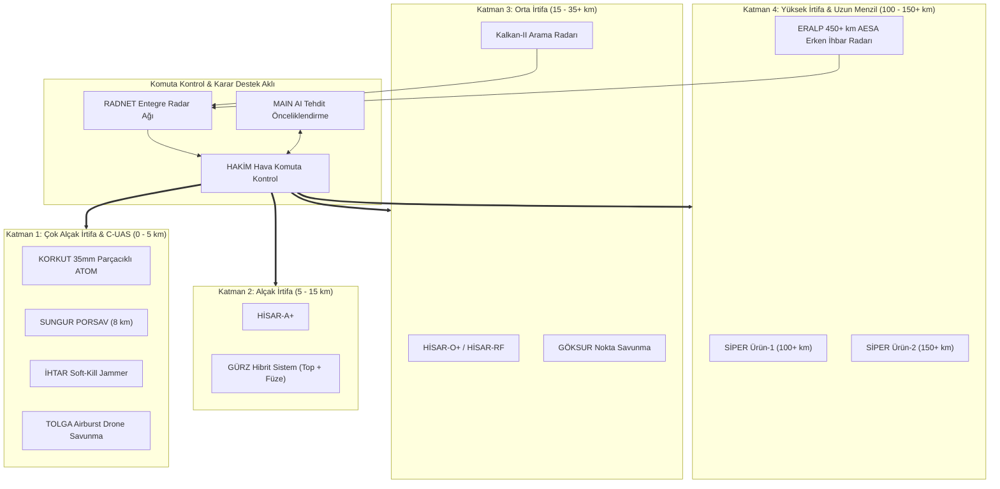

# 🏛️ Milli Teknoloji Savunma ve Egemenlik Mimarisi

Bu doküman, Türkiye Cumhuriyeti Milli Savunma ve Havacılık Sanayii ekosisteminin teknik katmanlarını, harekat doktrinlerini ve sistemler arası entegrasyon hiyerarşisini detaylandırmaktadır.

---

## 1. 🛡️ ÇELİK KUBBE (Çok Katmanlı Entegre Hava ve Füze Savunma Mimarisi)

ÇELİK KUBBE, 6 Ağustos 2024 Savunma Sanayii İcra Komitesi (SSİK) kararı ile resmileşen, Türkiye hava sahasını çok alçak irtifadan uzay sınırına kadar koruyan çok katmanlı, ağ merkezli ve yapay zeka koordinasyonlu hava savunma şemsiyesidir.

---

## 2. ⚡ Ağ Merkezli Muharebe ve Savaş Yönetim Sistemleri (C4I)

Türkiye'nin tüm deniz, hava ve kara platformları bağımsız adacıklar olarak değil; birbirlerine taktik veri linkleri ile bağlı tek bir sinir ağı olarak görev icra eder.

### ⚓ ADVENT SYS (Ağ Destekli Veri Entegre Savaş Yönetim Sistemi)
- **Geliştirici:** Dz.K.K. Araştırma Merkezi Komutanlığı (ARMERKOM) & HAVELSAN
- **Kabiliyet:** Tek bir geminin radarında görünen hedef, yüzlerce mil uzaktaki başka bir geminin MİDLAS dikey lançerinden atılan füzeyle vurulabilir (Cooperative Engagement Capability - CEC).
- **Entegre Platformlar:** TCG ANADOLU, TCG İSTANBUL, ADA Sınıfı Korvetler, MİLDEN, MARLİN ve SİDA filoları.

### 🦅 MUM-T (Manned-Unmanned Teaming / İnsanlı-İnsansız Birlikteliği)
- **KAAN & Loyal Wingman Doktrini:** 5. nesil savaş uçağı KAAN, düşman hava sahasına tek başına girmez. Önünde radar izi düşük KIZILELMA ve ANKA-3 otonom olarak uçar, hava savunma radarlarını yanıltmak için SÜPER ŞİMŞEK decoy'larını salar ve pilotun iş yükünü asgariye indirir.

---

## 3. ⚙️ Milli Güç Grupları ve İtki Yol Haritası

| Motor / Güç Grubu | Üretici | Güç Seviyesi | Hedef Platform | Durum |
| :--- | :--- | :--- | :--- | :--- |
| **TEI-TF6000** | TEI | 6.000 lbf | KIZILELMA-A, HÜRJET, ANKA-3 | Prototip Çalıştı (TRL 7) |
| **TEI-TF10000** | TEI | 10.000 lbf (Art Yakıcılı) | KIZILELMA-B (Süpersonik), Ağır Jetler | İmalat Fazı (TRL 6) |
| **TEI-TS1400** | TEI | 1.400 SHP | GÖKBEY, T129 ATAK | Uçuş Testleri (TRL 8) |
| **TEI-PD170** | TEI | 170 HP | ANKA, AKSUNGUR, Bayraktar TB3 | Seri Üretim (TRL 9) |
| **BATU** | BMC POWER | 1.500 BG | ALTAY Ana Muharebe Tankı | Araç Testi (TRL 8) |
| **UTKU** | BMC POWER | 1.000 BG | Fırtına II, TULPAR ZMA | Test Kulesi (TRL 8) |
| **TUNA** | BMC POWER | 400 BG | BMC VURAN, KİRPİ | Seri Üretim (TRL 9) |
